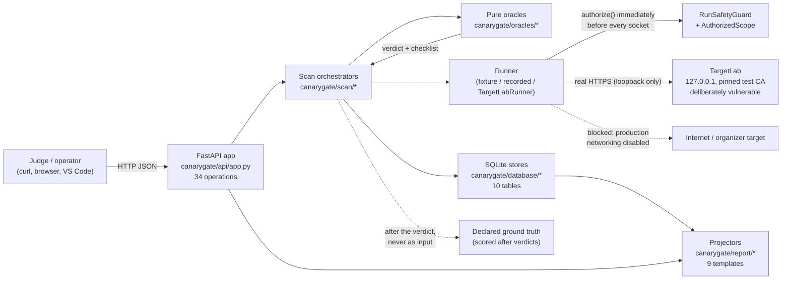
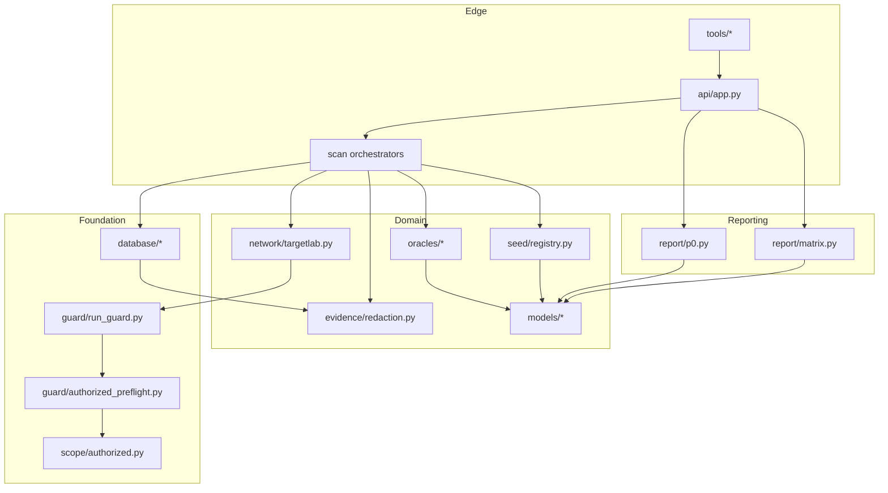
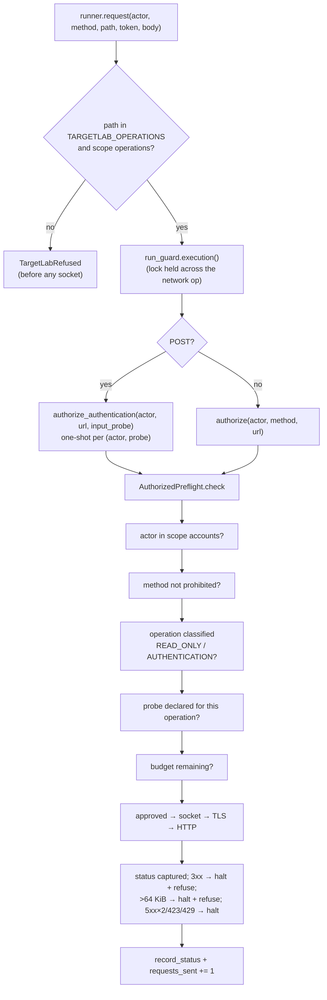
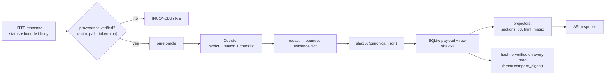
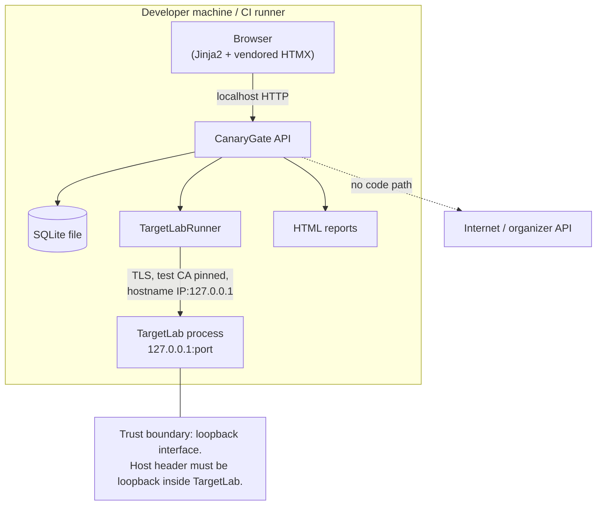
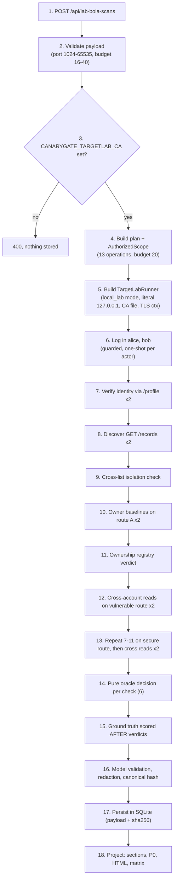
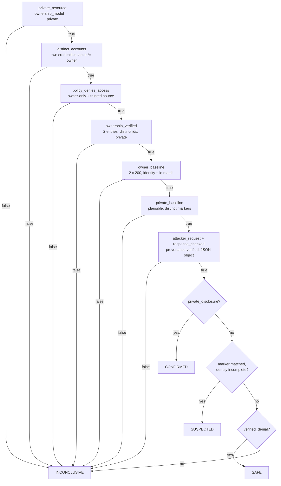
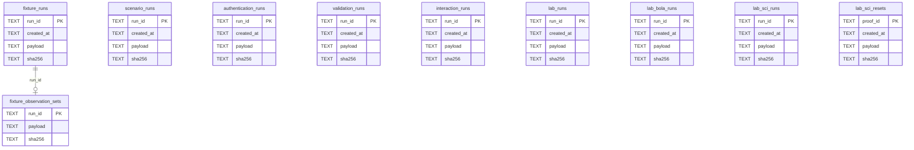
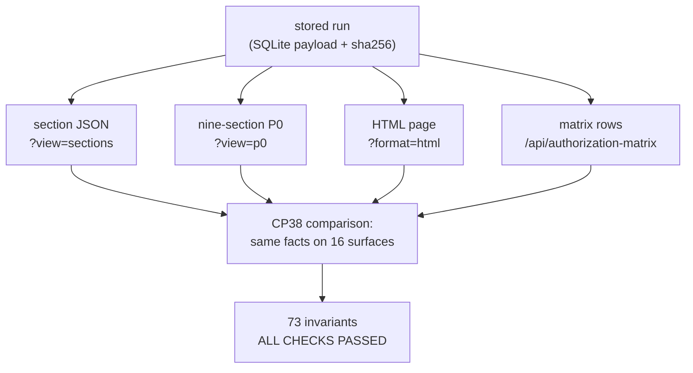

# CanaryGate — The Complete Technical Master Guide

- **Repository:** `Ace-095/Hackfusion_30102026`
- **Document scope:** the code as it exists at commit `d9436d1` on branch `arena/aa67fa1b-hackfusion-30102026` (test suite: 916 passing tests).
- **Audience:** the engineer who has to explain, debug, extend, or defend CanaryGate in front of judges — and who must never overstate what it does.

---

## 0. How this document is built, and how to read it

### 0.1 What this document is

This is a single-file technical reference for CanaryGate: what it is, why every decision was made, how each component works internally, what is genuinely implemented versus partially implemented, and how to defend each choice under questioning. It is written from the source, not from the marketing layer. Where a checkpoint document and the code disagree, the code wins and the disagreement is recorded in **Appendix C — Doc-vs-code discrepancy log**, which is the only section allowed to contain contradictions.

### 0.2 The rule used to write every technical chapter

> Current source → configuration/dependencies → database schema → API models → tests → TargetLab → existing docs → checkpoint notes → git history.

If a number, route, field name, verdict string, table name, or file path appears in this guide, it was read out of the repository in this session. Where the only evidence is a checkpoint's *reported* result (for example "CP36 reported 851 tests"), the text says so explicitly and gives the current measured value.

### 0.3 Evidence labels used throughout

CanaryGate's central honesty problem is that "we tested it" can mean several incompatible things. Every claim in this guide carries one of these labels:

| Label | Meaning | What it proves | What it does **not** prove |
|---|---|---|---|
| `[UNIT]` | Pure function or model test, no I/O | Logic, validation, invariants | Anything about a real server |
| `[MOCK]` | Guarded HTTPX transport with fake socket/TLS objects | Guard/transport wiring and refusal paths | That a socket works |
| `[FIXTURE]` | In-process fixture target, recorded responses | End-to-end pipeline shape | Real HTTP semantics |
| `[REC]` | Recorded transcript replayed through the real decision path | The decision path handles realistic bytes | Live behaviour of any server |
| `[LOOP]` | Real HTTPS to `127.0.0.1` TargetLab with a pinned test CA | Transport, TLS, guard, and decision path against a real server | Anything about a third-party target |
| `[LIVE]` | Organizer-authorized live target | General detection quality | — **does not exist in this repository** |
| `[MISSING]` | Not implemented | — | — |

The audit tool distinguishes these mechanically: `tools/p0_audit.py` assigns every one of the 56 test files an evidence label (`fixture`, `mocked_http`, `recorded_offline`, `recorded_offline_authentication`, `recorded_offline_validation`, `loopback_tls`, `real_networking`, `unit`, `in_process_api`) and fails if a test file has no label. At head: **7 files are `loopback_tls`, 1 row is labelled `real_networking` and that row is the *missing* live-validation requirement D12.**

### 0.4 The one-paragraph summary you should be able to say from memory

CanaryGate is a defensive API authorization scanner. It reads an OpenAPI document, builds an endpoint inventory, and then tests whether the API enforces *object-level* authorization (BOLA), whether authentication controls reject crafted credentials, whether input validation and information disclosure are handled safely, and whether two individually correct controls can combine into a leak (Security Control Interaction, SCI). It is built so that the dangerous parts are structurally impossible rather than merely discouraged: every outbound request passes one central guard immediately before the socket is created, the scope file is the only target authority, destructive methods cannot be issued at all, redirects are refused, evidence is minimized and hashed before storage, and a finding is only `CONFIRMED` when verified ownership, a private baseline, a cross-account request and private disclosure all line up. It validates against a deliberately vulnerable loopback lab written by the same team; it has never contacted an organizer target, and it does not claim general live-scanning readiness.

### 0.5 What this document will not do

It will not claim production readiness, general live-target accuracy, a complete frozen P0, a BFLA implementation, or that "all checks are complete." Two requirements are missing and nine are partial at head, and §18 lists them by identifier. Every place where the honest answer is "we cannot show that yet," the guide says so in the same sentence as the claim it limits.

---

## Table of contents

**Part I — Orientation**
- [§1 Introduction: four zoom levels](#1-introduction-four-zoom-levels)
- [§2 Cyber fundamentals from scratch](#2-cyber-fundamentals-from-scratch)

**Part II — The problems CanaryGate reasons about**
- [§3 The vulnerability classes and exactly which ones are implemented](#3-the-vulnerability-classes-and-exactly-which-ones-are-implemented)
- [§4 Security Control Interaction (SCI), in depth](#4-security-control-interaction-sci-in-depth)

**Part III — The system**
- [§5 Architecture](#5-architecture)
- [§6 The eighteen-step scan lifecycle](#6-the-eighteen-step-scan-lifecycle)
- [§7 The read-BOLA engine](#7-the-read-bola-engine)
- [§8 The SCI engine](#8-the-sci-engine)
- [§9 TargetLab](#9-targetlab)
- [§10 Safety, scope, and the threat model](#10-safety-scope-and-the-threat-model)
- [§11 Evidence, verdicts, and false-positive prevention](#11-evidence-verdicts-and-false-positive-prevention)
- [§12 The database](#12-the-database)
- [§13 The HTTP API](#13-the-http-api)
- [§14 The nine-section report and the authorization matrix](#14-the-nine-section-report-and-the-authorization-matrix)

**Part IV — Engineering**
- [§15 Technology stack, alternatives, and trade-offs](#15-technology-stack-alternatives-and-trade-offs)
- [§16 Testing strategy and the evidence ladder](#16-testing-strategy-and-the-evidence-ladder)
- [§17 Checkpoint history CP26–CP37](#17-checkpoint-history-cp26cp37)
- [§18 Limitations: implemented, partial, planned, out of scope](#18-limitations-implemented-partial-planned-out-of-scope)

**Part V — Operating and defending**
- [§19 Setup and execution](#19-setup-and-execution)
- [§20 The ten-step judge demonstration](#20-the-ten-step-judge-demonstration)
- [§21 Fifty-two judge questions, with answers you can say out loud](#21-fifty-two-judge-questions-with-answers-you-can-say-out-loud)

**Part VI — Reference**
- [Appendix A — Glossary](#appendix-a--glossary)
- [Appendix B — Acronyms](#appendix-b--acronyms)
- [Appendix C — Doc-vs-code discrepancy log](#appendix-c--doc-vs-code-discrepancy-log)
- [Appendix D — Source map](#appendix-d--source-map)
- [Appendix E — Ten Mermaid diagrams and what each one proves](#appendix-e--ten-mermaid-diagrams-and-what-each-one-proves)
- [Appendix F — What I must understand before defending CanaryGate (25 concepts)](#appendix-f--what-i-must-understand-before-defending-canarygate)
- [Appendix G — Verification log for this document](#appendix-g--verification-log-for-this-document)

---

# Part I — Orientation

## 1. Introduction: four zoom levels

### 1.1 One sentence

CanaryGate is an evidence-first API authorization scanner that decides BOLA, authentication, input-validation, disclosure, and control-interaction findings only from verified cross-account evidence, and refuses to run any request that its single central guard has not just approved.

### 1.2 Thirty seconds

It takes an OpenAPI document, lists the operations, and then runs targeted, bounded checks: can Alice read Bob's private object? Do crafted tokens change identity? Does malformed input get reflected? Do two controls that each look correct combine into a leak? Every request goes through one guard that enforces an exact host/port allow-list, method classes, a request budget, and (for the lab) a pinned TLS context. Results are stored as minimized, hashed evidence and rendered into a frozen nine-section report plus an authorization matrix that never hides an untested cell. The only "real" target it has ever talked to is a deliberately vulnerable loopback lab (`TargetLab`) that the same team wrote — so the honest claim is *controlled validation of our own lab*, not live-scanning readiness.

### 1.3 Two minutes

CanaryGate exists because API authorization bugs are boring to find and easy to fake. A scanner that says "403 was not returned, therefore vulnerable" is guessing: the server might have returned 200 with an empty body, the object might be shared, the identity might be wrong, or the response might be a login page. So the project defines a stricter contract:

1. **Ownership must be verified, not assumed.** Two distinct accounts each read their own object; each object's owner field must match the reader, and the two objects must be different. `canarygate/seed/registry.py` records this as `FixtureOwnershipResult` / `GuardedOwnership`.
2. **The private value must be established from the owner's own baseline.** The scanner learns Bob's private marker by reading Bob's object *as Bob*, then looks for *that exact value* in Alice's response.
3. **The policy must come from a trusted source bound to the transport.** `canarygate/oracles/read_bola.py` only honors `"owner-only"` expectations whose `expected_source` matches the runner that produced the evidence (`synthetic fixture policy`, `offline scenario policy`, or `targetlab declared record policy`).
4. **A denial must be checked, not inferred.** `403` alone is not enough: the body must equal the declared denial contract (`{"error": "forbidden"}`) for the synthetic paths, otherwise the result is `INCONCLUSIVE`.
5. **Only five verdicts exist.** `CONFIRMED`, `SUSPECTED`, `SAFE`, `INCONCLUSIVE`, `SKIPPED` (`canarygate/models/result.py`). There is no sixth "probably."

Around that contract sit four engineering systems: a **central guard** (`canarygate/guard/`) that is the only thing allowed to approve a request; a **loopback-only HTTPS transport** (`canarygate/network/targetlab.py`) that connects to the numeric literal `127.0.0.1` with a pinned test CA and no DNS; a **decision layer** (`canarygate/oracles/`) that is pure and therefore unit-testable; and a **reporting layer** (`canarygate/report/`) that projects stored evidence into nine fixed sections, an HTML view, and a matrix whose cells are `green`/`red`/`orange`/`grey`/`hatched` and where `hatched` explicitly means *not tested*.

The result is intentionally narrow. It does not do BFLA, mass assignment, BOPLA, GraphQL, gRPC, OAuth flows, CVSS scoring, or LLM labelling. Two requirements are outstanding (`D11` BFLA, `D12` live validation) and nine are partial, because the project would rather report "partial with a named gap" than fake completeness.

### 1.4 Detailed, with an example

Consider the one finding the demonstration actually produces.

**Setup.** TargetLab declares two accounts (`alice`, `bob`), two records (`ra` owned by alice, `rb` owned by bob), each with a private marker, and three deliberate flaws (`targetlab/state.py`). The scope (`canarygate/scan/lab_bola_scenarios.py` → `AuthorizedScope`) lists 13 operations, all `READ_ONLY` except `POST /login` (`AUTHENTICATION`), and a budget of 20.

**Run.** `POST /api/lab-bola-scans {"port": …}` builds a `TargetLabRunner`, logs both accounts in, verifies identity via `/profile`, harvests each account's list (`GET /records`), verifies that each list contains only that account's record, reads each owner's own record to capture the private marker, then performs the cross-account reads on both the vulnerable and the secure route.

**Decision.** For `LAB-BOLA-03` (alice reads bob's record), the oracle walks its checks in order: private resource? yes; distinct accounts? yes; trusted policy says `owner-only`? yes; ownership entries verified? yes; both owner baselines `200` with matching identity? yes; distinct private markers? yes; attacker request identity and path consistent? yes; response contains bob's marker plus bob's id and owner? yes. All ten checklist flags except `verified_denial` become true, and the verdict is `CONFIRMED` with reason *"Verified ownership and cross-user private baseline disclosure."* For `LAB-BOLA-05` (alice reads bob's **secure** record) the same machinery runs but the response is `403 {"error": "forbidden"}`, which sets `verified_denial` instead of `private_disclosure`, and the verdict is `SAFE` — a *positive* statement that the control was observed working, not an absence of evidence.

**Report.** The nine-section report renders one finding per check, an executive summary that counts `SKIPPED` and `INCONCLUSIVE` alongside everything else, a secured-endpoints section that lists `LAB-BOLA-05/06` because they were *checked and denied*, and a constraint checklist that prints request counts, guard blocks, budget remaining, redirects followed (0), and destructive requests executed (0). The matrix colours `GET /records/{id}` red for `other_account_resource` and `GET /records/{id}/secure` green, with distinct `source_ref` values so the two can never be confused with an offline scenario or an SCI cell.

**What that does not prove.** That CanaryGate can find BOLA in an unfamiliar API. The lab declares its own flaw, the policy comes from the lab's declarations, and the team wrote both sides. The demonstration proves the *machinery* is real — real sockets, real TLS, real HTTP, real denial bodies — not the *detection rate*.

---

## 2. Cyber fundamentals from scratch

Each concept below gets four things: a plain-language explanation, the technical definition, a concrete example, and why CanaryGate cares. If you already know the concept, read only the "Why CanaryGate cares" line; that is where the design decisions live.

### 2.1 HTTP and HTTPS

**Simple.** A browser (or scanner) sends a line of text asking for a resource, and the server answers with a status code, some headers, and usually a body. HTTPS is the same conversation inside an encrypted, authenticated tunnel.

**Technical.** HTTP/1.1 request: `METHOD /path?query HTTP/1.1`, headers, blank line, optional body. HTTPS wraps the connection in TLS; the client validates the server certificate chain against trusted roots and checks that the certificate's Subject Alternative Name covers the host (or IP) it connected to.

**Example.** `GET /records/rb HTTP/1.1` + `Host: 127.0.0.1:8765` + `Authorization: Bearer lab-token-alice` → `HTTP/1.1 200 OK`, JSON body.

**Why CanaryGate cares.** The entire safety argument is "we know exactly which bytes went where." `canarygate/network/targetlab.py` builds the request by hand (`http.client.HTTPConnection` over a socket it wrapped itself), sets `Accept-Encoding: identity`, sets `Connection: close`, and caps the body at `MAX_RESPONSE_BYTES = 64 * 1024` (`canarygate/guard/policy.py`). There is no connection pool to inherit, no proxy environment variable to honour, and no redirect handling to disable because none exists.

### 2.2 Methods and their risk classes

**Simple.** `GET` asks for data; `POST` sends data; `PUT`/`PATCH` change data; `DELETE` removes it. Reading is usually safe, writing is not.

**Technical.** CanaryGate collapses this into three sets in `canarygate/guard/policy.py`: `PROHIBITED_METHODS = {DELETE, PUT, PATCH, TRACE, CONNECT}` (hard-blocked everywhere), `READ_METHODS = {GET, HEAD, OPTIONS}`, and everything else is `POST`, which is only permitted when the scope classifies the exact path as `AUTHENTICATION` or when a declared input probe authorizes it.

**Example.** The scope loader (`canarygate/scope/loader.py`) classifies operations as `READ_ONLY`, `AUTHENTICATION`, `STATE_CHANGING`, or `DESTRUCTIVE`. Unknown classification fails closed. A `GET` cannot bypass the check by looking harmless: the method *and* the exact path must both be declared.

**Why CanaryGate cares.** "We only scan read-only endpoints" is a promise that decays the moment someone adds a cleanup step. CanaryGate makes it structural: `DELETE` cannot appear in `PROHIBITED_METHODS`' shadow, `POST /records` is not in any TargetLab scope, and `TARGETLAB_OPERATIONS` (in `canarygate/scope/authorized.py`) lists exactly 13 `(method, path)` pairs — twelve reads and one `POST /login`. Anything else is refused by `TargetLabTransport._validate` before the guard is even consulted.

### 2.3 Status codes (and why 403 is not proof)

**Simple.** `2xx` means it worked, `4xx` means the client did something wrong or was refused, `5xx` means the server broke.

**Technical.** Useful subset: `200 OK`, `201 Created`, `401 Unauthorized` (no/invalid credentials — "who are you?"), `403 Forbidden` (valid credentials, insufficient permission — "I know who you are, no"), `404 Not Found` (often used to *hide* existence), `409 Conflict`, `422 Unprocessable Entity` (syntactically valid but semantically rejected), `429 Too Many Requests`, `500 Internal Server Error`.

**Example.** TargetLab's secure route returns `403 {"error": "forbidden"}`; its login returns `401 {"error": "invalid_credentials"}`; a malformed login body returns `422 {"error": "invalid_request"}`.

**Why CanaryGate cares.** A scanner that treats "not 403" as vulnerable is wrong constantly: `404` may be a hardened denial, `500` may be a crash unrelated to authorization, and `200` may be a generic error page. So `403` alone never yields `SAFE`; the body must match the declared denial (`{"error": "forbidden"}`) for `verified_denial` to be true. Likewise `422` on a malformed-JSON probe can never be `CONFIRMED`, because a rejected parse is not a validation *failure* (`canarygate/oracles/validation.py`).

### 2.4 REST, resources, and endpoints

**Simple.** REST models the world as resources (`/records/ra`), addresses them with URLs, and uses HTTP methods as verbs.

**Technical.** A resource collection is `/records`; an instance is `/records/{id}`. Templates in the OpenAPI document (`/records/{record_id}`) describe the shape; concrete instances are discovered at runtime.

**Example.** `GET /records` returns Alice's list; `GET /records/rb` addresses Bob's record.

**Why CanaryGate cares.** BOLA is exactly the gap between *template* and *instance*: the route is authorized by its template, the object is not checked. CanaryGate therefore never reasons about `/records/{id}` in the abstract when making a finding — it needs two concrete ids, two concrete owners, and one concrete cross-account read. This is why the recipe (`ScenarioRecipe` / `LabBolaRecipe`) declares `discovery`, `detail`, `id_field`, `ownership_field`, `private_field` and `ownership_model` rather than just a path.

### 2.5 Paths, query strings, and why raw bytes matter

**Simple.** `/records/rb?expand=owner` has a path and a query.

**Technical.** Path and query are matched *literally* against the scope's declared operations; the guard rejects non-ASCII raw paths, fragments, userinfo (`user:pass@host`), empty `?`, and any host or port mismatch (`canarygate/guard/safety_guard.py`).

**Example.** `GET /records/rb?x=1` is **not** the declared `/records/rb`, so it is refused, even though a lenient router would accept it.

**Why CanaryGate cares.** Allow-lists that normalise before comparing can be bypassed with encoding tricks. CanaryGate compares the literal strings the scope declared and refuses anything it cannot match exactly. The cost is brittleness (a server that needs a query parameter cannot be scanned by this path); the benefit is that "in scope" means one thing only.

### 2.6 Headers

**Simple.** Headers carry metadata: who is asking, what format they want, how to cache.

**Technical.** Relevant ones: `Authorization` (credentials), `Content-Type` (body format), `Accept` (response format), `Host` (virtual host), `WWW-Authenticate` (challenge scheme), `Set-Cookie` (session), `Location` (redirect target).

**Example.** TargetLab documents its scheme as `bearerAuth` and returns `WWW-Authenticate: Bearer` on `401`.

**Why CanaryGate cares.** Three design consequences. (1) `Host` is set explicitly to `127.0.0.1:<port>` so a virtual-host router cannot be tricked. (2) TargetLab itself rejects requests whose `Host` is not loopback (`targetlab/app.py` middleware). (3) Credentials are only ever placed in memory and never returned: the API response models have no field for them, and `canarygate/evidence/redaction.py` redacts sensitive header names before anything is persisted.

### 2.7 JSON

**Simple.** A text format for objects and arrays: `{"id": "rb", "owner": "bob", "private_note": "…"}`.

**Technical.** CanaryGate parses response bodies with a duplicate-key-rejecting object hook (`_unique_object` in `canarygate/network/targetlab.py`), refuses oversized bodies (> 64 KiB), and treats non-object bodies as ambiguous for BOLA decisions.

**Example.** A response of `[]` (empty array) produces `INCONCLUSIVE`, not `SAFE`.

**Why CanaryGate cares.** Duplicate keys are a classic parser-differential attack (`{"owner":"alice","owner":"bob"}`); rejecting them means the scanner and the server cannot disagree about which value is real. Non-object bodies mean the scanner cannot verify identity or ownership, so it refuses to guess.

### 2.8 Authentication versus authorization

**Simple.** Authentication is *who you are*. Authorization is *what you may do*.

**Technical.** Authentication produces a subject (a user id) and usually a role or claims. Authorization compares that subject against a policy for a resource or function.

**Example.** Alice logs in (authentication) and then tries to read Bob's record (authorization). TargetLab returns `401` if Alice has no token and `403` if she has one but may not read.

**Why CanaryGate cares.** The two are tested by different engines and reported in different categories. Authentication probes ask "does a crafted credential change the effective identity or capability?" Authorization checks ask "does an authenticated but non-owning subject receive an object it should not?" A run that fails authentication first never gets to make an authorization claim — `canarygate/scan/lab_sci.py` returns a closed run with an explanatory reason when either account cannot authenticate.

### 2.9 Sessions, cookies, and bearer tokens

**Simple.** A session is server-side state keyed by a cookie. A bearer token is a credential the client presents on every request; whoever holds it is treated as the subject.

**Technical.** TargetLab issues opaque tokens (`lab-token-alice`, `lab-token-bob`) and maps them to accounts via `TOKEN_TO_ACCOUNT`. It does not use cookies at all.

**Example.** `Authorization: Bearer lab-token-alice` → identity `alice`.

**Why CanaryGate cares.** "Bearer" means possession equals identity, so a leaked token is a full compromise — which is why tokens are never persisted, never reported, and why `has_distinct_credentials` uses `hmac.compare_digest` rather than `==` when checking that two accounts hold genuinely different tokens.

### 2.10 JWTs and claims

**Simple.** A JWT is three base64url segments (`header.payload.signature`) carrying claims like `sub` (subject) and `role`.

**Technical.** A verifier must check the signature with the right key and algorithm, then validate `iss`, `aud`, and `exp`. A JWT is *not* self-authenticating: anyone can base64-decode, edit, and re-encode the payload.

**Example.** `canarygate/scan/auth_scenarios.py` builds synthetic JWT-shaped tokens with a fixed placeholder signature, an `exp` far in the future, and claims `{"sub": "account-a", "role": "user"}`. `craft_token(token, sub=…)`, `craft_token(token, role="admin")`, and `craft_token(token, alg_none=True)` produce the tampered variants. The module docstring is explicit: the project has no key material, never verifies a signature, and never treats a decoded claim as identity or privilege.

**Why CanaryGate cares.** This is a deliberate ethical and technical boundary. The scanner can *send* a tampered token and observe whether the server's effective identity changes; it must never *believe* the token itself. A `200` on `/profile` with identity `account-b` after a `sub` swap is evidence about the server, not about the token.

### 2.11 Roles and role-based access control

**Simple.** Roles group permissions: `admin` can do more than `user`.

**Technical.** RBAC maps subjects → roles → permissions. CanaryGate models roles as strings on accounts (`{"account": "alice", "role": "user"}`) and treats role expectations as declared policy (`role:admin`).

**Example.** `AUTHN-04b` (`jwt_role`) swaps the role claim to `admin` and asks for `/admin/users`. A `403` is `SAFE`; a `200` with `{"admin_capability": true}` is `CONFIRMED`.

**Why CanaryGate cares.** Role checks are function-level authorization. CanaryGate *tests* a single role-versus-policy expectation but does not implement a general BFLA engine — that is requirement `D11`, and it is **missing**. What exists is a bounded probe, clearly labelled as such (see §3.6).

### 2.12 Ownership and tenancy

**Simple.** "This object belongs to Alice" is a fact the server knows and the scanner must verify.

**Technical.** Ownership can be modelled as `private` (one owner), `shared` (several), or `public` (everyone). CanaryGate's `OwnedResource.ownership_model` (`canarygate/models/ownership.py`) is exactly that literal. BOLA only applies to `private`.

**Example.** TargetLab's `/records/ra` is `{"id": "ra", "owner": "alice", "private_note": "…"}` — private.

**Why CanaryGate cares.** If the object is shared, Alice reading Bob's record is *correct behaviour*. The oracle refuses to proceed unless `ownership_model == "private"`, and the ownership registry must show two distinct resources with distinct owners. A shared resource can therefore never be falsely reported as BOLA.

### 2.13 ACL policies and expected access

**Simple.** A policy says "who may do what." An expectation file records what the scanner believes the policy is, and where that belief came from.

**Technical.** In CanaryGate, expectations are *declared*, with provenance: `expected_access` plus `expected_source`. `read_bola.trusted_policy_source()` binds sources to transports: `synthetic fixture policy` ↔ fixture runner, `offline scenario policy` ↔ offline runner, `targetlab declared record policy` ↔ the loopback HTTPS runner. A lab run cannot borrow the synthetic trust of the fixture path, and vice versa.

**Example.** In the lab BOLA run, `scope.expected_policy["/records/rb"] = {"expected_access": "owner-only", "source": "TargetLab record policy"}`, bound to the trusted source name for the transport.

**Why CanaryGate cares.** Without provenance, "the scanner expected owner-only" is an unfalsifiable assertion. With provenance, a run that used a transport whose policy trust was not established produces `INCONCLUSIVE`, not a finding.

### 2.14 Object-level versus function-level authorization

**Simple.** Object-level asks "may *this user* touch *this item*?" Function-level asks "may this user call *this operation* at all?"

**Technical.** BOLA = broken object-level authorization; BFLA = broken function-level authorization. They fail differently and are detected differently.

**Example.** Alice reading `/records/rb` is an object-level failure. A non-admin successfully calling `GET /admin/users` is a function-level failure.

**Why CanaryGate cares.** The project implements object-level detection end-to-end (`[LOOP]` validated). It has **no BFLA engine**: no role inventory, no per-function policy model, no expected-permission ingestion at scale. Requirement `D11` is missing, and the guide says so in every chapter that touches roles.

### 2.15 Input validation

**Simple.** Servers should reject or neutralize unexpected input instead of trusting it.

**Technical.** CanaryGate probes five behaviours: an extra/unexpected property, malformed JSON, special characters, enumeration/pagination limits, and (for the lab only) a wrong password in a well-formed login body.

**Example.** A login endpoint that returns `200` for `{"username": "alice"}` with no password is a validation failure.

**Why CanaryGate cares.** A validation finding must show an *effect*, not just a `200`: `malformed_json → 422` is never `CONFIRMED`; a `200` with an unchanged body is `INCONCLUSIVE`, because the probe did not demonstrate that the input was honoured in a dangerous way.

### 2.16 Information disclosure

**Simple.** Error messages, stack traces, headers, and "extra" fields can leak internals or other users' data.

**Technical.** CanaryGate's `oracles/disclosure.py` looks for fixed signatures: framework trace patterns, internal paths, database errors, sensitive key names (`password`, `token`, `secret`, …), excess fields relative to a declared schema, and informative headers.

**Example.** TargetLab's `/errors/trace` returns a synthetic `RuntimeError` containing `targetlab-trace-marker`; that is a declared flaw used to validate the disclosure check.

**Why CanaryGate cares.** Signature matching over recorded bodies proves the *matcher* works; it does not prove the matcher generalizes. `D9` is partial for exactly this reason, and `DISC-01…06` are described as signature-based over recorded bodies.

### 2.17 Security testing: positive, negative, and false results

**Simple.** A test can pass because the system is right or because the test is weak.

**Technical.** False positive: reporting a flaw that is not there. False negative: missing one that is. CanaryGate adds a third category that most scanners ignore: `INCONCLUSIVE` and `SKIPPED`, which are *not* clean results and must never be rendered as green.

**Example.** The matrix has five states. `INCONCLUSIVE` and `SKIPPED` both map to `hatched`, which the schema forbids from carrying a verdict, and `COVERAGE_STATEMENT` in `canarygate/report/matrix.py` states that hatched cells are "not evidence of correct behaviour."

**Why CanaryGate cares.** Most of the engineering effort in this repository is not detection; it is *refusing to claim detection*. Nine of the ten checks in the BOLA checklist must all line up before `CONFIRMED`, and the ten include a verified policy source.

### 2.18 Evidence-based detection

**Simple.** A finding is a claim; a claim needs artifacts that another person can re-check.

**Technical.** CanaryGate stores, per check: the status code, a bounded checklist of booleans, a SHA-256 over the canonical evidence, the actor, the owner, the endpoint and the direction. It does not store bodies, tokens, or credentials. Each stored run also carries a `sha256` over the canonical JSON payload, and every store verifies it on read with `hmac.compare_digest`; a tampered payload raises `EvidenceIntegrityError` rather than returning data.

**Example.** `LAB-BOLA-03` carries `evidence_sha256: "40eb58…"` over `{status, checklist_true, checklist_total, verified_denial, private_disclosure, ownership_verified, owner_baseline}`. Changing the verdict in SQL without recomputing the hash is detected and refused (this is what the CP38 tamper test does, and it is why the test had to re-serialize canonical JSON rather than string-replace).

**Why CanaryGate cares.** A judge can ask "how do I know this finding is real?" and the answer is a chain: the verdict is a pure function of the checklist; the checklist is a pure function of observed responses; the responses were produced by a pinned transport; the stored record is hash-verified; and the ground-truth comparison is executed *after* the verdicts and marked `used_as_decision_input: false`.


---

# Part II — The problems CanaryGate reasons about

## 3. The vulnerability classes and exactly which ones are implemented

This chapter is deliberately blunt: for each class you get the concept, the check identifiers that exist in code, the decision rule, an example, the limits, and a status label. If a class has no implementation, the chapter says so instead of describing it aspirationally.

### 3.1 Read-BOLA (object-level authorization), Alice and Bob

**The flaw.** The server authenticates the caller but never checks that the requested object belongs to them. Alice changes `/records/ra` to `/records/rb` and receives Bob's private data.

**Where it lives in CanaryGate.**
- Oracle: `canarygate/oracles/read_bola.py::evaluate_read_bola`.
- Ownership registry: `canarygate/seed/registry.py::collect_guarded_ownership` (loopback) and the fixture equivalent.
- Offline demo: `canarygate/scan/scenarios.py` (`synthetic-vulnerable`, `synthetic-secure`, …).
- Loopback demo: `canarygate/scan/lab_bola.py` (`LAB-BOLA-01…06`).

**The decision rule, in the order the code evaluates it.** Every failure below returns `INCONCLUSIVE` (or `SKIPPED` when the request was never permitted), never `SAFE`:

1. `private_resource` — `resource.ownership_model == "private"`.
2. `distinct_accounts` — actor ≠ owner, and the runner holds two genuinely distinct credentials (`hmac.compare_digest` on the tokens), or the fixture path is exactly `{alice, bob}`.
3. `policy_denies_access` — `expected_access == "owner-only"` **and** `expected_source` equals the policy source trusted for that transport.
4. Ownership entries — two entries, owners `{actor, owner}`, both `ownership_verified`, both `private`, both the same `resource_type`, both with safe ids, and `ids[actor] != ids[owner]`.
5. `owner_baseline` — for *each* account, `200`, ≤ 64 KiB, request identity matches that account, body is an object, `id_field == that account's id`, `ownership_field == that account`.
6. `private_baseline` — owner's private value is a non-empty string ≤ 4096 chars, not a redaction placeholder, not equal to either account name, not containing either id, not equal to the actor's value, and (when declared) equals the known-owner canary.
7. `attacker_request` — the cross-account response really is `GET` on the owner's path with the actor's accepted credential.
8. `response_checked` — body is a JSON object.
9. `private_disclosure` — status `200` **and** the private field equals the owner's baseline value **and** the returned id and owner match the owner.
10. `verified_denial` — status `403` **and** body exactly `{"error": "forbidden"}` **and** the private marker is not in the body.

**Verdicts.** `CONFIRMED` if (3) and (9); `SUSPECTED` if the marker matched but identity fields were incomplete; `SAFE` if (3) and (10); otherwise `INCONCLUSIVE`.

**Alice/Bob example (loopback, real HTTPS).** `LAB-BOLA-01/02` are owner baselines (`SAFE`). `LAB-BOLA-03` (alice → bob) and `LAB-BOLA-04` (bob → alice) are `CONFIRMED` with status `200`, 9 of 10 checklist flags true (all but `verified_denial`). `LAB-BOLA-05/06` are the same reads on `/secure`, both `403` with the checked denial body, both `SAFE`. Run summary: 6 checks, 2 confirmed, 4 safe, 18 of 20 requests used.

**Limits.** The resource model, discovery route, detail route, id field, ownership field and private field must all be declared; IDs cannot be guessed "for free" — `resource_ids_withheld: true` means the run does not publish them. Two synthetic accounts only (`D3` partial). The policy is declared by the lab, not inferred from OpenAPI (`D2` partial). Nothing here generalizes to an arbitrary API without someone writing the recipe.

**Status:** `[FIXTURE]` + `[REC]` + `[LOOP]` implemented. No `[LIVE]`.

### 3.2 Authentication probes

The scanner sends crafted credentials and asks one question: *did the effective identity or capability change when the credential was wrong?* Six to eight checks exist depending on the workflow.

| ID | Probe | What is sent | Safe observation | Confirmed observation |
|---|---|---|---|---|
| `AUTHN-01` | `missing` | no credential | `401` | protected data returned |
| `AUTHN-02` | `malformed` | `Bearer not-a-jwt` | `401` | protected data returned |
| `AUTHN-03` | `wrong_scheme` | `Basic …` where Bearer is declared | `401` | accepted |
| `AUTHN-04a` | `jwt_sub` | token with modified `sub` | rejection **or** no identity effect | identity becomes the other account |
| `AUTHN-04b` | `jwt_role` | token with modified `role` | `403` on the admin route | admin capability granted |
| `AUTHN-05` | `alg_none` | unsigned token (`alg: none`) | rejection | accepted |
| `AUTHN-06` | `logout_reuse` | the token after logout | observed behaviour reported, **never confirmed** | — |
| `AUTHN-08` | `api_key_missing` / `api_key_invalid` | absent/unknown key | `401` | accepted |
| `AUTHN-07` | public-endpoint check | — | — | **not implemented**: `SKIPPED` with a reason in the fixture set, and absent from the generic `CHECK_IDS` |

**Where.** `canarygate/offline/auth_checks.py` (the fixed demo set), `canarygate/scan/auth_generic.py` (the generic scenario-driven path, with `REMEDIATION` strings per check), `canarygate/scan/auth_scenarios.py` (seven synthetic scenarios: `synthetic-jwt-secure`, `-sub-confirmed`, `-role-confirmed`, `-no-observability`, `-opaque`, `-api-key`, `-api-key-accepted`).

**Subject tampering.** `craft_token(token, sub=ACCOUNT_B)` re-encodes the payload with a different `sub`. In `synthetic-jwt-sub-confirmed`, `/profile` returns `200` with `{"identity": "account-b"}`, which is `CONFIRMED` — the server trusted an unverified claim. In `synthetic-jwt-secure`, the same request returns `401`, which is `SAFE`.

**Role tampering.** `craft_token(token, role="admin")` plus `GET /admin/users`. Confirmed only when the response demonstrates an admin capability (`{"admin_capability": true}`), not merely `200`. This is the *only* role-versus-policy check in the project, and it is a single probe, not a BFLA engine.

**`alg:none`.** The header segment is replaced with `{"alg": "none", "typ": "JWT"}` and the signature segment emptied or left as the placeholder. A server that accepts it is `CONFIRMED`; the scanner never treats the token as valid itself.

**Logout token reuse.** The scanner logs out, then reuses the token. `AUTHN-06` is deliberately incapable of `CONFIRMED`: post-logout reuse can be legitimate for stateless tokens with a valid `exp`, so the check records the observation and its reason.

**API keys.** `synthetic-api-key` rejects missing and invalid keys (`SAFE`); `synthetic-api-key-accepted` returns `200` with `{"identity": "account-a"}` for a **missing** key, which is `CONFIRMED` — a missing key must never authenticate anyone.

**Limits.** Tokens are syntactically JWT-shaped placeholders with no key material; no signature is ever verified by the scanner. `D6` is partial (fixed fixtures), `D7` is partial (JWT inputs are unverified and synthetic), and the whole family runs against fixtures or recorded transcripts — there is no lab or live authentication validation for these IDs.

**Status:** `[FIXTURE]`/`[REC]` implemented; `AUTHN-07` missing; no `[LOOP]`/`[LIVE]`.

### 3.3 Input-validation probes

| ID | Probe | Decision rule | Why it can never over-claim |
|---|---|---|---|
| `INPUT-01` | `missing_required_limit` | missing required parameter accepted | `200` alone is `INCONCLUSIVE` unless the response shows the input was honoured |
| `INPUT-02` | `wrong_type` | non-numeric limit accepted | same |
| `INPUT-03` | `invalid_enum_limit` | out-of-enum value accepted | same |
| `INPUT-04` | `out_of_range` | value beyond the declared maximum accepted | same |
| `INPUT-05` | `extra_property` | undeclared property accepted | acceptance must be observable, not just absence of `422` |
| `INPUT-06` | `malformed_json` | broken JSON accepted | **`422` can never confirm**; a rejected parse is correct behaviour |
| `INPUT-07` | `special_characters` | characters reflected/echoed unsafely | needs an effect, not a `200` |

**Where.** `canarygate/oracles/validation.py` (`input_verdict`, `extra_property_decision`, `malformed_json_decision`, `special_characters_decision`, `enumeration_decision`), `canarygate/offline/input_checks.py` (the fixture search demo), `canarygate/scan/validation_scenarios.py` (four synthetic scenarios).

**Example.** `synthetic-validation-weak` accepts `{"username": "alice", "limit": "notanumber"}` and returns `200` with the value echoed; `synthetic-validation-secure` returns `400` with a bounded error.

**Limits.** `D8` is partial: `INPUT-05/06/07` are exercised over recorded bodies, not against a running server. The guard also permits an input probe only on an operation classified `AUTHENTICATION`, which is why the audit's gap text says "the exact authentication POST is the only injection point." The probes are bounded and never include shell metacharacter payloads aimed at command injection — the project does not test for code execution.

**Status:** `[FIXTURE]`/`[REC]`, partial.

### 3.4 Information disclosure

| ID | Signal | Detection |
|---|---|---|
| `DISC-01` | stack trace | regex `Traceback (most recent call last):` |
| `DISC-02` | internal error detail | `SQLSTATE`, or `File "/srv/…", line N` |
| `DISC-03` | sensitive field | key or value matches fixed sensitive names/patterns, or a JWT/private-key/API-key shape |
| `DISC-04` | unexpected top-level field | field not in the declared response schema |
| `DISC-05` | version header | `Server`/`X-Powered-By` containing `x.y.z` |
| `DISC-06` | resource enumeration | comparison of list responses across identities |

**Where.** `canarygate/oracles/disclosure.py` (`disclosure_signals`, `inspect_sensitive_payload`, `inspect_extra_fields`), `canarygate/offline/input_checks.py` (`DISC_CASES`).

**Limits, stated precisely.** The signatures are fixed and conservative; the walker is bounded to 10,000 JSON nodes and depth 32; matches are returned as *signal names*, never matched text; `DISC-06` is enumeration-by-comparison and is not a general enumeration engine. `D9` is partial: `DISC-01…06` are signature-based over recorded bodies.

**Status:** `[FIXTURE]`/`[REC]`, partial. TargetLab's `/errors/trace` flaw exists and is inside the scope, but no lab-scan workflow consumes it — the disclosure engine has no `[LOOP]` path.

### 3.5 Shared or public resources

CanaryGate refuses to call a shared object a BOLA target. `OwnedResource.ownership_model` is a literal over `{private, shared, public}`, and `evaluate_read_bola` requires `private`. The ownership registry additionally requires cross-list isolation: each account's discovery response must contain only its own object, or `cross_list_isolation` is false and the run closes as unsuccessful.

**Why this matters more than it sounds.** Most real-world "BOLA" false positives are shared objects, org-scoped resources, or admin-only collections. A scanner that cannot express "shared" will mislabel all three. CanaryGate's model can express it; the consequence is that an object declared `shared` can never produce a BOLA finding — by construction, not by a warning.

### 3.6 BFLA — function-level authorization

**Status: `[MISSING]`, requirement `D11` in the P0 audit row set, frozen section §7.**

What exists:
- The scope can declare `expected_access: "role:admin"` for an operation.
- `AUTHN-04b` sends a role-tampered token to one declared admin operation and can confirm that the *claim* was trusted.
- The authorization matrix has a `role` column, and TargetLab's `/admin/users` was checked in the loopback BOLA run only as a *capability probe*, not as a BFLA finding.

What does **not** exist:
- A role inventory (who holds what role) — `D3` partial.
- A per-function policy model, or ingestion of expected permissions at scale — `D2` partial.
- Any engine that enumerates privileged operations and tests each with a low-privilege account.
- Any report section or matrix state dedicated to function-level findings.

A judge question you must answer without flinching: *"Did you implement BFLA?"* — **No. It is missing, `D11`, and we can show you the audit row that says so.** What we did instead was keep the one bounded role probe honest and stop the project from growing a second detection engine at the end of the timeline.

### 3.7 What is deliberately out of scope

Mass assignment, BOPLA/property-level authorization, GraphQL, gRPC, OAuth2/OIDC flows, SSRF, injection/RCE testing, rate-limit testing at scale, CVSS scoring, plugin architectures, LLM-based labelling, and any request that changes state on a target. Each of these was cut on purpose; §18 repeats the list with the reasoning, and `docs/DECISIONS.md` records the decisions.

---

## 4. Security Control Interaction (SCI), in depth

SCI is the part of CanaryGate that most distinguishes it, and the part most likely to be misunderstood in a demo. Read this chapter twice.

### 4.1 The idea

Two controls can each be correct in isolation and still combine into a failure. Classic example: a login endpoint rejects a bad password (correct), and a record endpoint enforces ownership (correct). But if the record handler consults the *last login outcome* and that state was left in a legacy "compatibility" mode, then a **rejected** login followed by an ownership-protected read returns someone else's data. Neither control is broken. The *sequence* is.

An ordinary scanner will never see this: it tests the login (pass) and tests the record endpoint with no preceding login (pass) and reports two green checks. A sequence-blind scanner is structurally incapable of finding the bug.

### 4.2 The three kinds modelled

`canarygate/oracles/interaction.py` defines exactly three:

```python
INTERACTION_KINDS = ("AUTHZ+INPUT_VALIDATION", "AUTHN+AUTHZ",
                     "INPUT_VALIDATION+INFORMATION_DISCLOSURE")
```

Each maps to the two controls it combines (`INTERACTION_CONTROLS`) and to a remediation key (`REMEDIATION_KEYS`: `sci_authorization`, `sci_authentication`, `sci_disclosure`). The lab validates only `AUTHN+AUTHZ`; the offline scenarios cover all three. There is no sixth kind and no user-defined kind.

### 4.3 What a "baseline" is, and why CP37 changed the arithmetic

A baseline is one control exercised **alone**, on the same runner, in the same run, against the same identity and target, with its own verified response. For the lab that means:

| Baseline | Control | Request | Expected | Observed |
|---|---|---|---|---|
| `SCI-AUTHZ` | Authorization | alice → bob's `/records/{id}/guarded` | `403 {"error":"forbidden"}` | `403`, `checked_denial: true`, `SAFE` |
| `SCI-AUTHN` | Authentication | alice `POST /login` with a wrong password | `401 {"error":"invalid_credentials"}` | `401`, `checked_rejection: true`, `SAFE` |
| combined | both | alice → the *identical* guarded read again | denial | `200` with bob's private marker → `private_data` |

**The CP37 bug.** Before CP37, `decide()` accepted an interaction with *one* baseline. That meant a plan that silently dropped a control could still be confirmed on the strength of the other one — a real false-positive path. CP37 changed the arithmetic:

```python
if len(baselines) < len(INTERACTION_CONTROLS[kind]):
    raise ValueError("every control in the interaction needs a baseline")
```

Now a missing baseline raises at the decision boundary. The other change was structural: a lab run is rejected unless it declares `127.0.0.1` and `live_target_contacted: false`, and an offline run is rejected if it claims networking or carries lab evidence.

**Why "one baseline per control" is the defended design.** The verdict claims *"each control passed alone"*. That is a universal statement over the declared controls. With one baseline you can only support "one control passed," so the sentence would be unsupported. The arithmetic change makes the claim and the evidence the same shape.

### 4.4 The five verdicts, reused

SCI does not invent a sixth verdict. It reuses `CONFIRMED`, `SUSPECTED`, `SAFE`, `INCONCLUSIVE`, `SKIPPED` from `canarygate/models/result.py`, and the decision tree keeps attribution separate from verdict (`ATTRIBUTIONS`).

### 4.5 The decision procedure, branch by branch

`decide(kind, baselines, combined)` evaluates in this exact order:

1. **Not permitted** — if the combined exchange was refused by scope or guard: `SKIPPED`, attribution `not_permitted`. It was not executed, so it cannot be a finding.
2. **A control already fails alone** — if any observable baseline is `CONFIRMED`: `INCONCLUSIVE`, attribution `individual_failure`. You cannot attribute a leak to an interaction when one control is independently broken.
3. **Unobservable/incomplete baseline** — if any baseline is not observable or is `INCONCLUSIVE`/`SKIPPED`: `INCONCLUSIVE`, `incomplete_baseline`.
4. **Combined not executed** — `SKIPPED`, `not_permitted`.
5. **Combined unverified** — the response could not be tied to the request it claims to answer: `INCONCLUSIVE`, `unverified_evidence`.
6. **Ambiguous impact or unknown status** — `INCONCLUSIVE`, `ambiguous_impact`.
7. **Demonstrated evidence impact with both baselines passing** — `CONFIRMED`, `interaction_induced`, checklist flags `policy_violated`, `impact_demonstrated`, `not_explained_by_individual` set, remediation key chosen by kind.
8. **Demonstrated impact but a baseline did not pass cleanly** — `SUSPECTED`, attribution `unproven_impact` (see the discrepancy note in Appendix C: this attribution is not in the `ATTRIBUTIONS` tuple the run model validates against).
9. **Denied with 4xx** — `SAFE`, `no_failure`; the interaction was executed and both controls held.
10. **Changed behaviour, no demonstrated impact** — `SUSPECTED`, `no_demonstrated_impact`.

### 4.6 A request-by-request walkthrough (real HTTPS, CP37/CP38 configuration)

```mermaid
sequenceDiagram
    autonumber
    participant S as Scanner TargetLabRunner
    participant G as RunSafetyGuard
    participant L as TargetLab 127.0.0.1 pinned CA

    S->>G: authorize("alice", POST /login)
    G-->>S: AUTHENTICATION permitted (one-shot per actor+probe)
    S->>L: POST /login {alice, correct password}
    L-->>S: 200 {token, identity: alice, role: user}
    S->>G: authorize("bob", POST /login)
    G-->>S: permitted
    S->>L: POST /login {bob, correct password}
    L-->>S: 200 {token, identity: bob}
    S->>L: GET /profile (alice)
    L-->>S: 200 {identity: alice}
    S->>L: GET /profile (bob)
    L-->>S: 200 {identity: bob}
    S->>L: GET /records (alice)
    L-->>S: 200 [ra]
    S->>L: GET /records (bob)
    L-->>S: 200 [rb]
    S->>L: GET /records/rb/guarded (alice)
    L-->>S: 200 {id: rb, owner: bob, private_note: <bob marker>}
    S->>L: GET /records/ra/guarded (bob)
    L-->>S: 200 {id: ra, owner: alice, private_note: <alice marker>}
    Note over S,L: BASELINE 1 — authorization alone
    S->>L: GET /records/rb/guarded (alice)
    L-->>S: 403 {"error": "forbidden"}  (verified denial)
    Note over S,L: BASELINE 2 — authentication alone
    S->>L: POST /login {alice, wrong password}
    L-->>S: 401 {"error": "invalid_credentials"}  (verified rejection)
    Note over S,L: COMBINED — the identical read, after the rejected login
    S->>L: GET /records/rb/guarded (alice)
    L-->>S: 200 {id: rb, owner: bob, private_note: <bob marker>}
    Note over S,G: 11 requests on a budget of 16; blocked_by_guard = 0
```

*Figure 1 — SCI sequence. The two baseline legs use the same actor, path, and token as the combined leg; the only difference is the rejected login between them.*

Request counts: 11 (`requests_sent: 11`, `budget_remaining: 5`, `blocked_by_guard: 0`). The order is enforced by code, not convention: `canarygate/scan/lab_sci.py` assigns `sequence["authorization"] = 1`, `sequence["authentication"] = 2`, `sequence["combined"] = 3` and stores those numbers in the baseline evidence.

### 4.7 Distinguishing three things people confuse

**(a) Two separate findings.** Suppose the guarded route ignored ownership *always*. Then `SCI-AUTHZ` would be `CONFIRMED` on its own, the interaction would be `INCONCLUSIVE` with `individual_failure`, and you would report an ordinary BOLA-style authorization finding — not an SCI.

**(b) A combined failure.** Both legs pass alone, the combined exchange is permitted, verified, and returns an impact that the policy forbids: `CONFIRMED` with `interaction_induced`, and the finding carries `why_not_individual: true` (`not_explained_by_individual`).

**(c) Interaction-induced disclosure without a private impact.** The combined response differs (different status, extra field) but does not contain the owner's private baseline value. Impact is `ambiguous` or `none`, so the outcome is `INCONCLUSIVE` or `SUSPECTED`. A behaviour change is not a security impact.

A fourth case that must never be forgotten: **the combined request was blocked** (budget, scope, one-shot auth). Then the verdict is `SKIPPED` and the reason names the guard. A refusal is not a pass.

### 4.8 The reset proof, and exactly what it proves

SCI's lab flaw is *stateful*: a rejected login sets a compatibility flag, a successful login clears it. A verdict that the condition exists is only half the story; a judge will ask "how do you know it was the rejected login and not the server being permanently broken?"

`POST /api/lab-sci-resets` answers that with four checks in a **separate, two-run scenario**:

| Check | What it establishes | Observed |
|---|---|---|
| `RESET-01` | before any rejected login, the guarded read is denied | `403` |
| `RESET-02` | the rejected login is refused with the declared body | `401` |
| `RESET-03` | the same read immediately after returns the owner's record and marker | `200` |
| `RESET-04` | after a **successful** login, the same read is denied again | `403` |

Two runners are needed because a run may authenticate an account only once by design (`authorize_authentication` one-shot keyed by `(actor, input_probe)`); the clearing event *is* a successful login. Totals: runner A sent 7 requests, runner B sent 1 — 8 in all, stored in `lab_sci_resets`, never rewriting the primary run.

**The honest sentence.** The reset proof demonstrates that a successful login clears the condition in a separate controlled execution. It does **not** demonstrate that the primary scan resets and repeats. Both facts are stated in `docs/checkpoints/37-targetlab-sci.md` and in this guide.

### 4.9 Coverage limits, stated as limits

- **One kind is lab-validated** (`AUTHN+AUTHZ`). The other two kinds run against recorded fixtures only.
- **One interaction pair per run.** The plan declares one probe, one guarded path, one owner.
- **The lab is ours.** Its flaw is declared in `targetlab/state.py::FLAWS`; the team wrote both the flaw and the detector, so this measures machinery, not discovery skill.
- **No general SCI discovery.** CanaryGate does not search sequences for you. Someone must declare the pair, the order, and the impact field. That is a design choice (a bounded, defensible proof) and a limitation (it is not a general-purpose interaction fuzzer).
- **No live claim.** `live_target_contacted: false` is in the run model, the report, and the transport block.

**Status:** `[FIXTURE]` + `[REC]` for three kinds; `[LOOP]` for one; no `[LIVE]`.


---

# Part III — The system

## 5. Architecture

### 5.1 The one-sentence shape

A FastAPI application exposes runs and reports; a **scan orchestrator** per workflow collects evidence through a **runner** (fixture, recorded transcript, or loopback HTTPS); a **pure oracle** turns evidence into a verdict; a **store** minimizes, hashes and persists it; a **projector** renders the same stored run into sections, nine-section reports, HTML, and matrix cells; and every runner's network call is approved by the **same guard** immediately before it happens.

### 5.2 Directory map (real, not invented)

```
canarygate/
  api/          app.py (34 route operations, 763 lines), schemas.py
  spec/         parser.py — bounded OpenAPI → inventory
  scope/        loader.py (file scope), authorized.py (validated runtime scope + TargetLab ops)
  guard/        policy.py, safety_guard.py, authorized_preflight.py, run_guard.py
  network/      boundary.py (GuardedReadRunner), targetlab.py (loopback HTTPS transport),
                guarded_httpx.py (production boundary, execution disabled),
                pinned_reader.py (retired tombstone)
  seed/         recipe.py, discovery.py, ownership.py, registry.py, extraction.py
  accounts/     identity_check.py, login_config.py
  offline/      scan.py, target.py, runner.py, auth_checks.py, input_checks.py, enumeration.py
  scan/         scenario / authentication / validation / interaction / lab_* orchestrators + models
  oracles/      read_bola.py, interaction.py, validation.py, disclosure.py, authentication.py, authn_probes.py
  evidence/     redaction.py, observations.py
  database/     store.py + 8 per-workflow stores (SQLite)
  report/       p0.py (nine sections), matrix.py, 8 per-workflow projectors, templates/*.html
  models/       pydantic contracts: result, ownership, scope, evidence, matrix, …
targetlab/      app.py, state.py, safety.py, testing.py, __main__.py
tools/          p0_audit.py, demo.py, demo_kit.py, consistency_audit.py, run_ci_tests.py
tests/          unit (55), integration (402), security (364), lab (95) = 916
```

Two facts that matter and are easy to get wrong:
- There is **no** top-level `demo.py`. The demonstration entry point is `tools/demo.py`. `canarygate/demo.py` is an unrelated 36-line CLI that talks to an already-running local API at `http://127.0.0.1:8000` for VS Code demos.
- The audit's summary field `api_routes_checked: 17` is **not** the number of routes. It counts requirement→route *bindings* declared in `tools/p0_audit.py` (17 bindings over 15 distinct routes). The application actually serves **34 method+path operations**. This guide uses 34 for the API surface and quotes 17 only as the audit's field value.

### 5.3 System context



*Figure 2 — System context. The dotted paths are the two things that deliberately do not happen: traffic to the internet, and ground truth feeding the decision.*

### 5.4 Module dependency layers



*Figure 3 — Dependency direction. `oracles/` and `models/` never import `api/`, `network/`, or `database/`; the decision layer is pure and can be tested without a socket, a file, or a clock.*

### 5.5 The request pipeline inside the guard



*Figure 4 — The single authorization point. Every check fails closed, and every refusal before `approved` happens without a socket.*

### 5.6 Evidence path



*Figure 5 — Evidence path. Redaction happens before hashing, hashing happens before storage, and the hash is re-checked on read; a tampered row raises `EvidenceIntegrityError` instead of being served.*

### 5.7 Trust boundaries



*Figure 6 — Trust boundaries. The only socket the scanner can open goes to the same host, through a TLS context whose CA is an explicit test-only file, with hostname checking on.*

### 5.8 Component-by-component reference

Each row is the contract, then the reasoning, then the blast radius if it were removed.

**1. `canarygate/api/app.py` — HTTP edge.**
*Responsibility:* expose runs, reports and the matrix; translate HTTP into a call on an orchestrator or store; never make a decision. *Inputs:* JSON request bodies validated by pydantic models in `api/schemas.py` (strict, `extra="forbid"`). *Outputs:* run objects, section reports, nine-section reports, HTML. *Depends on:* scan orchestrators, stores, report projectors. *Why FastAPI:* typed request/response models with generated OpenAPI, and dependency injection that lets tests swap a store. *If removed:* no way to drive the system except Python imports; the audit's "reachable through the real application" rows (R10, C7) would fail. *Consumers:* the judge demo, `tools/demo_kit.py`, tests using `TestClient`.

**2. `canarygate/scope/` — the authority.**
`loader.py` parses the YAML scope with a safe loader that rejects merge keys and duplicate keys; `authorized.py` defines the runtime `AuthorizedScope` (origin, mode, literal `127.0.0.1`, accounts, operations with classifications, expected policy, budget, probe vocabulary) and `TARGETLAB_OPERATIONS`, the closed set of 13 allowed lab operations. *Why:* the scope file is the sole target authority; a hostname or `base_url` must never be able to redirect the scanner. *If removed:* the guard would have nothing to compare against, and every safety property would become a convention. *Consumers:* guard, transports, orchestrators, report ("scope and rules" section).

**3. `canarygate/guard/` — the choke point.**
`policy.py` holds constants (`PROHIBITED_METHODS`, `READ_METHODS`, `MAX_RESPONSE_BYTES=64*1024`) and the common checks; `safety_guard.py` validates a URL against the exact host/port and the literal path/query; `authorized_preflight.py` checks actor, method, classification, probe permission, and budget; `run_guard.py` adds the lock, halting rules, one-shot authentication, and counters. *Why four files instead of one:* each has a different failure mode and a different test surface — lexical URL checks, operation semantics, run state. *If removed:* nothing else in the codebase is allowed to approve a request, so the scanner simply would not work; that is the point.

**4. `canarygate/network/` — transport.**
`targetlab.py` is the only code path that may open a socket to the lab: literal IP connect, TLS wrap with a pinned CA and `check_hostname=True`, `http.client` request, redirect refusal, 64 KiB cap, halt-on-error, `TargetLabRefused` on anything unexpected. `boundary.py` defines `GuardedReadRunner` and the provenance helpers (`verifies_recorded_read`, `verifies_response`) that the oracles call to prove a response belongs to a request. `guarded_httpx.py` is the production boundary with execution disabled. `pinned_reader.py` is a packaging tombstone. *Why not `httpx.Client` everywhere:* a high-level client brings redirect following, connection reuse, proxy env vars, and a transport stack that is harder to prove; the lab transport deliberately keeps the socket in view. *If removed:* no `[LOOP]` evidence, and the ownership registry could not verify real cross-account reads.

**5. `canarygate/seed/` — ownership machinery.**
`recipe.py` declares `Resource`, `Policy`; `discovery.py` harvests identifiers; `ownership.py` builds owner baselines; `registry.py` produces `FixtureOwnershipResult`/`GuardedOwnership` with verified owners, ids, baselines and cross-list isolation; `extraction.py` provides bounded selectors (`extract`, `valid_selector`, `MISSING`). *Why separate from the oracle:* ownership collection is I/O-ish and mode-specific; the oracle must stay pure and mode-agnostic. *If removed:* the oracle would have to trust whatever it was handed — the exact weakness the project exists to avoid.

**6. `canarygate/oracles/` — decisions.**
Six modules, all pure: `read_bola.py`, `interaction.py`, `validation.py`, `disclosure.py`, `authentication.py`, `authn_probes.py` (token crafting and probe names). *Why pure:* verdicts become reproducible, unit-testable without sockets, and impossible to nudge with a convenient side effect. *If removed:* every orchestrator would contain ad-hoc `if status == 403` logic, and the five-verdict contract would fragment.

**7. `canarygate/evidence/` — minimization.**
`redaction.py` holds canonical JSON, the digest, sensitive-key redaction, regex scrubbing, `prepare_for_storage`, `verify_evidence`, and `EvidenceIntegrityError`; `observations.py` bounds observation records. *Why:* a scanner that stores raw bodies becomes a second data breach. *If removed:* tokens and private markers would land in SQLite and in HTML reports.

**8. `canarygate/database/` — persistence.**
Nine store classes over ten tables, each with the same discipline: canonical JSON payload, SHA-256 column, verify on read, size cap, strict pydantic validation before insert. *Why SQLite:* a single file, no service to secure, trivially inspectable by a judge, and the tamper test can edit it with `sqlite3`. *If removed:* runs would be ephemeral; the judge could not re-hash anything.

**9. `canarygate/report/` — projection.**
`p0.py` builds the nine frozen sections; `matrix.py` builds the five-state matrix and merges sources by worst observation; eight per-workflow projectors produce section JSON; nine Jinja2 templates render HTML. *Why projectors instead of storing rendered reports:* one stored payload, many faithful views, and CP38 can assert they agree. *If removed:* no judge-facing artifact; and the "same evidence on every surface" invariant would be untestable.

**10. `canarygate/scan/` — orchestration.**
Per workflow: a plan (what to check), a runner (how to talk), a transcript/model layer (what may be stored), and a scan module (the order of operations). The lab workflows are `lab_bola.py` (430 lines, 6 checks) and `lab_sci.py` (478 lines, 3 legs + reset). *Why so many files:* each workflow has a distinct evidence shape and a distinct set of things it must never claim; sharing models would blur them. *If removed:* the oracles would be unreachable from the API.

**11. `targetlab/` — the target.**
190 lines of FastAPI with declared flaws, a loopback-only middleware, mutable per-process state, and `/lab/ground-truth` for after-the-fact scoring. *Why in the same repository:* a scanner that cannot be validated against a known-answer target has no evidence at all; keeping the lab in-tree makes the flaw auditable and the comparison reproducible. *If removed:* no `[LOOP]` validation, and the "ground truth is not an input" claim would have nothing to be tested against.

**12. `tools/` — mechanical honesty.**
`p0_audit.py` verifies 58 requirement rows, their file/symbol/test references, evidence labels, and route reachability; `demo.py` runs the four-stage demo; `demo_kit.py` compares 16 surfaces (73 invariants); `consistency_audit.py` wraps the comparison; `run_ci_tests.py` runs the suite in CI. *Why:* a claim that is not mechanically checked rots. *If removed:* the counts in this guide would be hand-maintained and would drift.

**13. `tests/` — regression evidence.**
56 files, 916 tests, four directories with different jobs (see §16). *Why:* every safety property in this document has an adversarial test that tries to break it, not just a happy-path test that exercises it.

### 5.8.1 Consumers and blast radius, in one table

| Component | Direct consumers | If it were removed or wrong |
|---|---|---|
| `api/app.py` | demo tool, tests, curl, browser | nothing is reachable; audit rows R10/C7 fail |
| `scope/` | guard, transports, orchestrators, report | no authority to compare against; safety becomes convention |
| `guard/` | `TargetLabTransport`, offline runners | requests would be approved by ad-hoc code or not at all |
| `network/targetlab.py` | `api/app.py` (constructs the runner), `scan/lab_sci.py` (imports `TargetLabRefused`), lab tests | no `[LOOP]` evidence; ownership cannot be verified over HTTP |
| `seed/` | all BOLA/SCI paths, report ownership block | the oracle would have to trust unverified claims |
| `oracles/` | `scan/*`, `report/p0.py` (via verdicts) | verdict logic fragments; five-verdict contract erodes |
| `evidence/` | every store, every projector | tokens/markers land in SQLite and HTML |
| `database/` | `api/app.py`, `tools/consistency_audit.py` | runs are ephemeral; nothing can be re-hashed |
| `report/` | `api/app.py`, `tools/demo_kit.py` | no judge-facing artifact; cross-surface comparison impossible |
| `scan/` | `api/app.py` | oracles unreachable; workflows disappear |
| `targetlab/` | `scan/lab_*`, `tests/lab` | no known-answer target; CP36/37 evidence impossible |
| `tools/` | CI, judges, this document | counts become hand-maintained and drift |
| `tests/` | CI, audit | claims lose regression protection |

### 5.9 How the components talk to each other

There are only four communication mechanisms in the entire system, and each is deliberate:

1. **In-process Python calls** between API → orchestrator → oracle → store. No message queue, no service mesh, no RPC.
2. **HTTP over loopback** between the operator's browser/curl and the FastAPI app (uvicorn).
3. **HTTP over TLS over loopback** between `TargetLabRunner` and `TargetLab` (the only outbound socket).
4. **SQLite** between the stores and one file on disk.

There is no fifth. In particular, the browser never talks to TargetLab, and no component talks to the internet. This matters for preview environments: the HTML reports are server-rendered single files with an inline `<style>` block (`canarygate/report/templates/*.html`), no external asset requests, no JavaScript, and no call to `localhost` from the browser. The nine templates total under a hundred lines each and can be opened from disk, which is what makes "the same evidence on every surface" checkable.


## 6. The eighteen-step scan lifecycle

This chapter follows one loopback BOLA scan from HTTP request to rendered report. The same shape applies to the other workflows with different legs, and the differences are called out at the end. Figure 7 is the picture; the table is the contract.



*Figure 7 — The lifecycle. Step 15 is deliberately after step 14: the answer key is a grader, never an input.*

### 6.1 The eighteen steps, with failure behaviour and representation

| # | Step | Component | Input | Output | If it fails | Where it appears in the report |
|---|---|---|---|---|---|---|
| 1 | Submit | `api/app.py::start_lab_bola_scan` | `{"port": 8765, "request_budget": 20}` | validated `LabBolaScanRequest` | `422` from pydantic | — |
| 2 | Validate bounds | `scan/lab_bola_models.py` | port, budget | accepted values | `422` | — |
| 3 | CA availability | `api/app.py` | `CANARYGATE_TARGETLAB_CA` | path | `400` "TargetLab CA is not configured; set CANARYGATE_TARGETLAB_CA" | — (nothing stored) |
| 4 | Build plan | `scan/lab_bola_scenarios.py` | constants + port | `AuthorizedScope`, `Resource`, `Policy` | `ValueError → 400` | `scope_and_rules` |
| 5 | Build runner | `network/targetlab.py` | scope, CA | `TargetLabRunner` with TLS context | construction error (mode/host/CA path) → `400` "Invalid TargetLab BOLA configuration"; request-time refusal → `502` | `transport` |
| 6 | Authenticate | runner + guard | credentials (in memory) | tokens per actor | any failure → all six checks `SKIPPED` with reason | `skipped_and_inconclusive` |
| 7 | Identity | `accounts/identity_check.py` | `/profile` responses | identity match booleans | registry returns not-SUCCESS | `ownership.status` |
| 8 | Discover | `seed/discovery.py` | `GET /records` per account | ids per account | registry not-SUCCESS | `ownership.resource_status` |
| 9 | Isolate | `seed/registry.py` | two lists | `cross_list_isolated` | registry not-SUCCESS | `ownership.cross_list_isolated` |
| 10 | Owner baselines | registry | own-record reads | marker, id, owner per account | not-SUCCESS → `INCONCLUSIVE` per check | `ownership.baselines_verified` |
| 11 | Ownership verdict | registry | all of the above | `SUCCESS`/`FAILED`/`PARTIAL`/`SKIPPED` | checks degrade to `INCONCLUSIVE` | `ownership` block |
| 12 | Cross-account (vulnerable) | orchestrator + guard | actor token + owner id | two responses | blocked → `SKIPPED`; transport error → `502`, nothing stored | findings `LAB-BOLA-03/04` |
| 13 | Cross-account (secure) | orchestrator + guard | same | two responses | same | `LAB-BOLA-05/06` + `secured_endpoints` |
| 14 | Decide | `oracles/read_bola.py` | evidence + policy | 5-verdict `Result` + checklist | any missing piece → `INCONCLUSIVE` | findings, `summary` |
| 15 | Score ground truth | `scan/lab_bola_scenarios.py` `EXPECTED_VERDICTS` | finished verdicts | matched/mismatched rows | mismatch is reported, not hidden | `ground_truth` |
| 16 | Minimize + hash | `evidence/redaction.py` | decision + bounded evidence | canonical JSON + SHA-256 | validation error → no run | `evidence_sha256` per check |
| 17 | Persist | `database/lab_bola_store.py` | run model | row `(run_id, created_at, payload, sha256)` | size cap or validation error → no row | re-read by id |
| 18 | Project | `report/lab_bola.py`, `p0.py`, `matrix.py` | stored run | sections, P0, HTML, matrix cells | 404 if run missing | four surfaces |

### 6.2 A fully worked example

**Command.** `.venv/bin/python tools/demo.py` (stage 1 of four).

**Observed output (verbatim from a run at head).**

```
STAGE 1 — read-BOLA on the vulnerable route — CONFIRMED
  LAB-BOLA-01  alice/bob  GET /records/{id}  status 200  SAFE
  LAB-BOLA-02  alice/bob  GET /records/{id}  status 200  SAFE
  LAB-BOLA-03  alice/bob  GET /records/{id}  status 200  CONFIRMED
  LAB-BOLA-04  alice/bob  GET /records/{id}  status 200  CONFIRMED
  owner baselines verified against each account's own record; the leaked marker matched the owner's baseline
```

**Request arithmetic (18 of a 20 budget).** 2 logins + two ownership collections × 6 requests (2 profile, 2 list reads, 2 owner baselines) + 2 cross-account reads on the vulnerable route + 2 on the secure route = 18. The run's `constraints` block reports `requests_sent: 18`, `budget_remaining: 2`, `blocked_by_guard: 0`, `halted: false`, `redirects_observed: 0`, `destructive_requests_executed: 0`.

**What the operator sees.** Six checks with verdicts, per-check checklists, a summary `{total: 6, confirmed: 2, safe: 4, suspected: 0, inconclusive: 0, skipped: 0}`, an ownership block showing both accounts verified on both routes, a ground-truth table with `matched: 6, mismatched: 0` and the statement that ground truth was evaluated after the verdicts, and a `limitations` list (six entries) whose first line reads: "Controlled validation against the loopback TargetLab only: real HTTPS requests were made to 127.0.0.1 with a pinned test certificate. This is not live-organizer validation and cannot measure real-world detection quality, because the lab is written by the same team."

**What a careful judge should notice.** The four "SAFE" rows are not "no finding"; two of them are *owner baselines* (a precondition) and two are *checked denials* (positive evidence the secure route works). The run-level verdict `CONFIRMED` comes from two checks, not from "any 200 anywhere."

### 6.3 How the other workflows differ

| Workflow | Legs | Requests (observed) | Reality label |
|---|---|---|---|
| Fixture scan (`POST /api/scan`) | recorded synthetic fixture | in-process, no socket | `[FIXTURE]` |
| Scenario scan | `synthetic-vulnerable` / `-secure` / `-metadata` / `-leaky-denial` / `-pagination-limit` / `-guard-block` | in-process, no socket | `[FIXTURE]` |
| Authentication scan | 7 scenarios, 8 check ids + `AUTHN-07` skipped | in-process | `[FIXTURE]` |
| Validation scan | 4 scenarios, `INPUT-01…07`, `DISC-01…06` | in-process, recorded bodies | `[REC]` |
| Interaction scan | 3 kinds, 10 scenarios | in-process, recorded transcripts | `[REC]` |
| Lab scan (`/api/lab-scans`) | earlier CP34 workflow | loopback HTTPS | `[LOOP]` |
| Lab BOLA (`/api/lab-bola-scans`) | 6 checks | 18 | `[LOOP]` |
| Lab SCI (`/api/lab-sci-scans`) | 3 legs + 2 baselines | 11 | `[LOOP]` |
| Lab reset (`/api/lab-sci-resets`) | 4 checks, 2 runners | 8 | `[LOOP]` |

The table is the fastest honest answer to "so what did you actually run?" — nine workflows in the table, five of them entirely offline and four that touch a real socket, with all four socket-touching ones pointed at the same loopback host.

---

## 7. The read-BOLA engine

### 7.1 Why one oracle, not three

There are three ways evidence arrives (fixture, recorded transcript, loopback HTTPS), but only one decision function. The oracle takes *evidence objects*, not a runner, and uses `trusted_policy_source(source_runner)` to decide which single policy source that evidence may be judged against. This is why the lab cannot be confirmed on synthetic trust, and why the fixture path cannot be confirmed on lab trust.

### 7.2 The types it accepts

- `resource: Resource` — `resource_type`, `discovery` and `detail` operations, `id_field`, `ownership_field`, `ownership_model`, `private_field`, optional `known_owner_canary` (`canarygate/seed/recipe.py`).
- `ownership: FixtureOwnershipResult` — `ownership_status`, `entries` (owner, model, type, id, verified), `ids`, `baselines`, `source_runner`, `identity_accounts`, `reason` (`canarygate/seed/registry.py`).
- `response: httpx.Response` — a response object whose `request` records method, URL, `Authorization` header and empty body, or a response the runner can vouch for via `verifies_recorded_read`.
- `expected_access`, `expected_source` — declared policy and its provenance.

Anything else (a dict, a duck-typed object, a response from another run) fails the `isinstance` checks and yields `INCONCLUSIVE`.

### 7.3 The algorithm in real code

The function is `evaluate_read_bola` in `canarygate/oracles/read_bola.py` (168 lines). Here is the control flow with the source's own branch conditions, condensed only where the condition is repeated:

```python
checks = empty_checklist()                       # 10 keys, all False
if not isinstance(resource, Resource) or not isinstance(ownership, FixtureOwnershipResult):
    return INCONCLUSIVE("Ownership evidence is missing")

checks["private_resource"] = resource.ownership_model == "private"

# two genuinely different credentials, proven by the runner
fixture_identities = (source_runner is None and {actor, owner} == {"alice", "bob"})
guarded_identities = (isinstance(source_runner, GuardedReadRunner)
                      and is_issued_guarded_ownership(ownership, resource)
                      and set(ownership.identity_accounts) == {actor, owner}
                      and source_runner.has_distinct_credentials(actor, owner))
checks["distinct_accounts"] = fixture_identities or guarded_identities

trusted = trusted_policy_source(source_runner)   # transport-bound allowlist
checks["policy_denies_access"] = (expected_access == "owner-only"
                                  and expected_source == trusted)

if not private_resource or not distinct_accounts:      -> INCONCLUSIVE
if ownership not SUCCESS, entries != 2, owners != {actor, owner},
   !verified, model != private, type mismatch, unsafe id: -> INCONCLUSIVE
if ids[actor] == ids[owner] or ownership.ids != ids or detail not GET/path: -> INCONCLUSIVE

for account in (actor, owner):
    baseline = ownership.baselines[account]
    require 200, <=64 KiB, request matches account+path, JSON object,
            body[id_field] == that id, body[ownership_field] == account
    values[account] = body[private_field]
checks["owner_baseline"] = True

require private value is a plausible marker (bounded, not redacted, not an
        account name, not containing ids, actor value != owner value)
checks["private_baseline"] = True

require cross-account response request matches actor+owner path
checks["attacker_request"] = True
require JSON object and <=64 KiB
checks["response_checked"] = True

marker_matches = status == 200 and body[private_field] == values[owner]
checks["private_disclosure"] = (marker_matches
                                and body[id_field] == ids[owner]
                                and body[ownership_field] == owner)
checks["verified_denial"] = (status == 403 and body == {"error": "forbidden"}
                             and values[owner] not in body["error"])

if not policy_denies_access:           -> INCONCLUSIVE
if private_disclosure:                 -> CONFIRMED
if marker_matches and identity fields missing/consistent: -> SUSPECTED
if verified_denial:                    -> SAFE
return INCONCLUSIVE
```

This is pseudocode, not source: the branch order and the conditions are the ones in `read_bola.py`, but repeated checks are summarised and a few type guards are omitted. Every `return INCONCLUSIVE` above corresponds to a real branch with its own human-readable reason string, which is why the report can explain *which* precondition failed.

### 7.4 The ten-flag checklist

`CHECKLIST_KEYS = ('private_resource', 'distinct_accounts', 'ownership_verified', 'owner_baseline', 'private_baseline', 'attacker_request', 'response_checked', 'private_disclosure', 'policy_denies_access', 'verified_denial')`.

For `LAB-BOLA-03`, nine are true and `verified_denial` is false — this is the shape of a real positive. For `LAB-BOLA-05`, nine are true and `private_disclosure` is false — the shape of a checked denial. A judge can compare the two rows and see that the difference between a finding and a pass is which of the last two flags is set, not whether the request "looked bad."



*Figure 8 — The BOLA gate order. Every missing precondition exits to `INCONCLUSIVE` with its own reason string; the terminal branches are the only places a run can become `CONFIRMED`, `SUSPECTED` or `SAFE`, and in a valid run they are mutually exclusive.*

### 7.5 CP36: what the loopback run actually validated

`docs/checkpoints/36-targetlab-bola.md` reports the CP36 milestone (851 tests at the time; head is 916). What CP36 established, verifiable in code and tests today:

1. **A real HTTPS request path** with a pinned test CA and hostname checking (`network/targetlab.py`).
2. **Ownership collection over that transport** through the *same* registry the offline paths use (`seed/registry.py::collect_guarded_ownership`), not a lab-specific copy.
3. **The same oracle** making the decision — `scan/lab_bola.py` imports `evaluate_read_bola` and contains no verdict logic of its own (a test asserts there is no second oracle).
4. **Ground truth scored after the fact** — `EXPECTED_VERDICTS` in `scan/lab_bola_scenarios.py`, `ground_truth.evaluated_after_verdicts: true`, `used_as_decision_input: false`.
5. **A negative control** — the secure route produces `SAFE` with a checked denial body, proving the pipeline can say "no" to the same shape of request.

What CP36 did **not** establish: general BOLA detection. Only one resource type, two accounts, two routes, and a policy the lab declares about itself.

### 7.6 Where BOLA evidence can be wrong, and what stops it

| Failure mode | What catches it |
|---|---|
| Object is shared, not private | `ownership_model != "private"` → `INCONCLUSIVE` |
| Same account on both sides | `ids[actor] == ids[owner]` → `INCONCLUSIVE` |
| Token is reused from another run | `has_distinct_credentials`, `verifies_recorded_read` |
| 200 but empty/generic body | body must be an object and contain the owner's exact marker |
| Marker is a placeholder like `[redacted]` | `_private_marker` rejects placeholders, ids, actor names |
| Denial is a 404 masquerading as safety | `verified_denial` requires 403 **and** the exact body |
| Policy was never established | `policy_denies_access` false → `INCONCLUSIVE` |
| Response is a redirect or oversized | refused at transport (3xx, > 64 KiB) |

---

## 8. The SCI engine

Chapter 4 explained the idea; this chapter is the implementation. Read them together: §4 for the reasoning, §8 for the code.

### 8.1 Files and roles

| File | Role | Purity |
|---|---|---|
| `oracles/interaction.py` | decision rules, kinds, impacts, attributions, remediations | pure, no I/O |
| `scan/interaction_plan.py` | declared plan: kind, controls, probe, path, policy | data |
| `scan/interaction_scenarios.py` | 10 offline scenarios covering the three kinds | fixtures |
| `scan/interaction_generic.py` | executes a plan against a recorded transcript and calls `decide()` | I/O over recordings |
| `scan/lab_sci.py` | real HTTPS legs against TargetLab, calls the same `decide()` | I/O over loopback |
| `scan/lab_sci_scenarios.py` | the fixed lab plan (`wrong_password`, guarded path, policy) | constants |
| `scan/lab_sci_models.py` | `LabSciScanRequest`, reset models, `RESET_IDS` | contract |
| `scan/lab_sci_ground_truth.py` | declared expected outcome, used for grading only | data |
| `report/interaction.py`, `report/lab_sci.py` | projections | read-only |

A test asserts that `scan/lab_sci.py` contains no `def decide` — the engine exists once.

### 8.2 The engine's inputs

```python
Baseline(id, control, verdict, observable=True)
Combined(executed, permitted, verified, status, impact, observed)
decide(kind, baselines, combined) -> Decision(verdict, reason, attribution, checklist, remediation_key)
```

`impact ∈ {"none", "private_data", "privileged_data", "internal_detail", "ambiguous"}`. Only the middle three count as demonstrated evidence impacts (`_EVIDENCE_IMPACTS`).

### 8.3 The decision procedure as pseudocode

```python
def decide(kind, baselines, combined):
    assert kind in INTERACTION_KINDS
    assert len(baselines) >= len(INTERACTION_CONTROLS[kind])   # CP37 hardening
    assert combined.impact in IMPACTS
    assert all(b.verdict in FIVE_VERDICTS for b in baselines)

    observable = all(b.observable for b in baselines)
    passed     = all(b.observable and b.verdict == "SAFE" for b in baselines)
    failing    = [b.id for b in baselines if b.observable and b.verdict == "CONFIRMED"]
    incomplete = [b.id for b in baselines if not b.observable
                  or b.verdict in {"INCONCLUSIVE", "SKIPPED"}]

    if not combined.permitted: return SKIPPED("not_permitted")
    if failing:                return INCONCLUSIVE("individual_failure")
    if not observable or incomplete: return INCONCLUSIVE("incomplete_baseline")
    if not combined.executed:  return SKIPPED("not_permitted")
    if not combined.verified:  return INCONCLUSIVE("unverified_evidence")
    if combined.impact == "ambiguous" or combined.status is None:
        return INCONCLUSIVE("ambiguous_impact")
    if combined.impact in EVIDENCE_IMPACTS and passed:
        return CONFIRMED("interaction_induced", remediation=REMEDIATION_KEYS[kind])
    if combined.impact in EVIDENCE_IMPACTS:
        return SUSPECTED("unproven_impact")          # see Appendix C
    if 400 <= combined.status < 500:
        return SAFE("no_failure")
    return SUSPECTED("no_demonstrated_impact")
```

Note what is *not* here: no route names, no scenario ids, no lab constants, no clock, no randomness. The engine cannot "know" it is being run against TargetLab. That is what makes the same code path credible for the offline scenarios and the lab.

### 8.4 How the lab builds each leg

`canarygate/scan/lab_sci.py::_run` (abridged, with the real verification calls):

```python
for account in plan.accounts:
    authenticated = runner.login(account)          # one guarded POST /login each
    if not authenticated: return closed_run("Account authentication was not established")

ownership = collect_guarded_ownership(runner, resource_type="record",
            resource=plan.resource, accounts=plan.accounts,
            profile_path=plan.profile_path, identity_field="identity")
if ownership.ownership_status != "SUCCESS": return closed_run(...)

owner_marker = extract(body(ownership.baselines[owner][0]), plan.resource.private_field)
owner_id     = ownership.ids[owner]
own_read     = plan.resource.detail.path.replace("{id}", owner_id)

# Leg 1 — authorization alone
denial = runner.get(actor, own_read)
denial_verified = runner.verifies_recorded_read(denial, actor, own_read)
if not denial_verified: return closed_run(...)
authz_verdict, authz_reason, observable = guarded_denial_verdict(
    denial.status_code, body(denial), plan.denial_body)

# Leg 2 — authentication alone
probe = runner.submit(actor, plan.login_path, plan.probe, plan.probe_body(actor))
probe_verified = runner.verifies_response(probe, actor, plan.login_path)
authn_verdict, authn_reason, observable = rejection_verdict(
    probe.status_code, body(probe), plan.rejection_body, actor, owner)

# Leg 3 — the identical read after the rejected login
combined = runner.get(actor, own_read)
impact, why = disclosure_impact(body(combined), owner_baseline=owner_marker,
                                owner_id=owner_id, owner=owner,
                                private_field=plan.resource.private_field)
decision = decide(plan.kind, (authz_baseline, authn_baseline), combined)
```

Three properties fall out of this code and are worth memorizing:

1. **Same actor, same path, same token.** Leg 3 differs from leg 1 only by the rejected login in between. If the path or the credential changed, the interaction claim would be confounded; the code reuses `own_read` and the same runner.
2. **Every leg is verified by its own transport.** `verifies_recorded_read` / `verifies_response` bind a response to the actor and path that produced it. A stored response cannot be replayed as evidence for another actor.
3. **Early exits produce closed runs, not silence.** If authentication, ownership, or a leg fails, the orchestrator stores a run with an explanatory `reason` and `CONFIRMED` is unreachable — usually `SKIPPED` or `INCONCLUSIVE`.

### 8.5 The CP37 single-baseline bug, in detail

**Symptom a reviewer would have found.** `decide()` accepted a list of baselines and checked only that it was non-empty. A plan that declared `AUTHN+AUTHZ` but silently executed only the authorization leg could still return `CONFIRMED` if the combined read leaked — because `passed` is computed over the baselines *present*, and one passing baseline makes `passed` true.

**Why it was dangerous.** It converts a missing control into a positive, which is the precise failure mode the project exists to prevent. A dropped baseline is exactly the kind of bug that only appears on a slow network or an exhausted budget.

**The fix.** The length check against `INTERACTION_CONTROLS[kind]`, plus tests that call `decide()` with one baseline and expect `ValueError`. Existing callers already passed two, so their behaviour was unchanged.

**What it says about the method.** The bug was found by writing the adversarial test *for the new lab path* and asking "what would make this confirm wrongly?" not by reading the code for style. The same pattern produced the `live_target_contacted` model constraint, the "offline run may not carry lab evidence" constraint, and the reset-proof separation.

### 8.6 The reset proof, at code level

`POST /api/lab-sci-resets` (`api/app.py::start_lab_sci_reset`) builds two runners. Runner A performs: guarded read (expect 403), rejected login (expect 401), guarded read (expect 200 with marker). Runner B performs only a successful login for the same account. Then the stored proof has four `ResetCheck` rows (`RESET-01…04`) each with `expected_status`, `status`, `passed`, and `evidence_sha256`, plus `status: "proven"` when all four pass.

Two design details worth defending:
- **Why two runners:** `authorize_authentication` is one-shot per `(actor, input_probe)` in a run, by design. A successful login in the same run would be blocked, and a blocked request is not evidence. Splitting the runs keeps every leg legal.
- **Why a separate table (`lab_sci_resets`):** the proof must not rewrite the primary run's evidence. It is attachable to a report only explicitly, via `?reset=<proof_id>`, and the API refuses a proof whose `port` differs from the run's (`400`).

### 8.7 Coverage, and the sentence that keeps it honest

The lab validates one interaction kind against one declared flaw with two accounts. The other two kinds are validated offline. There is no discovery of new interaction pairs, no fuzzing of sequences, and no claim that the engine would find an unknown interaction in an unknown API. Say it as: **"We proved the engine can detect an interaction when the interaction is declared and the evidence is real. We did not prove it can find one on its own."**


---

## 9. TargetLab

### 9.1 What it is

A 190-line FastAPI application, deliberately vulnerable in exactly three declared ways, served only over loopback, with no outbound network code. Its own module docstring begins "DO NOT DEPLOY."

```python
FLAWS = {
  "record_route":  {"path": "/records/{record_id}", "kind": "BOLA", …},
  "guarded_route": {"path": "/records/{record_id}/guarded", "kind": "SCI", …},
  "trace_route":   {"path": "/errors/trace", "kind": "DISCLOSURE", …},
}
```

### 9.2 The data it declares

- **Accounts:** `alice` / `alice-lab-password`, `bob` / `bob-lab-password`, both role `user`, tokens `lab-token-alice` / `lab-token-bob`.
- **Records:** `ra` (owner alice) and `rb` (owner bob), each with `id`, `owner`, `private_note`.
- **Markers:** `targetlab-alice-private-marker`, `targetlab-bob-private-marker`, and `targetlab-trace-marker` inside the synthetic stack trace.
- **Mutable state:** `compatibility: set[str]`, `logins`, `rejected_logins`, all behind a lock.

### 9.3 Its routes and intended correctness

| Route | Correct behaviour | Deliberate flaw |
|---|---|---|
| `GET /health` | reports state and that it is vulnerable | — |
| `POST /login` | issues token for correct credentials, `401` for wrong | a rejected login sets a legacy compatibility flag |
| `GET /profile` | identity from token, `401` without | — |
| `GET /admin/users` | `403` for any authenticated account (no admins exist); `401` without a token | — |
| `GET /records` | only the caller's records | — (this is the discovery control) |
| `GET /records/{id}` | owner only | **ignores ownership entirely** |
| `GET /records/{id}/secure` | owner only | — (the negative control) |
| `GET /records/{id}/guarded` | owner only | **skips ownership when the caller's compatibility flag is set** |
| `GET /errors/trace` | generic error | returns a synthetic `RuntimeError` stack trace |
| `GET /diagnostics/banner` | changes a banner string | — (proves behaviour variation without impact) |
| `GET /lab/ground-truth` | declares flaws, markers, accounts | — (never read by a scan) |

### 9.4 The compatibility flaw, precisely

```python
# targetlab/app.py (login)
if payload invalid:
    if isinstance(username, str): lab.mark_rejected(username)   # 422
...
if wrong password:
    lab.mark_rejected(username)                                # 401
...
lab.clear(username)                                            # successful login clears it
```

```python
# targetlab/app.py (guarded read)
if lab.is_compatible(account):
    return record          # the flaw: ownership skipped
return _forbidden()
```

Two consequences that matter for the demo:

1. **A malformed JSON body without a string `username` sets nothing.** It returns `422` before touching state. This is exactly why CP37 chose `wrong_password` (a well-formed body, `401`) instead of malformed JSON: the probe has to reach the state machine to reproduce the interaction.
2. **A successful login clears the flag.** That is what the reset proof demonstrates, in a separate two-run scenario.

### 9.5 Loopback enforcement (both directions)

- **Inbound:** middleware rejects any request whose `Host` header hostname is not loopback (`targetlab/safety.py`, `LOOPBACK_HOSTS = {"127.0.0.1", "localhost", "::1"}`), answering `403 {"error": "non_loopback_host_rejected"}`.
- **Bind:** `python -m targetlab` calls `assert_loopback_host` and exits with code 2 for anything else. Optional `--tls-cert/--tls-key` must be supplied together and must exist.
- **Outbound:** there is no HTTP client import in `targetlab/` at all. It cannot call out.

### 9.6 TLS fixtures

`tests/fixtures/tls/` holds two public, synthetic certificate/key pairs:

- `targetlab-cert.pem` / `targetlab-key.pem` — SAN `IP:127.0.0.1`, used by `targetlab/testing.py::LabTlsServer` to serve the real app over HTTPS on an ephemeral loopback port.
- `test-cert.pem` / `test-key.pem` — a second pair used to prove the scanner **fails closed** on the wrong CA (three tests set `CANARYGATE_TARGETLAB_CA` to `OTHER_CERT` and expect a `502` and no stored run).

The keys are test fixtures, not secrets, and the README says so. Note the README's last sentence ("Tests use an in-process socket pair, not a listening server") is stale relative to the lab tests, which do start a real loopback listener — see Appendix C.

### 9.7 Why keep the lab in the same repository?

Because otherwise "we validated against a vulnerable API" is an unverifiable sentence. In-tree, a judge can read the flaw (`state.py`), read the scope (`scope/authorized.py`), read the oracle (unchanged since the offline path), and see that the three are independent artifacts. The cost is the obvious circularity — the same team wrote all three — and that cost is stated in the run's own `limitations[]`, not buried in a footnote.

---

## 10. Safety, scope, and the threat model

### 10.1 The assets being protected

| Asset | Why it matters | Where it is protected |
|---|---|---|
| The organizer's target | Unauthorized traffic is the cardinal sin | Scope allow-list, guard, disabled production transport |
| Credentials and tokens | Possession = identity | In-memory only, never in models, redacted before storage |
| Response bodies | May contain other users' data | 64 KiB cap, bounded extraction, never stored raw |
| The evidence record | If it can be edited, every claim collapses | Canonical JSON + SHA-256 + verify-on-read |
| The operator's machine | A vulnerable lab must not be exposed | Loopback bind, Host check, no deployable config |
| The project's credibility | Overclaiming is a failure mode | Audit, limitations, evidence labels |

### 10.2 Actors

- **Operator/judge** — drives the API, reads reports.
- **The scanner itself** — trusted to follow its guard, *not* trusted to know what is safe.
- **TargetLab** — assumed hostile in the sense that its responses may be malformed, oversized, redirecting, or contradictory.
- **A future organizer target** — assumed unknown, out of scope today.
- **An attacker on the local machine** — out of scope: if someone can run code as you, they can edit the SQLite file; the hash detects it, it does not prevent it.

### 10.3 Trust boundaries

1. **Browser ↔ API** (loopback HTTP): untrusted JSON in, validated by strict pydantic models.
2. **API ↔ stores** (SQLite): trusted process, but payloads are re-validated on read.
3. **Runner ↔ TargetLab** (TLS over loopback): responses untrusted; parsed with duplicate-key rejection, size caps, redirect refusal.
4. **Scanner ↔ internet**: *no boundary because no path exists*. `network/guarded_httpx.py` (the production boundary) has execution disabled, and `network/targetlab.py` refuses any scope whose mode is not `local_lab` or whose hostname is not the literal `127.0.0.1`.

### 10.4 Attack surfaces and the controls over each

| Surface | Threat | Control | Evidence it is controlled |
|---|---|---|---|
| `POST /api/spec/upload` | Huge/compressed/path-traversal spec, YAML bombs | media-type allowlist, 128 KiB cap, no `content-encoding`, safe loader, local `$ref` only, depth/expansion limits | `spec/parser.py`, tests in `tests/security` |
| Run endpoints | Out-of-scope target injection | payloads accept only port/budget/scenario; no host, path, account, credential | `LabBolaScanRequest`, `LabSciScanRequest`, API tests |
| Scope YAML | Duplicate keys, merge keys, `base_url` | loader rejects merges/dupes; `base_url` is not a concept in `AuthorizedScope` | `scope/loader.py`, `tests/security/test_scope_classifications.py` |
| Guard bypass via odd URL | userinfo, fragment, non-ASCII, empty `?` | literal comparisons in `safety_guard.py` | `tests/security/test_authorized_policy.py` |
| Redirect to a live host | SSRF-ish pivot | 3xx refused at transport and counted; guard halts | `targetlab.py`, lab tests |
| Budget exhaustion / runaway | Unbounded traffic | per-run budget, decrement after all checks, `halted` state | `authorized_preflight.py`, `run_guard.py` |
| Credential leak into storage | Tokens in DB or HTML | redaction + models without credential fields | `evidence/redaction.py`, `D6`/`D7` tests |
| Evidence tampering | Edited verdicts | SHA-256 per row and per check, `hmac.compare_digest` on read | CP38 tamper tests |
| Accidental lab exposure | Reachable from another machine | bind check + Host middleware | `targetlab/safety.py`, `tests/lab` |

### 10.5 The guard's refusal list (what it will never approve)

From `guard/policy.py`, `guard/safety_guard.py`, `guard/authorized_preflight.py`, `guard/run_guard.py`:

- any scheme other than the scope's, any host other than the scope's, any port other than the scope's;
- userinfo in the URL, fragments, non-ASCII raw paths or queries, empty `?`;
- `DELETE`, `PUT`, `PATCH`, `TRACE`, `CONNECT` — always;
- an operation not declared in the scope, or declared with an unknown classification;
- a read method used on a non-`READ_ONLY` operation, or a non-read used on a read-only one;
- an authentication attempt for an actor/probe pair already used in the run (a plain login is itself a pair with probe `None`, so a second plain login for the same account is refused; a login and a `wrong_password` probe are different pairs and both may occur once);
- a request after `halted` (two consecutive 5xx, any 423/429, any 3xx, or any transport error);
- any request once the budget is exhausted. The budget is decremented **after** every other check passes, so a refused request does not silently consume it.

The last point is subtle and worth saying in a demo: refusals are counted in `blocked_by_guard` and do not decrement `remaining`. A judge can see both numbers in the constraint checklist.

### 10.6 Residual risk, honestly

| Residual risk | Why it remains | Mitigation |
|---|---|---|
| The lab and scanner share an author | Circular validation | Declared in every run's `limitations`; ground truth scored after verdicts |
| Loopback TLS is not a real target | Real-world TLS, CDNs, auth gateways untested | Stated as `[LOOP]`, never `[LIVE]` |
| Policy is declared, not learned | Mis-declared policy yields nothing (fail-closed) | `INCONCLUSIVE`, never a guess |
| A malformed-but-200 response can hide impact | Impact must match the owner baseline | `INCONCLUSIVE`/`SUSPECTED`, not `CONFIRMED` |
| SQLite tampering by a local attacker | Hash is detective, not preventive | Verify-on-read, tamper tests |
| A future developer re-enables production transport | Latent capability | `S8` test asserts disabled-before-socket; audit row |
| Two accounts only | Cannot model multi-tenant hierarchies | `D3` partial, stated |

### 10.7 What the project deliberately does not test

No state-changing or destructive requests, including "cleanup." No redirects. No rate-limit abuse. No injection/RCE payloads. No credential brute force. No scanning of third-party or public hosts. No upload of an organizer scope. No OAuth/OIDC flows. No GraphQL/gRPC. No mass assignment or BOPLA. No BFLA engine. The full list with reasons is in §18 and `docs/DECISIONS.md`.


---

## 11. Evidence, verdicts, and false-positive prevention

### 11.1 The five verdicts, defined from code

`canarygate/models/result.py` contains exactly one type alias:

```python
Verdict = Literal["CONFIRMED", "SUSPECTED", "SAFE", "INCONCLUSIVE", "SKIPPED"]
```

| Verdict | Meaning in this codebase | What it may be used for | What it must never be read as |
|---|---|---|---|
| `CONFIRMED` | The full evidence chain for that check type is present and the observed effect violates the declared policy | A finding | A severity beyond the fixed mapping, or a claim about other endpoints |
| `SUSPECTED` | A security-relevant effect was observed but part of the chain is missing or a control did not pass cleanly | A lead for a human | A finding; it is excluded from the confirmed count |
| `SAFE` | The check executed, was observable, and the observed behaviour matches the expected safe behaviour (e.g. a checked denial) | Positive evidence that a control worked | "The endpoint is secure"; "nothing else is wrong" |
| `INCONCLUSIVE` | The check executed or partially executed but the evidence cannot support either a finding or a pass | An honest gap | A pass |
| `SKIPPED` | The check was not performed (guard, budget, missing precondition) | Transparency | A pass, or a failure of the target |

The report's executive summary counts all five and states: *"Counts include SKIPPED and INCONCLUSIVE results; neither is a clean result."*

### 11.2 "Unperformed is not SAFE" — the mechanical version

Three separate mechanisms enforce this, and you should be able to name all three:

1. **The matrix.** `_VERDICT_STATE` maps `SAFE→green`, `CONFIRMED→red`, `SUSPECTED→orange`, `INCONCLUSIVE→hatched`, `SKIPPED→hatched`. The model validator forbids an untested cell from being anything but `hatched` with `verdict=None`, and forbids a tested cell without a verdict from being anything but `grey`. `COVERAGE_STATEMENT` says hatched cells "are not evidence of correct behaviour."
2. **The report.** `skipped_and_inconclusive` is a required section; `R5` in the audit asserts skipped and inconclusive checks are reported with reasons.
3. **The summaries.** Every run model carries explicit counts; `SAFE` is never computed as `total - findings`. For example the authentication summary in a secure JWT scenario reads `{total: 8, executed: 7, safe: 7, skipped: 1}` — the skipped check is visible.

### 11.3 The confirmation gates, per check family

| Family | Necessary conditions before `CONFIRMED` | Never sufficient |
|---|---|---|
| Read-BOLA | private resource, distinct credentials, trusted policy, verified ownership, two baselines, distinct private markers, matching attacker identity, `200`, owner's exact marker, id+owner match | 200 alone; id guess; shared object; "not 403" |
| Authentication (missing/malformed/scheme/key) | protected payload returned to a credential-less or invalid request, with response verified | 200 on a public page; 200 with an error body |
| `jwt_sub` / `jwt_role` | effective identity or capability changed, observed in the response, verified by transport | a decoded claim; a token the scanner itself trusts |
| `alg_none` | unsigned token accepted **and** effect observed | acceptance without effect |
| `logout_reuse` | — | cannot be confirmed by design; recorded only |
| Input validation | an observable effect of the accepted input; `malformed_json` rejected→never confirmed | a 422; a 200 with unchanged body |
| Disclosure | fixed signature matched in a bounded, verified response | a body echoing the probe input |
| SCI | both baselines executed, observable, `SAFE`; combined permitted, verified, impact in `{private_data, privileged_data, internal_detail}`; `not_explained_by_individual` | a behaviour change; a leak when a control already fails |

### 11.4 The false-positive table (with the tests that keep it true)

| Tempting false positive | Why it would be wrong | What CanaryGate does | Test that protects it |
|---|---|---|---|
| "Any 200 means BOLA" | Body may be empty, generic, or the caller's own object | marker must equal owner baseline, id and owner must match | `tests/integration/test_read_bola_oracle.py` |
| "403 means safe" | 403 body may leak the private value | `verified_denial` requires the exact body and marker absence | `tests/integration/test_targetlab_bola.py` |
| "Shared object = BOLA" | Sharing is intended | `ownership_model` must be `private` | `tests/unit/test_contracts.py`, `tests/integration/test_read_bola_oracle.py` |
| "Same id on both sides" | Cannot prove cross-account access | ids must differ | `tests/integration/test_read_bola_oracle.py` |
| "Token claim says admin" | The scanner must never trust claims | capability must be observed in a response | `tests/integration/test_authentication_scenario.py` |
| "Logout reuse = broken" | Stateless tokens legitimately survive logout | check cannot confirm | `tests/integration/test_auth_checks.py` |
| "422 on malformed JSON = validated input" | Rejection is correct behaviour | `malformed_json` can never confirm | `tests/unit/test_validation_oracles.py` |
| "Stack-trace text in the *request* echo = disclosure" | The scanner's own input is not a server leak | signatures are matched against bounded response fields; probe echo is excluded | `tests/unit/test_sensitive_disclosure_oracles.py` |
| "Behaviour changed → SCI" | Variation without impact is not a finding | impact must be evidence-bearing | `tests/security/test_sci_decisions.py` |
| "One passing control → interaction" | CP37 bug: missing control read as pass | one baseline per declared control; `ValueError` otherwise | `tests/integration/test_targetlab_sci.py` |
| "Ground truth agrees → confirmed" | The answer key must never decide | scored only after verdicts, `used_as_decision_input: false` | `tests/integration/test_targetlab_bola.py`, `tests/integration/test_targetlab_sci.py` |

*(These are real files at head; Appendix G records the verification method. Node ids are deliberately not quoted here because some names change as tests are refined.)*

### 11.5 False negatives: what the scanner will miss

It will miss a genuine BOLA when: the object has no private field to compare; the list endpoint does not isolate owners; the detail endpoint needs a query parameter the scope forbids; ownership is expressed through a nested object the recipe cannot select; the API returns HTML rather than JSON; the account needs an MFA step; or the resource ids are unguessable and not discoverable. Each of these produces `INCONCLUSIVE` with a reason, which is the correct outcome — a missed finding that says "I could not establish this" is honest; a guessed finding is not.

### 11.6 The evidence record

For every check the stored evidence is bounded to things that cannot leak:

```json
{
  "id": "LAB-BOLA-03",
  "direction": "cross_account",
  "endpoint": "GET /records/{id}",
  "actor": "alice",
  "owner": "bob",
  "status": 200,
  "verdict": "CONFIRMED",
  "reason": "Verified ownership and cross-user private baseline disclosure",
  "checklist": {"private_resource": true, "distinct_accounts": true, "...": true},
  "evidence": {"status": 200, "checklist_true": 9, "checklist_total": 10,
               "verified_denial": false, "private_disclosure": true,
               "ownership_verified": true, "owner_baseline": true},
  "evidence_sha256": "40eb58b78691e0473768990d61e227d6869b6d84c903d5257daedcd464c6bf3d",
  "remediation": "Enforce object-level authorization on every record handler: …"
}
```

There is no body, no token, no header, no marker, and no id. The `evidence_sha256` is computed over the canonical evidence dict, so a changed verdict changes the hash even if the row hash is recomputed.

### 11.7 The four honest sentences to memorize

1. "Every finding is a pure function of a checklist, and the checklist is a pure function of verified responses."
2. "A check that did not run is `SKIPPED`, never `SAFE`."
3. "Our only real target is a lab we wrote; the reset and the negative controls prove the machinery, not the detection rate."
4. "Ground truth is a grader, not an input; the run says so in a field a machine can check."

---

## 12. The database

### 12.1 What is stored, and what is not

**Stored:** run ids, timestamps, canonical JSON payloads (verdicts, reasons, checklists, bounded evidence, hashes, scope descriptors, transport facts, limitations), and a SHA-256 per row.

**Not stored:** credentials, tokens, cookies, request bodies, response bodies, headers, matched marker values, CPU/JSON raw transcripts, or anything from `/lab/ground-truth`. The stores validate the run model before insert, so a field that is not in the model cannot be persisted.

### 12.2 The ten tables



*Figure 9 — Entity relationship. Nine run tables share an identical four-column shape; only `fixture_observation_sets` has a declared foreign key (`run_id → fixture_runs.run_id`, `NO ACTION` on update/delete, `PRAGMA foreign_keys=ON` per connection).*

The uniformity is intentional: one storage pattern, one integrity check, one tamper test shape. Per-workflow separation means a lab run cannot be mistaken for an offline run at the storage layer, before any model validation runs.

### 12.3 The write path

```
validated run model
  → canonical_json (sorted keys, no whitespace)
  → size check (stores cap payloads; e.g. 512 KiB for lab_sci_runs)
  → sha256(payload)
  → INSERT (id, created_at, payload, sha256)   # single transaction
```

`fixture_runs` additionally writes its observation set in the *same* transaction (`database/store.py`), so a run without observations is not possible.

### 12.4 The read path

```
SELECT payload, sha256 WHERE id = ?
  → hmac.compare_digest(stored, sha256(payload))
      match   → parse JSON → validate against the strict run model → return
      mismatch→ raise EvidenceIntegrityError → HTTP 500
               {"detail": "Stored fixture data failed integrity verification"}
```

This is why CP38's tamper test had to do real work: the payload is canonical JSON, so a naive string replace either fails to match or produces invalid JSON; the test parses, mutates the verdict, re-serializes with `sort_keys=True`, and updates the row *without* updating the hash — and the read refuses it.

### 12.5 A sanitized stored record

```json
{
  "id": "9c1d4539-…",
  "created_at": "2026-10-30T16:44:29Z",
  "mode": "targetlab_sci_reset",
  "scenario_id": "targetlab-sci-reset",
  "status": "proven",
  "checks": [
    {"id": "RESET-01", "expected_status": 403, "status": 403, "passed": true,
     "observed": "the condition was clear: the guarded read was denied",
     "evidence_sha256": "3073e27…"}
  ],
  "reason": "A successful login cleared the lab condition: …"
}
```

Note what is absent: tokens, the record id, the marker, and the raw bodies. (The loopback port *is* stored, because the proof must be attachable only to a run on the same port.) The proof is checkable — four expected/actual pairs with hashes — without carrying anything sensitive.

### 12.6 Why no secrets and no bodies

1. **Legal/ethical:** the scanner may be pointed at someone else's data one day; storing it would make the tool a liability.
2. **Security:** a SQLite file on a laptop is not a vault. Tokens there are tokens leaked.
3. **Epistemic:** a body in storage invites re-analysis out of context. A bounded, hashed checklist forces the verdict to stand on the evidence that produced it.
4. **Practical:** redaction before hashing means the hash covers what can be shown, so a judge can recompute it from the API response.

### 12.7 Schema quirks worth knowing

- SQLite's `TEXT PRIMARY KEY` does not imply `NOT NULL`. The application always supplies an id through a validated model, so NULL ids are not reachable through the API, but the schema alone would allow them.
- Timestamps are ISO-8601 strings (`created_at TEXT NOT NULL`), not SQLite `datetime`; sorting is lexicographic and works because the format is fixed-width.
- There are no migrations. Each store runs `CREATE TABLE IF NOT EXISTS` at initialization; schema changes require a fresh database, which is acceptable for a single-run demonstration and is *not* production-grade.
- `fixture_observation_sets` is the only table with a foreign key. The other run tables are independent by design (a lab run must not cascade-delete an offline run).


---

## 13. The HTTP API

### 13.1 Surface count, stated correctly

The application serves **34 method+path operations**, which is what FastAPI's OpenAPI document contains. The audit field `api_routes_checked: 17` counts requirement→route *bindings* in `tools/p0_audit.py` (17 bindings across 15 distinct routes). Both numbers are correct; they measure different things. A judge who counts paths and hears "17 routes" will (rightly) think you are confused, so use "34 operations" for the API and "17 audit bindings" for the audit.

### 13.2 Route index

| # | Method | Path | Purpose | Reality |
|---|---|---|---|---|
| 1 | GET | `/api/health` | liveness + `live_scanning: false` | — |
| 2 | POST | `/api/spec/upload` | parse a raw OpenAPI document into an inventory; never scans | `[UNIT]`-backed |
| 3 | GET | `/api/endpoints` | built-in fixture inventory | `[FIXTURE]` |
| 4 | GET | `/api/setup/status` | setup block of the latest fixture run | `[FIXTURE]` |
| 5 | POST | `/api/scan` | run the fixture pipeline | `[FIXTURE]` |
| 6 | GET | `/api/scan/{run_id}` | stored fixture run | — |
| 7 | GET | `/api/scan/{run_id}/observations` | minimized observation set | — |
| 8 | GET | `/api/findings` | fixture findings list | — |
| 9 | GET | `/api/matrix` | legacy fixture matrix | — |
| 10 | POST | `/api/scenario-scans` | one of six synthetic scenarios | `[FIXTURE]` |
| 11 | GET | `/api/scenario-scans/{run_id}` | stored scenario run | — |
| 12 | GET | `/api/scenario-scans/{run_id}/report` | sections / P0 / HTML | see §13.6 |
| 13 | POST | `/api/authentication-scans` | one of seven auth scenarios | `[FIXTURE]` |
| 14 | GET | `/api/authentication-scans/{run_id}` | stored run | — |
| 15 | GET | `/api/authentication-scans/{run_id}/report` | sections / P0 / HTML | see §13.6 |
| 16 | POST | `/api/validation-scans` | one of four validation scenarios | `[REC]` |
| 17 | GET | `/api/validation-scans/{run_id}` | stored run | — |
| 18 | GET | `/api/validation-scans/{run_id}/report` | sections / P0 / HTML | see §13.6 |
| 19 | POST | `/api/interaction-scans` | one of ten SCI scenarios | `[REC]` |
| 20 | GET | `/api/interaction-scans/{run_id}` | stored run | — |
| 21 | GET | `/api/interaction-scans/{run_id}/report` | sections / P0 / HTML | see §13.6 |
| 22 | POST | `/api/lab-scans` | CP34 lab workflow | `[LOOP]` |
| 23 | GET | `/api/lab-scans/{run_id}` | stored run | — |
| 24 | GET | `/api/lab-scans/{run_id}/report` | sections / HTML (no P0 view) | see §13.6 |
| 25 | POST | `/api/lab-bola-scans` | six read-BOLA checks over HTTPS | `[LOOP]` |
| 26 | GET | `/api/lab-bola-scans/{run_id}` | stored run | — |
| 27 | GET | `/api/lab-bola-scans/{run_id}/report` | sections / P0 / HTML | see §13.6 |
| 28 | POST | `/api/lab-sci-scans` | three legs over HTTPS | `[LOOP]` |
| 29 | GET | `/api/lab-sci-scans/{run_id}` | stored run | — |
| 30 | GET | `/api/lab-sci-scans/{run_id}/report` | sections / P0 / HTML, optional `reset` | see §13.6 |
| 31 | POST | `/api/lab-sci-resets` | four-check reset proof, two runners | `[LOOP]` |
| 32 | GET | `/api/lab-sci-resets/{proof_id}` | stored proof | — |
| 33 | GET | `/api/authorization-matrix` | aggregated five-state matrix | five workflows |
| 34 | GET | `/api/reports/{run_id}` | fixture run / observation bundle / sections / HTML | works |

No authentication, no CSRF token, no CORS configuration: this is a local demonstration service bound to the developer's machine. That is a deliberate scope decision, not an oversight, and it is the first thing to fix before any shared deployment.

### 13.3 Representative requests and responses

**`GET /api/health`**

```json
{"status": "ok", "mode": "fixture", "live_scanning": false}
```

The `live_scanning: false` field is literal-typed in the response model; it cannot become true without a code change.

**`POST /api/spec/upload`** — send the raw document with `Content-Type: application/json`, `application/yaml`, `text/yaml`, `text/plain`, or `application/octet-stream`. Compressed bodies are rejected with `415`.

```json
{
  "mode": "inventory_only",
  "live_scanning": false,
  "sha256": "144ca5ee…",
  "endpoint_count": 2,
  "endpoints": [
    {"method": "GET", "path": "/health", "parameters": [], "security": [],
     "expected_access": "public", "expected_source": "openapi.default"},
    {"method": "GET", "path": "/records/{id}",
     "parameters": [{"name": "id", "in": "path", "required": true,
                     "schema": {"type": "string"}}],
     "security": [], "expected_access": "public", "expected_source": "openapi.default"}
  ],
  "message": "Inspection only; uploaded specifications are not saved or used by fixture scans."
}
```

**`POST /api/scenario-scans`**

```json
{"scenario_id": "synthetic-vulnerable"}
```

Response (abridged): `id`, `created_at`, `mode: "offline_scenario"`, `status: "completed"`, `scenario_id`, `transport: "offline_transcript"`, `network_transport_enabled: false`, `scope`, `recipe`, `policy`, `setup`, `evidence`, `checklist`, `verdict: "CONFIRMED"`, `reason`, `remediation`, `constraints`, `inventory`, `transcript_sha256`, `limitations`.

**`POST /api/lab-bola-scans`**

```json
{"port": 8765, "request_budget": 20}
```

`port` is 1024–65535; `request_budget` defaults to 20, range 16–40. No host, path, account, or credential is accepted. Without `CANARYGATE_TARGETLAB_CA` → `400`. Unreachable/refusing/redirecting lab → `502` and nothing stored (the API catches `TargetLabRefused` and maps it).

Response (abridged):

```json
{
  "id": "a302fbfb-…", "mode": "targetlab_bola", "status": "completed",
  "verdict": "CONFIRMED",
  "reason": "2 of 6 checks confirmed cross-account private disclosure on the vulnerable route, while the secure route denied the same reads",
  "transport": {"mode": "local_lab", "scheme": "https", "destination": "127.0.0.1",
                "tls_verification": "pinned_test_ca_with_hostname_check",
                "redirects": "refused", "retries": "none", "dns": "not_used",
                "network_transport_enabled": true, "live_target_contacted": false,
                "production_networking": false},
  "summary": {"total": 6, "confirmed": 2, "safe": 4, "suspected": 0,
              "inconclusive": 0, "skipped": 0},
  "ground_truth": {"source": "declared_targetlab_ground_truth",
                   "evaluated_after_verdicts": true, "used_as_decision_input": false,
                   "matched": 6, "mismatched": 0},
  "constraints": {"requests_sent": 18, "blocked_by_guard": 0, "budget_remaining": 2,
                  "halted": false, "redirects_observed": 0,
                  "destructive_requests_executed": 0},
  "checks": [ {"id": "LAB-BOLA-03", "verdict": "CONFIRMED", "status": 200, "…": "…"} ]
}
```

**`POST /api/lab-sci-scans`**

```json
{"port": 8765, "request_budget": 16}
```

Range 8–40; needs 11 requests. Response is an `InteractionRun` with `mode: "targetlab_sci"`, `interaction_kind: "AUTHN+AUTHZ"`, two `baselines`, one `combined`, `attribution: "interaction_induced"`, `checklist` (eight flags), `transport`, `ownership`, `disclosure`, `limitations`.

**`POST /api/lab-sci-resets`**

Same body. Response `LabResetProof`: `status: "proven"`, `reason`, `port`, four `checks` (`RESET-01…04`) with `expected_status`/`status`/`passed`/`evidence_sha256`, and runner totals. A proof can be attached to a SCI report with `?reset=<proof_id>`; if its `port` differs from the run's, the API answers `400`.

**`GET /api/authorization-matrix`**

```json
{
  "mode": "offline_authorization_matrix",
  "live_target_contacted": false,
  "network_transport_enabled": false,
  "columns": ["anonymous", "own_resource", "other_account_resource", "role"],
  "rows": [
    {"endpoint": "GET /profile", "method": "GET", "path": "/profile",
     "cells": [{"column": "anonymous", "state": "hatched", "tested": false,
                "verdict": null, "reason": "Not tested in this offline workflow",
                "source_ref": "not_tested"}]}
  ],
  "coverage": {"rows": 1, "cells": 4, "tested": 0, "untested": 4,
               "by_state": {"hatched": 4, "grey": 0, "green": 0, "orange": 0, "red": 0}},
  "verdict_counts": {"CONFIRMED": 0, "SUSPECTED": 0, "SAFE": 0,
                     "INCONCLUSIVE": 0, "SKIPPED": 0}
}
```

The matrix does **not** merge the fixture (`/api/matrix`) run automatically; the legacy endpoint is separate (`R11` asserts the legacy fixture report cannot contradict the P0 report). Lab, scenario, authentication, validation, and interaction runs all contribute cells to `/api/authorization-matrix` with distinct `source_ref` prefixes (`lab_bola:…`, `lab_sci:…`, `interaction:…`).

### 13.4 One call per route

Every operation below exists at head. "→" shows the minimum request body and the response shape that matters; all bodies are JSON.

| # | Call | Request | Response (key fields) |
|---|---|---|---|
| 1 | `GET /api/health` | — | `{status, mode, live_scanning:false}` |
| 2 | `POST /api/spec/upload` | raw YAML/JSON body, `Content-Type: application/json` | `{mode:"inventory_only", live_scanning:false, sha256, endpoint_count, endpoints[], message}` |
| 3 | `GET /api/endpoints` | — | `{mode:"fixture", endpoints[]}` |
| 4 | `GET /api/setup/status` | — | `{mode:"fixture", setup: null \| {…}, message}` |
| 5 | `POST /api/scan` | no body | `FixtureRun` (`id`, `verdict`, `setup`, `checks`, `constraints`, …) |
| 6 | `GET /api/scan/{id}` | — | stored `FixtureRun` or `404` |
| 7 | `GET /api/scan/{id}/observations` | — | `{mode, run_id, coverage, observations[]}` |
| 8 | `GET /api/findings` | — | `{mode:"fixture", findings[]}` |
| 9 | `GET /api/matrix` | — | `{mode:"fixture", cells[]}` (legacy fixture matrix) |
| 10 | `POST /api/scenario-scans` | `{"scenario_id":"synthetic-vulnerable"}` | `ScenarioRun` (`verdict`, `evidence`, `checklist`, `constraints`, `transcript_sha256`) |
| 11 | `GET /api/scenario-scans/{id}` | — | stored `ScenarioRun` |
| 12 | `GET /api/scenario-scans/{id}/report` | `?view=sections` or `?view=p0` or `?format=html` | sections / nine sections / HTML (default `view=run` → 500, Appendix C1) |
| 13 | `POST /api/authentication-scans` | `{"scenario_id":"synthetic-jwt-secure"}` | `AuthenticationRun` (`checks[8]`, `summary`, `claims_unverified`, `signature_verification`) |
| 14 | `GET /api/authentication-scans/{id}` | — | stored run |
| 15 | `GET /api/authentication-scans/{id}/report` | views as above | sections / P0 / HTML |
| 16 | `POST /api/validation-scans` | `{"scenario_id":"synthetic-validation-secure"}` | `ValidationRun` (`checks`, `summary`, `policy_source`, `requests_sent`) |
| 17 | `GET /api/validation-scans/{id}` | — | stored run |
| 18 | `GET /api/validation-scans/{id}/report` | views as above | sections / P0 / HTML |
| 19 | `POST /api/interaction-scans` | `{"scenario_id":"synthetic-sci-authz-input-confirmed"}` | `InteractionRun` (`baselines`, `combined`, `verdict`, `attribution`, `checklist`) |
| 20 | `GET /api/interaction-scans/{id}` | — | stored run |
| 21 | `GET /api/interaction-scans/{id}/report` | views as above | sections / P0 / HTML |
| 22 | `POST /api/lab-scans` | `{"port":8765}` | `LabRun` (`checks`, `summary`, `transport`, `constraints`) |
| 23 | `GET /api/lab-scans/{id}` | — | stored run |
| 24 | `GET /api/lab-scans/{id}/report` | `?view=sections` or `?format=html` | sections / HTML (`view=p0` → 400) |
| 25 | `POST /api/lab-bola-scans` | `{"port":8765,"request_budget":20}` | `LabBolaRun` (`checks[6]`, `ownership`, `summary`, `ground_truth`, `transport`, `constraints`) |
| 26 | `GET /api/lab-bola-scans/{id}` | — | stored run |
| 27 | `GET /api/lab-bola-scans/{id}/report` | views as above | sections / P0 / HTML |
| 28 | `POST /api/lab-sci-scans` | `{"port":8765,"request_budget":16}` | `InteractionRun` (`mode:"targetlab_sci"`, `baselines[2]`, `combined`, `transport`, `disclosure`) |
| 29 | `GET /api/lab-sci-scans/{id}` | — | stored run |
| 30 | `GET /api/lab-sci-scans/{id}/report` | views + optional `?reset=<proof_id>` | sections / P0 / HTML; `400` if the proof is from another port |
| 31 | `POST /api/lab-sci-resets` | `{"port":8765}` | `LabResetProof` (`status:"proven"`, `checks[4]`, `requests`) |
| 32 | `GET /api/lab-sci-resets/{proof_id}` | — | stored proof |
| 33 | `GET /api/authorization-matrix` | — | `{columns[4], rows[], coverage, verdict_counts}` |
| 34 | `GET /api/reports/{run_id}` | `?format=json\|html`, `?view=run\|sections`, `?include_observations=true` | fixture run / bundle / sections / HTML |

### 13.5 Error behaviour you should be able to explain

| Situation | Status | Body | Stored? |
|---|---|---|---|
| Unknown run/proof id | `404` | `{"detail": "…not found"}` | n/a |
| Invalid scenario id | `404` | `{"detail": "Unknown offline scenario"}` (raised from `KeyError`) | no |
| Bad enum/bounds | `422` | pydantic detail | no |
| Missing `CANARYGATE_TARGETLAB_CA` | `400` | "TargetLab CA is not configured; set CANARYGATE_TARGETLAB_CA" | no |
| Lab unreachable / TLS refused / redirect | `502` | mapped from `TargetLabRefused` | **no** |
| Spec too large | `413` | "Specification too large" | no |
| Compressed spec | `415` | "Compressed documents are not supported" | no |
| Invalid spec | `422` | "Invalid or unsupported OpenAPI specification" | no |
| Tampered DB row | `500` via `EvidenceIntegrityError` | `{"detail": "Stored fixture data failed integrity verification"}` | unchanged |

The `502`-and-store-nothing behaviour is an important safety property: a half-observed run would be evidence-shaped but unsupported.

### 13.6 A known defect in the default report view — read this before demoing

Six section-report endpoints declare `response_model=<SectionReport>` but their `view=run` branch returns the bare stored run:

- `/api/scenario-scans/{id}/report`
- `/api/authentication-scans/{id}/report`
- `/api/validation-scans/{id}/report`
- `/api/interaction-scans/{id}/report`
- `/api/lab-bola-scans/{id}/report`
- `/api/lab-sci-scans/{id}/report`

The seventh section-report route, `/api/lab-scans/{id}/report`, fails the same way on its default view. Because `view` defaults to `"run"`, a plain `GET …/report` returns **HTTP 500** (FastAPI `ResponseValidationError`) in this build. Verified by request against `create_app()` at head. The working forms are explicit:

- `?view=sections` → 200 section JSON (all seven routes),
- `?view=p0` → 200 nine-section JSON (six routes: scenario, authentication, validation, interaction, lab-bola, lab-sci — `/api/lab-scans` rejects `p0` with `400 "View must be run or sections"`),
- `?format=html` → 200 HTML page (all seven),
- and the fixture route `/api/reports/{id}` works with no parameters (200).

`docs/API.md` (line ~348) and `docs/INTERFACE_FREEZE.md` (line ~84) both document `view=run` as valid, and neither documents the 500. The guide records this as a real defect, not a feature: the demo never uses the bare form, and the fix belongs in application code, which this document is not allowed to change. See Appendix C, item 1.


---

## 14. The nine-section report and the authorization matrix

### 14.1 One stored run, many surfaces



*Figure 10 — Projection fan-out. The surfaces are not independent reports; they are four renderings of one payload, which is why they can be mechanically compared.*

### 14.2 The nine frozen sections

`P0_SECTION_KEYS` in `report/p0.py` fixes the order, and the model validator rejects any other order or any missing section:

`executive_summary`, `scope_and_rules`, `endpoint_inventory`, `findings`, `secured_endpoints`, `skipped_and_inconclusive`, `authorization_matrix`, `manual_interventions_and_inferences`, `constraint_checklist`.

| § | Section | Purpose | Data source | Logic | Key fields | Example (lab BOLA run) |
|---|---|---|---|---|---|---|
| 1 | `executive_summary` | one-screen truth | run verdicts | counts per verdict, per category, per severity; `finding_count`; explicit statement | `run_kind`, `mode`, `verdict_counts`, `category_counts`, `severity_counts`, `network_transport_enabled`, `live_target_contacted`, `loopback_lab_contacted`, `statement` | `CONFIRMED: 2, SAFE: 4`; `High: 2`; `loopback_lab_contacted: true`, `live_target_contacted: false` |
| 2 | `scope_and_rules` | what was authorized | `run["scope"]` | echo the origin, host, port, scope hash, accounts, budget, rules of engagement | `origin`, `scope_sha256`, `written_authorization_reference`, `accounts`, `request_budget`, `rules_of_engagement` | `https://127.0.0.1:PORT`, `targetlab-local-controlled-validation`, budget 20 |
| 3 | `endpoint_inventory` | what exists on the target | lab inventory / OpenAPI | list method, path, parameters, security, expected access + source | `method`, `path`, `security`, `expected_access`, `expected_source` | `GET /records/{id}`, `owner-only`, `TargetLab record policy` |
| 4 | `findings` | what failed | checks with verdict `CONFIRMED` | grouped into four fixed categories; severity mapped; remediation attached | `id`, `category`, `severity`, `verdict`, `reason`, `account`, `role`, `target_resource`, `verified_owner`, `expected`, `observed`, `expectation_source`, `evidence_checklist`, `curl`, `remediation`, `evidence_sha256`, `finding_kind`, `interaction` | `LAB-BOLA-03`, Authorization, High, `expected: "a cross-owner private read is denied"` |
| 5 | `secured_endpoints` | what passed *because it was checked* | checks with verdict `SAFE` and a verified denial | only endpoints actually tested; never a global "secure" claim | `id`, `category`, `endpoint`, `verdict`, `reason`, `evidence_checklist`, `expectation_source` | `LAB-BOLA-05/06` on `GET /records/{id}/secure`, `403` checked |
| 6 | `skipped_and_inconclusive` | what we do not know | checks with those verdicts | one row per check with its reason | `id`, `category`, `endpoint`, `verdict`, `reason` | empty for a clean lab run; populated when a budget or precondition fails |
| 7 | `authorization_matrix` | coverage at a glance | all contributing runs | four columns, five states, coverage counts | `columns`, `rows[].cells[]`, `coverage`, `verdict_counts` | `other_account_resource: red` for `/records/{id}` |
| 8 | `manual_interventions_and_inferences` | what a human did or what was assumed | run metadata | explicitly marks interventions, inferences and after-the-fact scoring | `status`, `interventions[]`, `inferences[]`, `manual_intervention_required` | `ground_truth_comparison: AFTER_THE_SCAN`, `reset_verification: SEPARATE_SCENARIO` |
| 9 | `constraint_checklist` | did the rules hold | run constraints + transport | fixed item/value/source triples | `requests_sent`, `blocked_by_guard`, `budget_remaining`, `live_target_contacted`, `items[]` | redirects 0, destructive 0, `destructive requests executed, including cleanup: 0` |

### 14.3 A real finding, field by field

```json
{
 "id": "LAB-BOLA-03",
 "category": "Authorization",
 "timestamp": "2026-10-30T16:51:31Z",
 "endpoint": "GET /records/{id}",
 "severity": "High",
 "verdict": "CONFIRMED",
 "reason": "Verified ownership and cross-user private baseline disclosure",
 "account": "alice",
 "role": "user",
 "target_resource": "the owner's private record (identifier minimised)",
 "verified_owner": "bob (ownership verified; owner baseline recorded)",
 "request": {"method": "GET", "path": "/records/{id}",
             "credentials": "placeholder only",
             "body": "not retained (bounded recorded fixture)"},
 "response": {"status": null, "body": "not retained; only bounded facts are stored"},
 "expected": "a cross-owner private read is denied",
 "observed": "the response carried the other owner's private marker",
 "expectation_source": "targetlab declared record policy",
 "evidence_checklist": {"...": true, "verified_denial": false},
 "curl": "curl -sS -X GET \"$BASE/records/{id}\" -H \"Authorization: Bearer $TOKEN_B\"",
 "remediation": "Enforce object-level authorization on every record handler: …",
 "remediation_key": "bola",
 "evidence_sha256": "40eb58…",
 "finding_kind": "single_control",
 "interaction": null
}
```

Two deliberate oddities to be ready for:

- **`response.status` is `null` in P0 findings.** `_finding()` hard-codes `{"status": None, "body": "not retained…"}`. The status is present in the stored run and the section view (`status: 200`), but the P0 projection does not echo it. This is minimization, and it is also a usability wart; if a judge asks "why is the status missing?", the honest answer is "the frozen projection stores bounded facts only, and the status is available in the run and section surfaces" — not "the scanner did not know."
- **`curl` uses `$TOKEN_B` and `{id}` placeholders.** It is a reproduction *template*, not a runnable command with real credentials; the scanner never stores a token or a resource id it could print.

### 14.4 Two kinds of finding

- `finding_kind: "single_control"`, `interaction: null` — ordinary checks.
- `finding_kind: "interaction"`, `interaction` object with `kind`, `controls`, per-baseline outcomes, combined outcome, attribution, `why_not_individual`, checklist — SCI (`SCI-01`).

This is how the frontend and any consumer must keep them apart; a single-control finding and an interaction finding have different evidence shapes and must not be rendered by the same template branch.

### 14.5 Severity, and why there is no CVSS

`severity_for` is a fixed mapping:

- Authorization → `High`
- Authentication → `High` for `AUTHN-01/02/03/08`, else `Medium`
- Disclosure → `Medium`
- Input validation → `Low`
- anything not `CONFIRMED` → `None`

There is no scoring engine, no vector string, and no attempt to model exploitability. The trade-off: severities are crude and context-free; the benefit: they are deterministic, explainable in one sentence, and cannot drift with a library update. (`R3` asserts the fixed mapping.)

### 14.6 HTML versus JSON

Both come from the same stored payload.

| Property | JSON (`view=sections` / `view=p0`) | HTML (`format=html`) |
|---|---|---|
| Consumer | tests, scripts, `tools/demo_kit.py`, future UI | humans, judges |
| Fidelity | all fields | tables with verdict colouring |
| Assets | none | inline `<style>`, no scripts, no external requests |
| Banner | `statement` fields | title "CanaryGate P0 report — not live testing" |
| Tamper surface | hash-checked | hash-checked before render |
| Determinism | byte-stable for the same payload | recomputed from the payload each request |

The HTML templates are nine files under `canarygate/report/templates/`, each self-contained. That is why a report can be opened from disk, emailed, or served behind a proxy with no build step.

### 14.7 The matrix in detail

**Columns:** `anonymous`, `own_resource`, `other_account_resource`, `role`. Four, fixed.
**States:** `green` (SAFE), `red` (CONFIRMED), `orange` (SUSPECTED), `grey` (observed only), `hatched` (not tested / no clean verdict). Five, fixed.
**Merging:** when two sources contribute a cell, the *worse* observation wins (`_STATE_ORDER`: hatched < grey < green < orange < red) and both `source_ref`s are preserved. This is `R9`: historical merge keeps the worst observation and both sources.
**Counting:** `coverage` asserts `tested + untested == cells` and `rows × 4 == cells`, and `sum(by_state) == cells`; a matrix that does not add up cannot be constructed.
**Source refs (exact formats in code):** `not_tested`; `scenario:<scenario_id>#ownership`; `lab_bola:<scenario_id>:<route-key>#ownership`; `interaction:<scenario_id>`; `lab_sci:<scenario_id>`. When two sources merge, the refs are joined with a comma. The prefix tells a reader which workflow produced the cell without opening it.

**Why the secured-endpoints section exists.** A report that lists only failures teaches nothing: a judge cannot tell whether the scanner tested anything that *worked*, and a target with no findings could be either secure or untouched. Listing checked denials with their checklist is the difference between "no findings" and "verified denials." It is also a false-positive control: if the secure route had produced a *finding*, you would know the scanner was broken, because the same request shape is supposed to be denied.

### 14.8 Partial coverage, stated in the report itself

The matrix carries `COVERAGE_STATEMENT`:

> "Partial offline authorization coverage: only cells observed in recorded synthetic runs are populated. Untested cells are marked hatched and are not evidence of correct behaviour. No live target was contacted."

When a lab run contributes rows, the statement remains true at the level of the whole matrix (offline + lab cells both exist), and the `live_target_contacted: false` field confirms the boundary. The `role` column is mostly hatched: the project does not have a role inventory, which is `D3`/`D11` again.


---

# Part IV — Engineering

## 15. Technology stack, alternatives, and trade-offs

Only the technologies actually imported or configured are listed. `pyproject.toml` pins every runtime dependency exactly.

| Layer | Choice | Version | Why it was chosen | Alternatives rejected, and why |
|---|---|---|---|---|
| Language | Python | `>=3.11,<3.14` | Fast to write a security tool with precise data models; `ssl`, `socket`, `http.client`, `hashlib`, `hmac`, `sqlite3` are all stdlib | Go (better perf, but slower iteration and the team had 16 hours); Node (weaker stdlib TLS control, and a second language for the frontend) |
| API framework | FastAPI | `0.115.12` | Pydantic-native request/response models, generated OpenAPI, dependency injection for test doubles | Flask (no typed models), Django (too much surface), Litestar (less familiar) |
| Validation | Pydantic | `2.10.6` | Strict models (`extra="forbid"`, `strict=True`, frozen where appropriate) are the project's main contract mechanism | dataclasses + manual checks (error-prone), attrs (no JSON schema) |
| ASGI server | Uvicorn | `0.34.2` | Needed for TargetLab over TLS; simple, no extra config | Hypercorn (unnecessary), gunicorn (multi-process complicates state) |
| YAML | PyYAML | `6.0.2` | Scope and fixtures are human-edited YAML; custom safe loaders reject merges/dupes | ruamel (heavier), JSON-only (worse for humans) |
| HTTP client | HTTPX | `0.28.1` | Standard request/response objects (`httpx.Response`) that the oracles can prove provenance over; used for the disabled production boundary and in-process transports | `requests` (no async, weaker transport hooks), raw `http.client` only (no typed response objects for fixtures) |
| Raw transport (lab) | stdlib `socket` + `ssl` + `http.client` | — | Full visibility of the socket, explicit CA, hostname check, no redirect layer, no proxy env handling | `httpx.Client` (follows redirects by default, connection pooling, more machinery to prove) |
| Templates | Jinja2 | `3.1.6` | Server-rendered, no build step, no JS dependency for reports | React/etc. (build pipeline, browser-side data fetching), string concatenation (escaping bugs) |
| Persistence | SQLite (stdlib) | — | One file a judge can open; no service to secure; transactional | Postgres (a service to run), JSON files (no transactions, no tamper test) |
| Hashing | `hashlib` / `hmac` (stdlib) | — | SHA-256 digests and constant-time comparison | Third-party crypto (unnecessary), MD5 (obviously wrong) |
| TLS test fixtures | `openssl`-generated PEM pair | — | A real cert with `IP:127.0.0.1` SAN to exercise real verification | `verify=False` (forbidden), `trustme` (extra dependency) |
| Tests | pytest | `8.3.5` | Fixtures, parametrization, `monkeypatch`, `TestClient` | unittest (verbose), nose (dead) |
| CI | GitHub Actions | — | Ubuntu + Windows matrix with a single Python version, failure annotations via `tools/run_ci_tests.py` | Local-only testing (no cross-OS evidence) |
| Frontend | Jinja2 HTML (server-rendered) | — | Reports must work offline and be diffable | SPA (no need), vendored HTMX (not present in this repository's templates) |

### 15.1 The three technology decisions that carry the most weight

1. **Pydantic strict models everywhere.** Every run, check and report is a model with `extra="forbid"`. This is what prevents "helpful" fields from appearing in evidence, and it is why the lab SCI run could be *rejected* for claiming networking in offline mode. The cost is verbosity: adding a field means touching models, tests, projectors and docs.
2. **Pure oracles + one transport object.** The decision layer imports nothing that can do I/O. That is why 916 tests can exercise the real decision path without a single network call in most of them, and why `[LOOP]` tests can be a small, focused subset.
3. **Raw socket for the lab.** Using `http.client` over a socket we wrapped means there is no hidden redirect follower, no proxy support, no connection reuse, and no TLS fallback. It also means the code is longer and less idiomatic — an accepted trade for provability.

### 15.2 What is deliberately absent from the stack

No ORM (SQL is four columns and trivial), no Alembic (no migrations, fresh DB per demo), no Celery/Redis (runs are synchronous and short), no Docker (the environment is one Python process), no LLM SDK, no CVSS library, no plugin loader, no GraphQL/gRPC client, no browser automation. Each absence is a decision recorded in `docs/DECISIONS.md`, and each one removes a class of supply-chain and configuration risk.

---

## 16. Testing strategy and the evidence ladder

### 16.1 The shape of the suite

| Directory | Files | Tests | What it is for |
|---|---|---|---|
| `tests/unit` | 9 | 55 | Pure contracts: oracles, parser, redaction, JWT metadata, storage |
| `tests/integration` | 27 | 402 | Full pipelines through the API and stores; offline scenarios; lab BOLA/SCI; demo consistency |
| `tests/security` | 14 | 364 | Adversarial guard/policy/redaction tests; each tries to break a safety property |
| `tests/lab` | 6 | 95 | TargetLab itself: API contract, transport, adversarial lab tests |
| **Total** | **56** | **916** | |

Collected with `.venv/bin/python -m pytest tests --collect-only -q` at head. CI runs the same suite on `ubuntu-latest` and `windows-latest` with Python 3.11 (`.github/workflows/tests.yml`).

### 16.2 What each kind of test proves — and does not

| Kind | Example file | Proves | Does not prove |
|---|---|---|---|
| Unit oracle | `tests/unit/test_validation_oracles.py` | decision rules are correct for given inputs | that any server produces those inputs |
| Fixture pipeline | `tests/integration/test_generic_fixture_pipeline.py` | wiring from API → runner → oracle → store → report | real HTTP semantics |
| Security/adversarial | `tests/security/test_authorized_policy.py` | the guard refuses out-of-scope/malformed/prohibited requests | that a live target would be safe to scan |
| Recorded transcript | `tests/integration/test_sci_scenarios.py` | realistic response bytes flow through the real decision path | that the recorder captured a real server |
| Loopback TLS | `tests/integration/test_targetlab_bola.py` | real socket, real TLS, real 403/200, real store, real report | anything about a third-party target |
| Lab adversarial | `tests/lab/test_lab_sci_adversarial.py` | wrong CA, tampered evidence, dropped baseline, refused redirect all fail closed | general detection quality |
| Cross-surface consistency | `tests/integration/test_demo_consistency.py` | 16 surfaces agree over 73 invariants; 7 tamper negatives detected | that the surfaces are *right*, only that they agree |
| Audit | `tests/integration/test_p0_audit.py` | every requirement row has code, tests and an evidence class | that the requirement is fully met (hence `partial`) |

### 16.3 The four-level distinction you must never blur

1. **Test-passing.** 916 tests pass. This proves the code does what the tests assert.
2. **Implemented.** The audit marks 47 of 58 requirements implemented, with code references and tests.
3. **Lab-validated.** Seven test files use real loopback TLS; four workflows have real-socket evidence. This proves the machinery works against a real server — one we wrote.
4. **Real-world validated.** **Zero.** No organizer-authorized target has ever been contacted. `D12` is missing.

A judge who asks "is it tested?" deserves all four sentences, in that order.

### 16.4 CP36 and CP37 as test milestones (reported, then verified)

- **CP36 reported 851 tests** at the time (`docs/checkpoints/36-targetlab-bola.md`). Head is 916. The CP36-specific evidence, still present: `tests/integration/test_targetlab_bola.py` and `tests/lab/test_lab_bola_*` (contract + adversarial).
- **CP37 reported 903 tests.** The CP37-specific evidence: `tests/lab/test_lab_sci_contract.py`, `tests/lab/test_lab_sci_adversarial.py`, plus additions to `tests/integration/test_targetlab_sci.py`, including the single-baseline `ValueError` test and the "no second decision engine" assertion.
- These numbers are *reported* because the code has advanced; they are not quotable as current. Current is 916, measured.

### 16.5 What the adversarial tests actually attack

Representative themes (files are real; Appendix G records how this guide was verified):

- **Scope and policy:** duplicate YAML keys, merge keys, unclassified operations, `base_url` injection, host mismatch, port mismatch, userinfo, fragment, non-ASCII path, empty query.
- **Guard and run state:** budget exhaustion, one-shot login reuse, halt after 3xx/5xx/423/429, no socket on refusal, request counters, sequential execution.
- **Transport:** wrong CA, hostname mismatch, oversized response, redirect refusal, duplicate JSON keys, truncated body, timeout.
- **Evidence:** token in a header, marker in a body, nested sensitive keys, oversized payload, hash mismatch, JSON re-serialization tampering, cross-run response replay.
- **Oracles:** shared object, same id, placeholder marker, 200 with empty body, 403 with leak, 422 on malformed JSON, behaviour change without impact, one-baseline SCI, ground truth tampering.
- **Reporting:** missing section, wrong section order, unhatched untested cell, inconsistent counts, legacy report contradiction.

### 16.6 The P0 audit as a testing artifact

`tools/p0_audit.py` is not a coverage tool and says so. It:

1. declares 58 requirements with ids (`S1…S11`, `D1…D12`, `R1…R11`, `C1…C7`, `L1…L12`, `I1…I4`, `A1`), frozen spec section references, status, evidence class, implementation references and test node ids;
2. resolves every implementation reference (`module:symbol`) and every test node id in the collected suite;
3. fails if an implemented/partial row has no test;
4. fails if a partial/missing row hides its gap;
5. fails if any test file lacks an evidence label;
6. asserts each declared route binding is actually served by the app;
7. emits a JSON report for the demo and docs.

At head it reports: **58 requirements, 47 implemented, 9 partial, 2 missing, 0 unreachable; 916 collected tests across 56 files; 17 route bindings; 7 loopback test files; 1 real-networking row (D12, missing).** `failures: []`.

The audit's own limitation is worth memorizing: it proves *traceability*, not *quality*. A weak test with the right id would satisfy it. That is why the security tests are adversarial and why CP38 added cross-surface comparison on top.

### 16.7 The CP38 consistency layer

`tools/demo.py` runs four stages and then `tools/demo_kit.py` compares 16 surfaces (stored run, section JSON, nine-section P0, HTML text, matrix, ground truth, constraints, transport, limitations) across two runs, plus seven negative checks in `tests/integration/test_demo_consistency.py` (five tampered report/matrix surfaces, one tampered database row, one static safety sweep). Output at head:

```
ALL CONSISTENCY CHECKS PASSED (73 invariants over 16 surfaces)
```

This is the closest thing the project has to an integration contract: if a projector silently drops a fact, or a template shows a different verdict than the JSON, the demo fails.

---

## 17. Checkpoint history CP26–CP37

The checkpoints are the engineering log. Each row gives the goal, the artifact it produced, and the significance — including the mistakes, because they are the most defensible part of the story.

| CP | Title | What it produced | Engineering significance |
|---|---|---|---|
| 26 | P0 audit and fixture reporting | First traceability audit, fixture report | Established "no claim without a row" |
| 27 | Generic proof-path integration | Generic BOLA proof path, trustworthy verdicts | Proved the pipeline generalizes beyond one fixture |
| 28 | Generic offline scan integration | Scenario scan API + storage | Made workflows selectable and persisted |
| 29 | Remaining P0 authentication checks | `AUTHN-01…08` (with 07 skipped) | Introduced probe-based auth testing; tokens as inputs only |
| 30 | Input validation + disclosure | `INPUT-01…07`, `DISC-01…06` | Added the two non-authorization categories |
| 31 | Frozen nine-section report + matrix | `report/p0.py`, `report/matrix.py` | Fixed the report contract and the five-state matrix |
| 32 | Full P0 acceptance audit | 35 requirement rows, 709 collected tests at the time | Declared P0 *incomplete* with named gaps instead of "done" |
| 33 | SCI interaction | `oracles/interaction.py`, three kinds, ten scenarios | Added the second (and only other) detection engine |
| 34 | TargetLab | The vulnerable lab + contract tests | Gave the project a real server to be wrong against |
| 35 | Isolated TargetLab HTTPS transport | `network/targetlab.py` | First real socket; loopback-only, pinned CA, no redirects |
| 36 | Real TargetLab read-BOLA | `scan/lab_bola.py`, `LAB-BOLA-01…06` | First real HTTPS finding; negative control on `/secure` |
| 37 | Real HTTPS SCI | `scan/lab_sci.py`, reset proof | First real interaction finding; fixed the single-baseline bug |

### 17.1 Three moments that define the project's credibility

**CP32 — refusing to declare victory.** The audit could have been written to pass. Instead the missing and partial rows were published, and the gate stayed "incomplete" through CP38. That decision is why `D11`/`D12` are still visible today.

**CP37 — the bug that made the claim true.** `decide()` accepting a single baseline was a real false-positive path. Finding it while writing the lab path, and fixing the arithmetic rather than the test, is the clearest example of the method working.

**CP38 — proving the surfaces agree.** Adding a consistency checker after the feature freeze is unglamorous and is exactly what stops a demo from showing one verdict in the HTML and another in the JSON.

### 17.2 What the history deliberately does not show

No checkpoint was marked "validated on a live target," because none was. No checkpoint claims BFLA. No checkpoint claims the parser handles full OpenAPI. The log's value is that it records the boundaries as clearly as the progress.

---

## 18. Limitations: implemented, partial, planned, out of scope

### 18.1 The audit's own numbers (verbatim at head)

```
requirements: 58
statuses: implemented 47, partial 9, missing 2, unreachable 0
test files: 56      collected tests: 916      api route bindings: 17
real_networking rows: D12 (missing)
```

### 18.2 Implemented (47)

Everything in §5, §7, §8, §11, §12, §13, §14 that carries a `[UNIT]`/`[FIXTURE]`/`[REC]`/`[LOOP]` label with a passing test: the guard and scope model; the read-BOLA oracle and registry; the five-verdict contract; the authentication probe family; input/disclosure probes over recorded bodies; SCI for three kinds offline and one kind over real HTTPS; the nine-section report and five-state matrix; storage, integrity and redaction; all API routes; the audit itself.

### 18.3 Partial (9) — with the audit's exact gap text

| ID | Requirement (frozen §) | Gap, verbatim from `tools/p0_audit.py` |
|---|---|---|
| `S2` | Exact host/port allow-list, literal IP pinning, TLS hostname kept (§11) | "Pinning is proven over socketpairs with the transport disabled; an approved-resolver flow and use against a real organizer target do not exist." |
| `S6` | Login only for the exact authorized operation, never retried (§10 §21) | "Login is proven only against the disabled guarded prototype and synthetic pre-provisioned scenario credentials; no supplied organizer credentials were ever used." |
| `D1` | Endpoint inventory from an OpenAPI document (§5) | "Subset parser, not full OpenAPI semantics; an uploaded document cannot drive a scan." |
| `D2` | Expected access and its provenance recorded per endpoint (§6) | "Only public/authenticated are derived from OpenAPI; owner-only comes from the synthetic policy and there is no general policy ingestion or inference confirmation." |
| `D3` | Accounts and roles established before checks (§7) | "Two synthetic pre-provisioned accounts only; no role inventory, API-key/cookie onboarding or supplied credentials." |
| `D6` | `AUTHN-01/02/03` missing, malformed, wrong-scheme (§8) | "Fixed fixture credentials and one denial contract; no generic scheme or credential discovery." |
| `D7` | `AUTHN-04a/04b/05/06/08` tampering, alg:none, logout, API key (§8) | "JWT claims are used only as crafted inputs, never verified; no live session, admin endpoint or supplied credentials." |
| `D8` | `INPUT-05/06/07` extra property, malformed JSON, special characters (§9) | "Recorded synthetic bodies only; the exact authentication POST is the only injection point and no production parser is exercised." |
| `D9` | `DISC-01–06` stack trace, internals, sensitive data, excess fields, headers, enumeration (§9) | "Signature-based detection over recorded bodies: fixed pattern list, top-level-only schema comparison, no timing analysis, no nested schema comparison." |

### 18.4 Missing (2) — the audit's exact gap text

| ID | Requirement (frozen §) | Gap, verbatim |
|---|---|---|
| `D11` | BFLA role-versus-policy checks (§7) | "No BFLA implementation exists; the report shows role coverage as a single role-escalation probe only." |
| `D12` | Live validation against an organizer-authorized target (§15) | "Production transport is disabled by design; no live target has been contacted, so live readiness is not established." |

### 18.5 Planned (not started, and not promised)

- An approved-resolver flow and a production transport that satisfies `S2`/`S6`/`D12`.
- Policy ingestion ("expected permissions" from an organizer document) to address `D2`.
- A role inventory and a real BFLA engine for `D11`.
- Full OpenAPI semantics (callbacks, links, discriminator, composed schemas) for `D1`.
- Real credential onboarding (API keys, cookies, OAuth client credentials) for `D3`/`D6`/`D7`.

### 18.6 Out of scope by decision

BOPLA/mass assignment, GraphQL, gRPC, OAuth2/OIDC flow testing, CVSS scoring, plugin systems, LLM labelling, fuzzing, destructive or state-changing requests, cleanup requests, redirect following, public-internet scanning, and any "auto-fix" capability. Each is recorded in `docs/DECISIONS.md` with the reason; the short version is that each would either expand the safety envelope faster than it could be verified, or add a second detection model after the freeze.

### 18.7 The three sentences that must accompany any limitations discussion

1. "P0 is incomplete: nine partial, two missing, and we can name all eleven."
2. "Our real evidence comes from a lab we wrote ourselves."
3. "We have never contacted an organizer target, so we make no claim about live readiness."


---

# Part V — Operating and defending

## 19. Setup and execution

### 19.1 Prerequisites

- Python 3.11–3.13 (`requires-python = ">=3.11,<3.14"`). CI uses 3.11.
- No database server, no Docker, no network access required for anything except `pip install`.
- Write access to the repository directory (SQLite files and the demo's temp directory).

### 19.2 Install (verified)

```sh
python3 -m venv .venv
.venv/bin/pip install -e ".[test]"
```

On Windows, replace `.venv/bin/` with `.venv\Scripts\`. `requirements.txt` simply points at `-e .[test]`, which is what CI installs.

### 19.3 The five commands you will actually use

```sh
# 1. full regression — expect "916 passed"
.venv/bin/python -m pytest tests -q

# 2. requirement audit — expect 58 requirements, 0 failures
.venv/bin/python tools/p0_audit.py

# 3. machine-readable audit
.venv/bin/python tools/p0_audit.py --json /tmp/audit.json

# 4. one-command four-stage demonstration (starts its own lab + fresh DB)
.venv/bin/python tools/demo.py

# 5. re-hash and re-project an existing database
.venv/bin/python tools/consistency_audit.py --database /path/to/demo.sqlite3
```

`tools/demo.py` flags: `--database PATH` (use an existing file), `--json PATH` (machine-readable summary), `--keep` (keep the temp database and print its path). Exit code 0 only when every consistency check passes.

### 19.4 Running the API and the lab by hand

```sh
# Terminal 1 — the vulnerable lab, over HTTPS on loopback
.venv/bin/python -m targetlab --port 8765 \
  --tls-cert tests/fixtures/tls/targetlab-cert.pem \
  --tls-key  tests/fixtures/tls/targetlab-key.pem

# Terminal 2 — the CanaryGate API
export CANARYGATE_TARGETLAB_CA=tests/fixtures/tls/targetlab-cert.pem
export CANARYGATE_DB_PATH=.canarygate/dev.sqlite3
.venv/bin/python -m uvicorn canarygate.api.app:app --port 8000

# Terminal 3 — a real loopback BOLA run
curl -sS -X POST localhost:8000/api/lab-bola-scans \
     -H 'content-type: application/json' -d '{"port": 8765}' | head -c 400
```

TargetLab refuses a non-loopback `--host` (exit code 2) and rejects non-loopback `Host` headers at runtime (`403 non_loopback_host_rejected`). The API answers `400` if `CANARYGATE_TARGETLAB_CA` is unset, and `502` if the lab is unreachable or the CA is wrong.

### 19.5 Expected output, by command

| Command | Success looks like | Failure looks like |
|---|---|---|
| `pytest tests -q` | `916 passed in ~70s` | any `FAILED`; CI annotates the first ten |
| `p0_audit.py` | `58 requirements, 0 failures`, then counts | `ReferenceError`, dangling symbol, unclassified test file |
| `demo.py` | four stages, then `ALL CONSISTENCY CHECKS PASSED (73 invariants over 16 surfaces)` | non-zero exit, a stage disagreement, a tamper test that did not fire |
| `consistency_audit.py` | same invariant line, rebuilt from stored evidence | `EvidenceIntegrityError`, projection mismatch |
| `compileall -q canarygate targetlab tests tools` | silence | syntax error |

### 19.6 Troubleshooting

| Symptom | Cause | Fix |
|---|---|---|
| `400 … TargetLab CA is not configured` | env var unset | export the path to `targetlab-cert.pem` |
| `502 TargetLab request failed` | wrong CA, server not running, or a *different* cert pair | use the matching cert; confirm the lab is on `127.0.0.1` |
| `502` with a valid CA | hostname check failed (cert lacks `IP:127.0.0.1` SAN) | regenerate the fixture pair as documented |
| Plain `GET …/report` returns `500` | known defect in default `view=run` | use `?view=sections`, `?view=p0`, or `?format=html` (§13.6) |
| `ValueError: execution halted` | two 5xx, a 3xx, 423, 429, or a transport error | restart the run; the guard halts by design |
| `ValueError: authentication already attempted in this run` | a second login for the same `(actor, probe)` | use a new run (this is why the reset proof needs two) |
| `pytest: command not found` | venv not activated | use `.venv/bin/python -m pytest` |
| Audit fails with "test file has no evidence class" | new test not registered | add it to `TEST_EVIDENCE` in `tools/p0_audit.py` |
| Windows: `ssl` errors on test runs | path separators in old scripts | the suite passes on Windows in CI; use the provided commands |
| SQLite `database is locked` | two processes on one file | use separate `CANARYGATE_DB_PATH` values |
| `EvidenceIntegrityError` after manual edits | someone changed a payload without rehashing | expected; delete the DB or re-run the scan |

### 19.7 Why no `.env`, config file, or secrets store

There are no secrets in the system: lab credentials are constants in `targetlab/state.py`, and the API accepts no credentials at all. The only environment variables are `CANARYGATE_TARGETLAB_CA` (a public test cert path) and `CANARYGATE_DB_PATH` (a file path). That is a deliberate consequence of the "no organizer traffic" boundary — a real deployment would need a proper secret story, and this project does not pretend to have one.

---

## 20. The ten-step judge demonstration

The whole demonstration can be one command (`tools/demo.py`), but a judge wants to see the machinery. These ten steps take roughly six minutes.

**Two ways to run it.** Steps 1–9 assume the manual setup in §19.4 (TargetLab and the API in separate terminals, CA exported), because they use `curl`. Step 10 is self-contained: `tools/demo.py` starts its own loopback TLS TargetLab in-process, calls the app through FastAPI's `TestClient`, and needs neither uvicorn nor an exported CA. If the room is short on time, run step 10 first and then show steps 3, 7 and 8 against the running API.

### Step 1 — Show health and the "not live" flag

**Command**
```sh
curl -sS localhost:8000/api/health
```
**Expected**
```json
{"status":"ok","mode":"fixture","live_scanning":false}
```
**What the judge observes:** the service is up and declares its boundary in its own health response.
**Technical point:** the field is a literal type (`Literal[False]`), not documentation.
**Say:** "The service cannot claim live scanning; it is typed false."

### Step 2 — Upload a spec, get an inventory, and note what did *not* happen

**Command**
```sh
curl -sS -X POST localhost:8000/api/spec/upload -H 'content-type: application/json' \
  -d '{"openapi":"3.0.0","info":{"title":"Demo","version":"1"},"paths":{"/records/{id}":{"get":{"parameters":[{"name":"id","in":"path","required":true,"schema":{"type":"string"}}],"responses":{"200":{"description":"ok"}}}}}}'
```
**Expected:** `endpoint_count: 1`, `mode: "inventory_only"`, `live_scanning: false`, and a SHA-256 of the document.
**What the judge observes:** parsing is bounded, nothing is stored, no scan starts.
**Technical point:** `spec/parser.py` is a *subset* parser (`D1` partial) that refuses remote `$ref`, merge keys, duplicate keys, and oversized documents.
**Say:** "This proves the inventory step; it is not a full OpenAPI implementation, and the audit marks it partial."

### Step 3 — Run the read-BOLA scan over real HTTPS

**Command**
```sh
curl -sS -X POST localhost:8000/api/lab-bola-scans -H 'content-type: application/json' \
  -d '{"port":8765}' | python -m json.tool | head -40
```
**Expected:** `verdict: "CONFIRMED"`, `summary.confirmed: 2`, `safe: 4`, `constraints.requests_sent: 18`, `transport.destination: "127.0.0.1"`, `live_target_contacted: false`.
**What the judge observes:** six checks, two confirmed, four safe, real status codes 200/403.
**Technical point:** the decision came from `evaluate_read_bola`, the same oracle the offline fixture uses.
**Say:** "Two cross-account reads leaked the owner's marker; the secure route denied the same read with a checked denial body."

### Step 4 — Show the secure route is a real negative control

**Command**
```sh
curl -sS localhost:8000/api/lab-bola-scans/<run_id> | python -c "import json,sys; d=json.load(sys.stdin); [print(c['id'], c['verdict'], c['status'], c['reason']) for c in d['checks']]"
```
**Expected:** `LAB-BOLA-05 SAFE 403 The endpoint denied the cross-user read with a checked denial body` (and the same for 06).
**What the judge observes:** the same scanner says "no" to the same request shape on a hardened route.
**Technical point:** `verified_denial` requires 403 **and** `{"error":"forbidden"}` **and** absence of the marker.
**Say:** "A 403 alone would not be enough; the body has to match the declared denial."

### Step 5 — Show ownership evidence, not a guess

**Command**
```sh
curl -sS localhost:8000/api/lab-bola-scans/<run_id> | python -c "import json,sys; d=json.load(sys.stdin); print(json.dumps(d['ownership'], indent=1)[:600])"
```
**Expected:** both accounts `SUCCESS`, `ids withheld`, `cross_list_isolated: true`, per-account baselines verified.
**What the judge observes:** the scanner proves Alice owns one object and Bob owns another before it claims anything.
**Technical point:** `collect_guarded_ownership` is the same registry used by every transport.
**Say:** "Two identities, two objects, two baselines, one isolation check — no finding without all four."

### Step 6 — Show the ground truth is a grader

**Command**
```sh
curl -sS localhost:8000/api/lab-bola-scans/<run_id> | python -c "import json,sys; g=json.load(sys.stdin)['ground_truth']; print(g['evaluated_after_verdicts'], g['used_as_decision_input'], g['matched'], g['mismatched'])"
```
**Expected:** `True False 6 0`.
**What the judge observes:** the answer key is scored after the verdicts and explicitly not an input.
**Technical point:** `used_as_decision_input` is a literal `False`; a test removes the expected-verdict table and asserts identical verdicts.
**Say:** "If you deleted the answer key, the scan would produce the same results."

### Step 7 — Run the SCI scan

**Command**
```sh
curl -sS -X POST localhost:8000/api/lab-sci-scans -H 'content-type: application/json' -d '{"port":8765}' | python -c "import json,sys; d=json.load(sys.stdin); print(d['verdict'], d['attribution']); [print(b['id'], b['verdict'], b['evidence']['status']) for b in d['baselines']]; print(d['combined']['status'], d['combined']['impact'])"
```
**Expected:** `CONFIRMED interaction_induced`; `SCI-AUTHZ SAFE 403`; `SCI-AUTHN SAFE 401`; `200 private_data`.
**What the judge observes:** both controls passed alone, and the identical read after a rejected login returned the private marker.
**Technical point:** one guarded runner, one budget, `sequence` numbers 1/2/3; `decide()` has no knowledge of the lab.
**Say:** "Neither control is broken. The order is."

### Step 8 — Show the reset proof

**Command**
```sh
curl -sS -X POST localhost:8000/api/lab-sci-resets -H 'content-type: application/json' -d '{"port":8765}' | python -c "import json,sys; d=json.load(sys.stdin); print(d['status']); [print(c['id'], c['expected_status'], c['status'], c['passed']) for c in d['checks']]"
```
**Expected:** `proven`; `RESET-01 403 403 True`, `RESET-02 401 401 True`, `RESET-03 200 200 True`, `RESET-04 403 403 True`.
**What the judge observes:** the condition is clear before, set by a rejection, and cleared by a success.
**Technical point:** two runners because authentication is one-shot per run; stored in its own table.
**Say:** "This proves the flaw is stateful and that a successful login resets it — in a separate controlled run, not inside the primary scan."

### Step 9 — Show the report surfaces agree

**Command**
```sh
BASE=localhost:8000/api/lab-sci-scans/<run_id>/report
curl -sS "$BASE?view=p0" | python -c "import json,sys; d=json.load(sys.stdin)['sections']; print(list(d)); print(d['executive_summary']['verdict_counts']); print(d['findings']['Authorization'][0]['id'], d['findings']['Authorization'][0]['finding_kind'])"
curl -sS "$BASE?format=html" | grep -o 'CanaryGate P0 report[^<]*' | head -1
```
**Expected:** the nine section keys in order; `CONFIRMED: 1`; `SCI-01 interaction`; the HTML title containing "not live testing".
**What the judge observes:** the JSON and HTML are the same evidence, and the HTML says what it is.
**Technical point:** projectors are pure functions of the stored payload; CP38 asserts it.
**Say:** "Every surface is a projection of one stored run; the demo fails if they disagree."

### Step 10 — Run the one-command proof and show the invariants line

**Command**
```sh
.venv/bin/python tools/demo.py
```
**Expected tail:**
```
STAGE 4 — evidence and reporting
  stage 1 stored run, sections, nine sections, HTML and matrix agree (18/20 requests)
  stage 3 stored run, sections, nine sections, HTML and matrix agree (11/16 requests)
  matrix: GET /records/{id} red for another account's resource; GET /records/{id}/secure green; GET /records/{id}/guarded red
  ground truth is scored when the report is built, never before the verdict
  every surface states: controlled validation of the loopback lab, not live validation

ALL CONSISTENCY CHECKS PASSED (73 invariants over 16 surfaces)
```
**What the judge observes:** the same result from a clean start, with the consistency check as the exit criterion.
**Technical point:** 16 surfaces, 73 invariants, and seven negative checks that prove the checker can fail.
**Say:** "One command, clean database, and it exits non-zero if any surface disagrees."

### 20.1 If something goes wrong during the demo

- **Port in use:** the demo picks a free port itself; for manual runs, choose another `--port`.
- **`502`:** the lab is not running, or the CA path is wrong. Restart step 1 of §19.4.
- **Stale database with an old schema:** point `CANARYGATE_DB_PATH` at a new file; there are no migrations.
- **A plain `/report` 500:** you used the default view; add `?view=sections` or `?view=p0`.
- **Judge asks for live:** say no, show `D12`, and offer the loopback evidence instead. Do not improvise a live target.


---

## 21. Fifty-two judge questions, with answers you can say out loud

Format for each question: **Say** (the spoken answer, 2–4 sentences), **Deeper** (what to explain if they lean in), **Example** (a concrete artifact), **Limit** (the honest boundary — never skip this).

---

### Group A — Basics and positioning (Q1–Q8)

**Q1. What is CanaryGate, in one sentence?**
**Say:** "An evidence-first API authorization scanner that only reports a finding when it has verified ownership, a private baseline, a cross-account request and private disclosure — and that refuses any request its central guard has not just approved."
**Deeper:** Five workflows cover read-BOLA, authentication probes, input validation, disclosure, and control interactions; each has a pure oracle and a bounded evidence record. The only real target is a loopback lab we wrote.
**Example:** `LAB-BOLA-03` with nine of ten checklist flags true.
**Limit:** It is not a general-purpose DAST scanner and has no live-target evidence.

**Q2. What problem are you solving that existing tools don't?**
**Say:** "Authorization scanners are good at saying 'not 403, therefore vulnerable.' We built the opposite discipline: a finding requires the owner's exact private value to appear in another account's response, with the policy provenance and identity both verified."
**Deeper:** The project also targets a class scanners usually miss: two controls that each pass but interact into a leak. That is the SCI engine.
**Example:** The secure route returns `403` and is reported `SAFE`; the vulnerable route returns the marker and is `CONFIRMED`.
**Limit:** We do not claim better detection rates than commercial tools — we have not measured them.

**Q3. Why not just use Burp/ZAP/Nuclei?**
**Say:** "Those are excellent general tools, but they make it hard to prove *why* a finding is true, and they are built to be pointed at arbitrary hosts. Our constraint was the opposite: a scanner that structurally cannot send an unauthorized request."
**Deeper:** Our value is the evidence contract — five verdicts, ten-flag BOLA checklist, hash-verified storage, ground truth as a grader — plus a lab where those claims are reproducible.
**Example:** `verified_denial` requires the exact 403 body, not just the status.
**Limit:** For broad coverage of many vulnerability classes, existing tools are better; that is not what this build does.

**Q4. Is CanaryGate production-ready?**
**Say:** "No. It is a controlled validation build. Two frozen requirements are missing, nine are partial, and no organizer or public target has ever been contacted."
**Deeper:** Production would need an approved-resolver flow, real credential onboarding, policy ingestion, and a role inventory before it could responsibly leave loopback.
**Example:** `D11` BFLA and `D12` live validation are the two missing rows.
**Limit:** Say "not production-ready" before anyone asks; it is the fastest way to keep the rest of the answers credible.

**Q5. What is the single most important design decision?**
**Say:** "One central guard, called immediately before the socket is created, with no other code path allowed to open a connection."
**Deeper:** `RunSafetyGuard.authorize` / `authorize_authentication` are the only approval points; `TargetLabTransport` is the only socket; the production transport is disabled. Refusals happen before any network object exists.
**Example:** `network/targetlab.py` calls `self._run_guard.execution()` and then `authorize` inside it, holding the lock across the whole operation.
**Limit:** The guard is only as good as the scope it is given; a wrong scope is a design error, and the guard cannot detect an organizer's intent.

**Q6. Why five verdicts instead of vulnerable/not-vulnerable?**
**Say:** "Because most real checks end in 'I could not establish this', and calling that safe is how scanners lie. `INCONCLUSIVE` and `SKIPPED` are visible, counted and never green."
**Deeper:** The matrix maps both to `hatched`, the schema forbids a hatched cell from carrying a verdict, and the executive summary counts all five.
**Example:** A scenario with one unexecuted check summarises `{total: 8, executed: 7, safe: 7, skipped: 1}`.
**Limit:** More verdicts make reports harder to read; we accept that cost.

**Q7. What did you build in 16 hours, and what did you cut?**
**Say:** "We built the guard, scope model, five workflows, two detection engines, persistence with integrity, a frozen nine-section report, a matrix, a vulnerable lab, a real loopback HTTPS transport, a P0 audit and a one-command demo. We cut BFLA, mass assignment, GraphQL, OAuth flows, CVSS and any live scanning."
**Deeper:** Every cut is in `docs/DECISIONS.md`; the freeze at CP38 stopped new features so the remaining time went into consistency and evidence.
**Example:** 916 tests, 58 requirement rows, 34 route operations at head.
**Limit:** The feature list is narrow on purpose, and the narrowness is the reason the safety claims hold.

**Q8. Why should a judge believe any of this?**
**Say:** "Because every claim has a mechanism you can inspect and re-run: the demo is one command, the audit is mechanical, the evidence is hash-verified, and the answer key is scored after the verdicts."
**Deeper:** `tools/demo.py` exits non-zero if any of 16 surfaces disagree; `tools/p0_audit.py` fails on dangling references or unclassified tests; the README tells you the exact commands.
**Example:** `ALL CONSISTENCY CHECKS PASSED (73 invariants over 16 surfaces)`.
**Limit:** Belief should still stop at "controlled validation of our own lab." That sentence is printed on every report.

---

### Group B — Architecture and implementation (Q9–Q17)

**Q9. Walk me through the architecture.**
**Say:** "FastAPI edge, one orchestrator per workflow, a runner that talks to a fixture, a recording or the loopback lab, a pure oracle for the decision, a store that minimizes and hashes, and projectors that render the same run as sections, nine sections, HTML and matrix cells."
**Deeper:** Dependencies point inward: `api → scan → oracles/seed/network → guard/scope → models`. Oracles never import the API, the database or a transport.
**Example:** Figure 3 in §5.4.
**Limit:** It is a single-process monolith by choice; no queue, no workers, no horizontal scaling.

**Q10. Why so many small modules? Isn't it over-engineered?**
**Say:** "Each module has a different failure mode. The guard fails closed on policy, the transport fails closed on TLS and size, the oracle fails closed on evidence, the store fails closed on integrity. Collapsing them would make each one harder to test and easier to weaken."
**Deeper:** 114 Python files in `canarygate/`, ~15.4k lines across `canarygate`, `targetlab` and `tools`; the largest file is the nine-section projector at 780 lines.
**Example:** `guard/` is four files: constants, URL checks, preflight, run state.
**Limit:** Some duplication (eight similar stores, eight projectors) is deliberate isolation, not elegance.

**Q11. How does a request get from the API to the lab?**
**Say:** "The API validates `{port, budget}`, builds a plan and an `AuthorizedScope`, constructs a `TargetLabRunner`, and every call goes through `TargetLabTransport.request`, which validates the path, enters the run guard, authorizes, then opens a socket to `127.0.0.1`, wraps TLS with the pinned CA, sends one request, refuses redirects, and caps the body."
**Deeper:** The runner keeps tokens in memory, proves provenance via `verifies_recorded_read`, and refuses a second login for the same actor and probe.
**Example:** Figure 4 in §5.5.
**Limit:** Only 13 operations are possible; anything else is refused before the guard.

**Q12. Where is the state?**
**Say:** "Three places: SQLite for runs, in-memory state for a run (tokens, budget, guard counters), and TargetLab's own per-process state (compatibility flags, login counters)."
**Deeper:** The run state dies with the request; tokens never touch disk; the lab state resets when the lab process restarts.
**Example:** `LabState` with `compatibility`, `logins`, `rejected_logins`.
**Limit:** A restart between the scan and the reset proof would clear the lab condition, so the demo keeps both in one process.

**Q13. Why SQLite, and why one table per workflow?**
**Say:** "SQLite is a single file a judge can open, with transactions and no service to secure. One table per workflow keeps evidence shapes separate before any model validation runs."
**Deeper:** All ten tables share four columns (`id`, `created_at`, `payload`, `sha256`); only `fixture_observation_sets` has a foreign key.
**Example:** Figure 9 in §12.2.
**Limit:** No migrations; schema changes mean a fresh database.

**Q14. How do the report, the matrix and the HTML stay consistent?**
**Say:** "They are projections of one stored payload, and CP38 compares them. If a projector drops or changes a fact, the demo fails."
**Deeper:** `tools/demo_kit.py` extracts facts from the stored run, section JSON, P0 JSON, HTML text and matrix, then compares 73 invariants across 16 surfaces, including seven negative checks that prove the comparison can fail.
**Example:** `test_demo_consistency.py`.
**Limit:** Agreement is not correctness — four surfaces can agree on a wrong verdict.

**Q15. What happens when the lab returns something unexpected?**
**Say:** "It is refused or it halts the run: a redirect, an oversized body, a duplicate JSON key, two 5xx in a row, 423, 429, or any transport exception. The run either stores a completed result or stores nothing."
**Deeper:** `TargetLabTransport._send` raises `TargetLabRefused`, calls `run_guard.halt()`, and the API maps it to `502` without a stored run.
**Example:** Wrong-CA tests expect `502` and an empty database.
**Limit:** A single 500 is tolerated and recorded; only a streak halts.

**Q16. What is the strangest file in the repository?**
**Say:** "`canarygate/network/pinned_reader.py` — a seven-line tombstone that exists so a stale build directory cannot ship the retired reader."
**Deeper:** It has no behaviour; removing it would risk an old artifact reappearing from `build/`.
**Example:** The file's docstring says exactly that.
**Limit:** It is packaging hygiene, not architecture.

**Q17. How would you extend this to a new check without breaking the contract?**
**Say:** "Add a requirement row and evidence label first, then the oracle function, then the orchestrator, then the store and projector, then tests at three levels. The audit fails until every reference resolves."
**Deeper:** The sequence is forced by `tools/p0_audit.py`: implementation and test node references are checked mechanically, and a new test file without a label fails the audit.
**Example:** The CP38 rows `I1–I4` were added this way.
**Limit:** The freeze at CP38 means this is the documented path, not something we exercised after the freeze.


---

### Group C — Security and safety (Q18–Q26)

**Q18. How do you guarantee the scanner never touches an unauthorized host?**
**Say:** "The scope file is the only target authority, the guard compares scheme, host and port literally, the lab transport only accepts `local_lab` mode and the literal `127.0.0.1`, and the production transport's execution is disabled."
**Deeper:** There is no `base_url` concept, no redirect following, no DNS for the lab socket, and no proxy environment handling. A hostname in a scope is rejected for lab mode.
**Example:** `TargetLabTransport.__init__` raises `TargetLabRefused` on mode ≠ `local_lab` or hostname ≠ `127.0.0.1`.
**Limit:** This is a property of *this build*. A future production transport must re-earn every one of these.

**Q19. What if someone adds a `DELETE` endpoint to a scope?**
**Say:** "It is refused. `DELETE`, `PUT`, `PATCH`, `TRACE` and `CONNECT` are prohibited globally, and a `DESTRUCTIVE` classification can never be executed."
**Deeper:** The check order is method class → operation classification → probe permission → budget; a prohibited method fails on the first step regardless of how the scope was written.
**Example:** `PROHIBITED_METHODS` in `guard/policy.py`.
**Limit:** The guard cannot stop a developer from editing the constant; the audit and tests make that visible, not impossible.

**Q20. How do you prevent redirect-based SSRF?**
**Say:** "Redirects are refused, not followed. A 3xx raises, halts the run and is counted; there is no redirect handler anywhere in the lab transport."
**Deeper:** The raw `http.client` request does not follow redirects by default, and the transport checks the status before reading the body.
**Example:** `redirects_observed: 0`, `redirects: "refused"` in the transport block.
**Limit:** We never tested against a server that redirects, because that would require a redirecting lab; the refusal path is unit-tested.

**Q21. What about DNS rebinding?**
**Say:** "There is no DNS lookup in the lab path. The socket connects to the numeric literal `127.0.0.1`, and TLS is verified for that IP."
**Deeper:** No resolver is consulted, so there is no name to rebind. The production boundary's resolver story is explicitly unimplemented (`S2` partial, `S8` asserts production networking disabled before socket/DNS).
**Example:** `dns: "not_used"` in the transport block.
**Limit:** A future real target needs an approved-resolver design; we do not have one.

**Q22. How are credentials protected?**
**Say:** "They exist only in memory for the duration of a run, the response models have no field for them, redaction runs before storage, and tokens are compared with `hmac.compare_digest`."
**Deeper:** `prepare_for_storage` strips sensitive keys and known patterns; `_SENSITIVE_KEYS` includes password/token/secret/authorization; a test greps the SQLite file for the lab tokens and markers.
**Example:** `has_distinct_credentials` and the storage-leak tests.
**Limit:** A process with a debugger can read memory; that is out of scope.

**Q23. If I edit the database, can I fake a finding?**
**Say:** "You can edit it, but the read will refuse: every payload has a SHA-256 column checked with `hmac.compare_digest`, and per-check evidence has its own hash."
**Deeper:** CP38's tamper test parses the canonical JSON, changes a verdict, re-serializes without updating the hash, and asserts the API raises rather than serving it.
**Example:** `tests/integration/test_demo_consistency.py` tamper negatives (7).
**Limit:** Hash verification is detective. An attacker who recomputes both hashes wins; the guarantee is integrity against accident and casual tampering, not a signature.

**Q24. What stops the scanner from hammering a target?**
**Say:** "A per-run request budget, sequential execution under a lock, and halting rules. The budget is decremented only after every other check passes, so refused requests do not silently consume it."
**Deeper:** `requests_sent`, `budget_remaining` and `blocked_by_guard` are printed in every constraint checklist; the lab run uses 18 of 20 and the SCI run 11 of 16.
**Example:** `constraints` in the lab BOLA run.
**Limit:** The budget is per run. There is no global rate limit across runs; the demo creates one run at a time.

**Q25. Could the scanner cause harm on a real target by accident?**
**Say:** "Not in this build, because it cannot reach one. The dangerous capabilities — write methods, redirects, retries, outbound DNS — are absent or disabled, not merely configured off."
**Deeper:** The production transport exists as a boundary with execution disabled; `S8` asserts the refusal happens before a socket or DNS call; the audit labels the single `real_networking` row as missing.
**Example:** `tests/security/test_live_disabled.py`.
**Limit:** If someone re-enables that transport without the missing safeguards, the guarantee disappears. The test makes that change loud, not impossible.

**Q26. What is your threat model, briefly?**
**Say:** "Assets are the target, credentials, response data, evidence integrity and our own credibility. Actors are the operator, the scanner, a hostile target, and a local attacker. Trust boundaries are browser→API, runner→target, and scanner→internet — the last has no path."
**Deeper:** Each surface has a control and a test: spec upload (bounded parser), run endpoints (no target input), scope YAML (safe loader), guard (literal URL checks), storage (hash + redaction), lab exposure (bind + Host checks).
**Example:** §10.4's table.
**Limit:** Insiders, hosts compromised at the OS level, and supply-chain attacks are out of scope.

---

### Group D — BOLA and detection (Q27–Q35)

**Q27. What exactly makes a BOLA finding `CONFIRMED`?**
**Say:** "A private resource, two genuinely distinct credentials, a policy from a trusted source bound to the transport, verified ownership entries with different ids, both owner baselines with matching identity, distinct private markers, a cross-account request verified to be from the attacker, a 200 response, and the owner's exact marker plus the owner's id and owner field."
**Deeper:** Ten checklist flags; `CONFIRMED` requires `policy_denies_access` and `private_disclosure`, not just the marker.
**Example:** `LAB-BOLA-03` has 9 true and `verified_denial: false`.
**Limit:** All of it depends on a correct recipe and a correct policy declaration.

**Q28. Why isn't a 200 response enough?**
**Say:** "Because a 200 can be an empty object, a generic page, or the caller's own resource. We require the owner's private value, learned from the owner's own baseline, to appear in the other account's response."
**Deeper:** The marker is validated as plausible (bounded, not a redaction placeholder, not an account name, not containing ids) and must differ between the two owners.
**Example:** `_private_marker` and `values[actor] != values[owner]`.
**Limit:** If the private field is absent or uninteresting, we return `INCONCLUSIVE` rather than guessing.

**Q29. Why isn't a 403 enough for SAFE?**
**Say:** "Because a 403 body can still leak the private value or be a generic error. `verified_denial` requires status 403, the exact declared body `{\"error\":\"forbidden\"}`, and the marker absent."
**Deeper:** For the synthetic paths the denial contract is fixed; for the lab the policy declares the same body. A 404 would produce `INCONCLUSIVE`, not `SAFE`.
**Example:** `LAB-BOLA-05/06`.
**Limit:** A real target with a different denial body would need a declared contract; we do not infer one.

**Q30. How do you know the two accounts are really different?**
**Say:** "Each account logs in separately, `/profile` confirms identity for each, and the runner checks that the two tokens differ using `hmac.compare_digest`."
**Deeper:** The oracle additionally requires `identity_accounts == {actor, owner}` and `is_issued_guarded_ownership`, so a response from another run cannot be substituted.
**Example:** `verifies_recorded_read` binds actor and path.
**Limit:** A target that returns the same identity for two credentials would fail closed (`INCONCLUSIVE`), not confirm.

**Q31. What if the object is shared, not private?**
**Say:** "Then it is not a BOLA target. `ownership_model` must be `private`; shared and public resources are expressible in the model and can never produce a finding."
**Deeper:** This is the single biggest source of real-world BOLA false positives, and it is excluded by type rather than by a warning in the docs.
**Example:** `OwnedResource.ownership_model ∈ {private, shared, public}`.
**Limit:** The recipe author must declare the model correctly; we do not infer it.

**Q32. How do you find resource ids?**
**Say:** "From each account's own discovery response, and we require cross-list isolation: Alice's list must not contain Bob's object. Ids are withheld from reports."
**Deeper:** `discovery` and `detail` operations, `id_field` and `ownership_field` come from the recipe; a list that is global (like VAmPI's) would fail isolation and produce no finding.
**Example:** `cross_list_isolated: true` in the ownership block.
**Limit:** If the API does not expose an isolated list, we cannot establish ownership and return an incomplete result.

**Q33. You validated against a lab you wrote. Isn't that circular?**
**Say:** "Yes, and we say so in every run's limitations. The lab proves the machinery — real TLS, real 403s, real markers, real storage — not the discovery ability. Independent validation needs an organizer-authorized target, which is `D12` and missing."
**Deeper:** The circularity is mitigated, not eliminated: the oracle is unchanged from the offline path, the ground truth is scored afterwards, and the secure route is a negative control.
**Example:** CP36 reported 851 tests at the time; head is 916.
**Limit:** This is the most important limitation in the project. Never describe the lab as "live."

**Q34. How would BOLA detection perform on a real API?**
**Say:** "Unknown. We have no measurement. What we can say is what would have to be true for it to work: a private field, an isolated discovery route, a declarable policy, and two accounts."
**Deeper:** The `D2`/`D3` gaps are exactly the missing pieces for general deployment: policy ingestion and credential/role onboarding.
**Example:** The recipe model lists the six declarations required.
**Limit:** Do not extrapolate a detection rate from six checks on two routes.

**Q35. What is the difference between your BOLA check and IDOR scanning?**
**Say:** "IDOR is often tested by incrementing ids and looking for 200s. We refuse that: the object must be private, the id must come from discovery, and the response must carry the owner's verified marker."
**Deeper:** This is why the checklist has ten flags instead of one, and why `verified_denial` exists as an independent positive signal.
**Example:** The false-positive table in §11.4.
**Limit:** It is narrower than IDOR scanning; many real IDORs will not satisfy it.


---

### Group E — Security Control Interaction (Q36–Q43)

**Q36. What is an SCI finding, in one sentence?**
**Say:** "A weakness that exists only because two controls that each pass on their own are combined in a particular order."
**Deeper:** The engine requires every declared control to have its own observed `SAFE` baseline, the combined exchange to be permitted, executed and verified, and the impact to be evidence-bearing (`private_data`, `privileged_data`, `internal_detail`).
**Example:** `SCI-AUTHZ 403 SAFE`, `SCI-AUTHN 401 SAFE`, combined `200 private_data` → `CONFIRMED interaction_induced`.
**Limit:** We validate one interaction kind against one declared flaw; the other two kinds are offline only.

**Q37. How is that different from two separate findings?**
**Say:** "If either control fails on its own, the interaction is `INCONCLUSIVE` with `individual_failure`, and we report the ordinary finding instead. The interaction path is only reachable when both baselines pass."
**Deeper:** `decide()` checks `failing` before anything else, so a broken control short-circuits the interaction claim. That is the difference between “two bugs” and “one interaction bug.”
**Example:** `Baseline(SCI-AUTHZ, verdict=CONFIRMED)` → `INCONCLUSIVE individual_failure`.
**Limit:** The engine cannot tell you whether an individual failure is itself a real finding; that is the other workflow's job.

**Q38. Why does it need two baselines?**
**Say:** "Because the claim is that *both* controls pass alone. With one baseline you can only support one control, so CP37 made a missing baseline an error rather than a silent pass."
**Deeper:** `len(baselines) < len(INTERACTION_CONTROLS[kind])` raises `ValueError`, and tests assert it. Before that fix, a plan that dropped a control could still confirm.
**Example:** The single-baseline regression test in `tests/integration/test_targetlab_sci.py`.
**Limit:** The check is arithmetic, not semantic: it cannot detect two baselines for the same control.

**Q39. What exactly happens in the lab, request by request?**
**Say:** "Two logins, two profiles, two list reads, two owner baselines, then the authorization denial, the wrong-password rejection, and the identical guarded read. Eleven requests on a budget of sixteen."
**Deeper:** The third leg reuses the same actor, path and token as the first; the only difference is the rejected login in between.
**Example:** Figure 1 in §4.6.
**Limit:** The lab's flaw is declared; a real interaction would have to be discovered or specified by a human.

**Q40. Why `wrong_password` instead of malformed JSON for the rejected login?**
**Say:** "Because the lab only sets its legacy flag when the body parses and carries a string username. A completely broken body returns 422 before touching the state machine, so the interaction would never reproduce."
**Deeper:** `wrong_password` is a well-formed body with an obviously fake password, permitted only on the exact authentication POST and one-shot per run/actor.
**Example:** `wrong_password_body()` produces `{"username": "alice", "password": "targetlab-wrong-password-for-alice"}`.
**Limit:** The probe name lives in the input-probe vocabulary (`INPUT_PROBE_NAMES`), not the auth-probe tuple; that is a vocabulary quirk worth knowing if you read the code.

**Q41. What does the reset proof actually prove?**
**Say:** "That the condition is clear before, set by a rejected login, exploited immediately after, and cleared by a successful login — in a separate controlled two-run scenario."
**Deeper:** Four checks `RESET-01…04` with expected/actual statuses 403/401/200/403, stored in their own table with per-check hashes.
**Example:** `POST /api/lab-sci-resets` → `status: "proven"`.
**Limit:** It does not prove that the primary scan resets and repeats. Say that sentence explicitly.

**Q42. Why two runners for the reset?**
**Say:** "Because authentication is one-shot per actor and probe in a run by design, and the clearing event is a successful login. A second login in the same run would be refused, and a refused request is not evidence."
**Deeper:** Runner A performs seven requests (two logins, one owner baseline, and the four `RESET` legs); runner B performs only the clearing login. Eight requests total.
**Example:** `authorize_authentication` keyed by `(actor, input_probe)`.
**Limit:** More runners mean more state; the design accepts that to keep every leg legal.

**Q43. Could the SCI engine find an unknown interaction on its own?**
**Say:** "No. It evaluates a declared pair, order and impact. Discovery of interaction pairs is not implemented, and we do not claim it."
**Deeper:** The plan declares kind, controls, probe, path and policy; the engine decides. There is no sequence search, no fuzzing, and no combinatorial exploration.
**Example:** `scan/interaction_plan.py` is data, not a search strategy.
**Limit:** This is the honest answer even though it is the least impressive one; overclaiming here would be fatal.

---

### Group F — Evidence, validation, product (Q44–Q52)

**Q44. How is evidence stored, and can I verify it?**
**Say:** "As canonical JSON plus a SHA-256 per row, with per-check evidence hashes, and the hash is re-verified on every read. You can recompute it from the API response."
**Deeper:** `redaction.prepare_for_storage` minimizes, `canonical_json` fixes the bytes, `hmac.compare_digest` verifies, and stores refuse a payload over the size cap.
**Example:** `evidence_sha256` on each check.
**Limit:** Hashes prove integrity, not truth; a well-formed lie would hash fine.

**Q45. What is the difference between "tests pass" and "it works"?**
**Say:** "Tests prove the behaviors we asserted. 'Works' would require validation against a target we did not write. We have the first, not the second."
**Deeper:** Four levels: 916 tests passing → 47 implemented requirements → seven loopback test files → zero real-world targets.
**Example:** `D12` missing is the fourth level.
**Limit:** Judges should hear all four levels, in that order.

**Q46. How do you know the ground truth didn't influence the verdict?**
**Say:** "The scan never reads `/lab/ground-truth`; the expected table is scored when the report is built, and the run carries `evaluated_after_verdicts: true` and `used_as_decision_input: false`."
**Deeper:** A test removes the expected-verdict table and asserts identical verdicts; another asserts the scan module does not mention ground truth.
**Example:** `ground_truth.matched: 6, mismatched: 0` on a clean run.
**Limit:** The team wrote the table, so it is a consistency check, not independent truth.

**Q47. What happens if you remove the expected verdicts?**
**Say:** "Nothing changes in the scan. The same six verdicts appear; only the grading block disappears."
**Deeper:** That is the adversarial test that keeps the claim honest.
**Example:** `tests/integration/test_targetlab_bola.py`.
**Limit:** It proves independence from *that table*, not from the authors' intent.

**Q48. Why does the report say "not live testing" everywhere?**
**Say:** "Because every surface must state its own limits. The HTML title, the executive statement, the rules of engagement and the transport block all say it."
**Deeper:** `live_target_contacted: false` is a model field, `loopback_lab_contacted: true` distinguishes the lab, and limitations lists travel with the run.
**Example:** HTML `<title>CanaryGate P0 report — not live testing</title>`.
**Limit:** Text can be ignored; the fields are there so a machine can check it.

**Q49. What is the biggest bug you found in your own work?**
**Say:** "The SCI decision engine accepted a single baseline, so a plan that silently dropped a control could still be confirmed. We found it while building the lab path and fixed the engine, not the test."
**Deeper:** The fix is a length check against the declared controls, plus regression tests. The lesson was to ask "what would make this confirm wrongly?" on every new path.
**Example:** `decide()` raising `ValueError` for one baseline.
**Limit:** There are almost certainly more bugs of that shape; the audit and adversarial tests are how we keep finding them.

**Q50. What is still missing, precisely?**
**Say:** "Two requirements: BFLA and live validation. Nine are partial: pinning against a real resolver, organizer credentials, full OpenAPI, policy ingestion, role inventory, generic auth checks, JWT/live sessions, recorded-only input validation, and signature-only disclosure."
**Deeper:** §18.3/§18.4 quote the audit's gap text verbatim, including `D11` and `D12`.
**Example:** `tools/p0_audit.py --json` shows all eleven.
**Limit:** Do not round "nine partial" up to "done," and do not round "two missing" down to "next week."

**Q51. If you had eight more hours, what would you do?**
**Say:** "Fix the default report-view defect, add a redirecting lab route to test the refusal path against a real server, and build a second lab flaw for a different SCI kind — not new features, more adversarial evidence for what exists."
**Deeper:** The freeze exists because new features after the deadline are unverified; hardening the existing surfaces is the highest-value use of time.
**Example:** The 500 on default `view=run` is a real, reproducible defect (§13.6).
**Limit:** Even with those, `D12` would still be missing without an organizer target.

**Q52. Give me the one sentence you want remembered.**
**Say:** "CanaryGate proves its machinery against a lab it wrote and refuses to claim anything beyond that; the discipline is in what it will not report."
**Deeper:** Ten-flag BOLA checklist, both-baseline SCI, five verdicts, hash-verified evidence, ground truth as grader, two requirements visibly missing.
**Example:** `ALL CONSISTENCY CHECKS PASSED (73 invariants over 16 surfaces)` — and the next line in every report: controlled validation, not live.
**Limit:** That sentence is the ceiling, not a stepping stone to a bigger claim.


---

# Part VI — Reference

## Appendix A — Glossary

Defined as the code uses the term, not as a textbook would.

| Term | Meaning in CanaryGate |
|---|---|
| **Account** | A synthetic identity with a role and, for the lab, a password and token (`alice`, `bob`). |
| **Actor** | The identity a request is sent *as*. |
| **Attribution** | Why an SCI verdict came out as it did (`interaction_induced`, `individual_failure`, `incomplete_baseline`, `unverified_evidence`, `ambiguous_impact`, `no_demonstrated_impact`, `no_failure`, `not_permitted`; plus the latent `unproven_impact`, Appendix C5). |
| **Baseline** | A control exercised alone on the same runner/target, with its own verified response. |
| **BOLA** | Broken Object Level Authorization: a valid user reaches an object they do not own. |
| **BFLA** | Broken Function Level Authorization: a user invokes a function/role they should not. **Not implemented** (`D11`). |
| **Budget** | Maximum requests in a run; decremented after all other guard checks. |
| **Check** | One declared test with an id (`LAB-BOLA-03`, `AUTHN-04a`, `SCI-01`, …). |
| **Checklist** | Fixed boolean flags that gate a verdict (10 for BOLA, 8 for SCI). |
| **Combined exchange** | The request that follows both controls in an SCI run. |
| **Control** | A security mechanism (authentication, authorization, input validation, disclosure handling). |
| **Denial contract** | The exact status + body that counts as a verified denial (`403 {"error":"forbidden"}`). |
| **Evidence** | Bounded facts plus hashes proving what was observed. |
| **Fixture** | In-process synthetic target/recorded data; no socket. |
| **Guard** | The single approval point (`RunSafetyGuard` + preflight). |
| **Impact** | What an SCI combined exchange disclosed: `none`, `private_data`, `privileged_data`, `internal_detail`, `ambiguous`. |
| **INCONCLUSIVE** | Evidence insufficient for either a finding or a pass. |
| **Interaction (SCI)** | A weakness caused by combining two passing controls. |
| **Marker** | A private value learned from the owner's own baseline; must never be stored or printed. |
| **Matrix** | Four columns × five states view of authorization coverage. |
| **Observation** | A bounded record of a request/response pair used for setup and evidence. |
| **Oracle** | Pure function turning evidence into a verdict. |
| **Ownership** | Verified fact that an object belongs to an account; `private`/`shared`/`public`. |
| **Probe** | A crafted credential or input sent to test a control. |
| **Projection** | A rendering of one stored run (sections, P0, HTML, matrix). |
| **Recipe** | Declared resource shape: discovery, detail, id/ownership/private fields, model. |
| **Run** | One execution of a workflow, stored with id, payload and hash. |
| **SAFE** | Observed behaviour matched the expected safe behaviour (e.g., checked denial). |
| **Scope** | The only target authority: origin, accounts, operations, classifications, budget. |
| **SKIPPED** | Check not performed; never a pass. |
| **SUSPECTED** | Security-relevant effect with an incomplete chain; a lead, not a finding. |
| **TargetLab** | The deliberately vulnerable loopback API used for `[LOOP]` validation. |
| **Transport** | The object that opens the socket; exactly one exists for the lab. |
| **Verdict** | One of five literals. |
| **Verified denial** | 403 + exact body + marker absent. |

---

## Appendix B — Acronyms

| Acronym | Expansion | Where it matters |
|---|---|---|
| ACL | Access Control List | §2.13 policy expectations |
| API | Application Programming Interface | everywhere |
| ASGI | Asynchronous Server Gateway Interface | uvicorn/FastAPI |
| BFLA | Broken Function Level Authorization | `D11`, missing |
| BOLA | Broken Object Level Authorization | core engine |
| BOPLA | Broken Object Property Level Authorization | out of scope |
| CA | Certificate Authority | pinned test cert |
| CI | Continuous Integration | GitHub Actions, two OSes |
| CVSS | Common Vulnerability Scoring System | deliberately absent |
| DAST | Dynamic Application Security Testing | category of tool |
| DNS | Domain Name System | not used in the lab path |
| ER | Entity Relationship | §12 diagram |
| HMAC | Hash-based Message Authentication Code | `compare_digest` usage |
| HTML | HyperText Markup Language | report surface |
| HTTP(S) | HyperText Transfer Protocol (Secure) | transport |
| IDOR | Insecure Direct Object Reference | compared in Q35 |
| JSON | JavaScript Object Notation | payloads |
| JWT | JSON Web Token | synthetic probes |
| P0 | Priority-zero frozen requirement set | audit |
| RBAC | Role-Based Access Control | roles, partial |
| REST | Representational State Transfer | API model |
| SCI | Security Control Interaction | second engine |
| SHA-256 | Secure Hash Algorithm, 256-bit | evidence integrity |
| SSRF | Server-Side Request Forgery | redirect/DNS reasoning |
| SUT | System Under Test | TargetLab |
| TLS | Transport Layer Security | pinned CA |
| YAML | YAML Ain't Markup Language | scope/fixtures |

---

## Appendix C — Doc-vs-code discrepancy log

**This is the clearly marked section required by the brief.** Everything here was found by reading and running the code at head. The implementation is authoritative; each item records what the docs say, what the code does, the risk to a demo, and the correct phrasing to use.

### C1. Default `view=run` returns HTTP 500 on seven section-report routes

- **Docs say:** `docs/API.md` (~line 348) lists `format=json|html`, `view=run|sections|p0`; `docs/INTERFACE_FREEZE.md` (~line 84) says the same.
- **Code does:** each route declares `response_model=<SectionReport>` but returns the bare stored run when `view == "run"` (the default). FastAPI raises `ResponseValidationError` → **500**.
- **Reproduced:** plain `GET /api/scenario-scans/{id}/report`, `/authentication-scans/…`, `/validation-scans/…`, `/interaction-scans/…`, `/lab-bola-scans/…`, `/lab-sci-scans/…`, `/lab-scans/…` all returned 500; `?view=sections`, `?view=p0` (six of seven; `lab-scans` rejects `p0`), and `?format=html` all returned 200.
- **Risk:** a judge typing the documented default sees a 500.
- **Say:** "The documented `view=run` branch has a response-model defect; use `?view=sections`, `?view=p0`, or `?format=html`. The demo does. The fix belongs in application code and is out of scope for this document."
- **Why the audit missed it:** `tools/p0_audit.py` checks that a declared `(method, path)` is served by the app; it does not exercise every query-parameter branch. A route that exists but 500s on its default view still satisfies reachability.
- **Status:** real defect, not fixed (documentation-only task).

### C2. The lab SCI report prints offline rules of engagement

- **Code does:** `report/p0.py` selects `_LAB_RULES` only for `kind == "lab_bola"`; every other kind gets `_RULES` ("Recorded synthetic responses only. The run is offline: no live target, socket, DNS lookup …").
- **Observed:** a `lab_sci` nine-section report contains that offline sentence while the same report's `constraint_checklist` says `network_transport_enabled: true`, `loopback_lab_contacted: true`, and its `transport` block says real HTTPS to `127.0.0.1`.
- **Why it matters:** the narrative understates the truth (a real socket was used), which is the opposite of the project's usual failure mode but still a contradiction inside one document.
- **Say:** "The SCI report reuses the offline rules text; the transport and checklist fields are authoritative. The prose is stale."
- **Status:** prose defect; evidence unaffected.

### C3. TargetLab TLS README is stale about listening servers

- **Docs say:** `tests/fixtures/tls/README.md` ends "Tests use an in-process socket pair, not a listening server or external network."
- **Code does:** `targetlab/testing.py::LabTlsServer` starts uvicorn with the real app on `127.0.0.1:<ephemeral>` over TLS, and the CP35–37 lab tests use it.
- **Say:** "The fixture README predates the loopback TLS server; the server is real, loopback-only, and started per test."
- **Status:** documentation drift.

### C4. TargetLab docstrings say "malformed" where the flag is set by any rejected login

- **Code does:** `targetlab/app.py` and `targetlab/state.py` describe the compatibility flag as left by a "rejected malformed login." The handler calls `mark_rejected` for a wrong password too (401), and for a malformed body only when it still carries a string `username`.
- **Why it matters:** CP37's choice of `wrong_password` is correct precisely because a *completely* broken body returns 422 without reaching the state machine.
- **Say:** "The docstrings are imprecise; the code sets the flag on any parsed request with a known username and a bad outcome, which is why the probe is a well-formed wrong password."
- **Status:** comment/docstring defect; behaviour is as CP37 describes.

### C5. `decide()` can emit an attribution the run model rejects

- **Code does:** `oracles/interaction.py` returns `SUSPECTED` with attribution `"unproven_impact"` when an impact is observed but a baseline did not pass cleanly. `ATTRIBUTIONS` does not contain `"unproven_impact"`, and `scan/interaction_models.py` validates `self.attribution in ATTRIBUTIONS`.
- **Reachability:** not exercised by the lab path (its baselines are only `SAFE`/`CONFIRMED`/`INCONCLUSIVE`). The offline path's authorization baseline can return `SUSPECTED`, so a crafted recorded scenario could reach the branch and fail response validation.
- **Say:** "There is a latent inconsistency between the decision engine's attribution vocabulary and the run model's allow-list; no current scenario reaches it."
- **Status:** latent bug; out of scope to fix here.

### C6. `RESET_REQUESTS = 7` is unused, and the reset actually uses 8

- **Code does:** `scan/lab_sci_scenarios.py` declares `RESET_REQUESTS = 7`; nothing reads it. The reset proof performs 7 requests on runner A plus 1 on runner B = 8 (`docs/checkpoints/37-targetlab-sci.md` says 8).
- **Say:** "The constant is dead and understates the total because it only counts the first runner."
- **Status:** dead constant.

### C7. The audit's "api routes checked: 17" is bindings, not routes

- **Code does:** `api_routes_checked = sum(len(r.api_routes) for r in REQUIREMENTS)` → 17, across 15 distinct routes. The application serves **34** method+path operations.
- **Risk:** quoting "17 routes" to a judge who then counts the OpenAPI document.
- **Say:** "Seventeen requirement-to-route bindings over fifteen routes; the API surface is thirty-four operations."
- **Status:** reporting-label ambiguity, not a bug.

### C8. P0 findings drop the HTTP status that the run holds

- **Code does:** `report/p0.py::_finding` hard-codes `"response": {"status": None, ...}`. The stored run and the section view carry `status: 200`/`403`.
- **Why it matters:** a judge may read `null` as "unknown". It is a minimization decision, not missing evidence.
- **Say:** "The frozen projection stores bounded facts only; the status is in the run and section surfaces."
- **Status:** deliberate but confusing; candidate for a future change.

### C9. `docs/CONTRACTS.md` is a pre-implementation draft

- **Docs say:** it calls itself "DRAFT, not frozen" and states, for example, that `OwnedResource.ownership_verified` is "only a claim … not evidence." That was true when written.
- **Code does:** ownership is now verified by `seed/registry.py` with baselines and cross-list isolation, and the oracle refuses unverified entries.
- **Say:** "That document records a design review before implementation; it is historical."
- **Status:** historical doc; do not quote as current.

### C10. Two different `demo.py` files

- **Docs say:** "run `demo.py`" in several places.
- **Code has:** `tools/demo.py` (the four-stage demonstration) and `canarygate/demo.py` (a 36-line VS Code CLI that calls a running API at `127.0.0.1:8000`). There is no top-level `demo.py`.
- **Say:** "The demonstration is `tools/demo.py`; `canarygate/demo.py` is an unrelated convenience client."
- **Status:** naming ambiguity.

### C11. How to use this log

Do not pre-emptively recite it. Use it when a judge finds one of these, or when you are about to make a claim the code does not support. Every item follows the same shape: *docs say X, code does Y, here is the risk, here is the honest sentence.* The presence of this log is itself an argument: a project that hides discrepancies cannot produce it.


---

## Appendix D — Source map

Every path below exists at head; the symbol is where the behavior described in this guide lives.

| Path | Key symbols | Role |
|---|---|---|
| `canarygate/api/app.py` | `create_app`, 34 route handlers, nine store dependencies, lifespan | HTTP edge |
| `canarygate/api/schemas.py` | `SpecInspection`, `SetupResponse`, `FixtureSectionReport`, … | response contracts |
| `canarygate/spec/parser.py` | `parse_inventory`, `_UniqueKeyLoader`, `_resolve_local_refs`, `MAX_SPEC_BYTES` | bounded OpenAPI parsing |
| `canarygate/scope/loader.py` | `OperationClass`, `ScopedOperation`, `load_scope` | file scope validation |
| `canarygate/scope/authorized.py` | `AuthorizedScope`, `TARGETLAB_HOST`, `TARGETLAB_OPERATIONS`, `AUTH_PROBE_NAMES`, `INPUT_PROBE_NAMES` | runtime authority |
| `canarygate/guard/policy.py` | `PROHIBITED_METHODS`, `READ_METHODS`, `MAX_RESPONSE_BYTES`, `DecisionCounter` | constants + common checks |
| `canarygate/guard/safety_guard.py` | `SafetyGuard.authorize` | literal URL checks |
| `canarygate/guard/authorized_preflight.py` | `AuthorizedPreflight.check`, `remaining` | actor/method/probe/budget |
| `canarygate/guard/run_guard.py` | `RunSafetyGuard`, `authorize_authentication`, `execution`, `halt`, `record_status` | run state |
| `canarygate/network/targetlab.py` | `TargetLabTransport`, `TargetLabRunner`, `TargetLabRefused` | loopback HTTPS |
| `canarygate/network/boundary.py` | `GuardedReadRunner`, `verifies_recorded_read`, `verifies_response` | provenance |
| `canarygate/network/guarded_httpx.py` | disabled production boundary | future transport |
| `canarygate/network/pinned_reader.py` | tombstone | packaging hygiene |
| `canarygate/seed/recipe.py` | `Resource`, `Policy` | declarations |
| `canarygate/seed/registry.py` | `collect_guarded_ownership`, `FixtureOwnershipResult`, `is_issued_guarded_ownership` | ownership proof |
| `canarygate/seed/discovery.py`, `ownership.py`, `extraction.py` | harvest, baselines, `extract`/`valid_selector`/`MISSING` | ownership machinery |
| `canarygate/accounts/identity_check.py` | `observe_identity_pair` | identity observation |
| `canarygate/oracles/read_bola.py` | `evaluate_read_bola`, `CHECKLIST_KEYS`, `trusted_policy_source` | BOLA decisions |
| `canarygate/oracles/interaction.py` | `decide`, `Baseline`, `Combined`, `INTERACTION_KINDS`, `ATTRIBUTIONS`, `CHECKLIST_KEYS` | SCI decisions |
| `canarygate/oracles/validation.py` | `input_verdict`, `malformed_json_decision`, `extra_property_decision`, `special_characters_decision`, `enumeration_decision` | input decisions |
| `canarygate/oracles/disclosure.py` | `disclosure_signals`, `inspect_sensitive_payload`, `inspect_extra_fields` | disclosure signatures |
| `canarygate/oracles/authn_probes.py` | `craft_token`, `credential_rejection_decision`, `subject_tamper_decision`, `role_tamper_decision` | auth decisions |
| `canarygate/offline/scan.py` | fixture pipeline | `[FIXTURE]` workflow |
| `canarygate/offline/input_checks.py` | `INPUT-01…07`, `DISC-01…06` cases | recorded checks |
| `canarygate/scan/lab_bola.py` | `run_lab_bola_scan`, six checks | loopback BOLA |
| `canarygate/scan/lab_bola_scenarios.py` | `SCENARIO_ID`, `EXPECTED_VERDICTS`, `POLICY_SOURCE` | lab declarations |
| `canarygate/scan/lab_sci.py` | `_run`, `guarded_denial_verdict`, `rejection_verdict`, `disclosure_impact` | loopback SCI |
| `canarygate/scan/lab_sci_scenarios.py` | `REQUIRED_REQUESTS`, `REJECTED_LOGIN_PROBE`, `wrong_password_body`, `EXPECTED` | lab plan |
| `canarygate/scan/lab_sci_models.py` | `RESET_IDS`, `LabSciScanRequest`, `ResetCheck` | contracts |
| `canarygate/scan/interaction_models.py` | `InteractionRun` (validates attribution, mode, checklist) | SCI persistence contract |
| `canarygate/scan/interaction_scenarios.py` | 10 scenario ids | offline SCI |
| `canarygate/evidence/redaction.py` | `canonical_json`, `digest`, `prepare_for_storage`, `verify_evidence`, `EvidenceIntegrityError` | minimization + integrity |
| `canarygate/database/store.py` … `lab_reset_store.py` | nine stores, ten tables | persistence |
| `canarygate/report/p0.py` | `P0_SECTION_KEYS`, `severity_for`, `_finding`, `build_p0_report` | nine sections |
| `canarygate/report/matrix.py` | `COLUMNS`, `_VERDICT_STATE`, `COVERAGE_STATEMENT`, merge logic | matrix |
| `canarygate/report/templates/*.html` | nine self-contained templates | HTML |
| `targetlab/app.py` | `create_lab_app`, login/guarded/secure/trace routes, Host middleware | vulnerable lab |
| `targetlab/state.py` | `FLAWS`, `LAB_ACCOUNTS`, `RECORDS`, `PRIVATE_MARKERS`, `LabState` | declared truth |
| `targetlab/safety.py` | `LOOPBACK_HOSTS`, `assert_loopback_host`, `host_name` | loopback enforcement |
| `targetlab/testing.py` | `LabTlsServer`, `TARGETLAB_CERT`, `OTHER_CERT`, `free_port` | test server |
| `tools/p0_audit.py` | `REQUIREMENTS`, `TEST_EVIDENCE`, `run_audit`, `EVIDENCE_LABELS` | mechanical audit |
| `tools/demo.py` | four stages, `--database/--json/--keep` | one-command demo |
| `tools/demo_kit.py` | 16 surfaces, 73 invariants, compare helpers | consistency engine |
| `tools/consistency_audit.py` | `--database`, `--json` | re-hash + re-project |
| `tests/fixtures/tls/` | `targetlab-cert.pem`, `targetlab-key.pem`, `test-cert.pem`, `test-key.pem` | public test certs |

---

## Appendix E — Ten Mermaid diagrams and what each one proves

| # | Where | What it shows | What it proves | What it does **not** prove |
|---|---|---|---|---|
| 1 | §4.6 | SCI sequence: login, identity, discovery, baselines, deny → rejected login → leak | The three legs share actor/path/token; the only difference is the rejected login | That a real API has this flaw |
| 2 | §5.3 | System context, including the two dotted "does not happen" paths | Internet traffic and ground-truth-as-input are structurally absent | That every component is bug-free |
| 3 | §5.4 | Dependency layers (api → scan → oracles/seed/network → guard/scope → models) | Oracles and models cannot reach the network or the database | That layering is enforced by tooling (it is enforced by imports and review) |
| 4 | §5.5 | The guard pipeline with every fail-closed branch | Authorization happens immediately before the socket, under a lock | That the guard's policy is the *right* policy |
| 5 | §5.6 | Response → provenance → oracle → redaction → hash → store → projection | Evidence is minimized and hashed before storage, and verified on read | That a projector renders every field |
| 6 | §5.7 | Trust boundaries and the loopback-only lab | The only socket is TLS to `127.0.0.1` with a pinned CA | That the OS cannot be compromised |
| 7 | §6 | The 18-step lifecycle | Order of operations, including ground truth after verdicts | That every workflow uses exactly this order |
| 8 | §7.4 | The BOLA gate order, 10 flags, terminal branches | A finding requires the full chain; each missing piece has its own exit | That the flags are the only possible evidence |
| 9 | §12.2 | ER diagram: nine run tables + observations FK | One four-column storage pattern, per-workflow separation | That the payloads are valid (models check that) |
| 10 | §14.1 | Projection fan-out from one stored run to four surfaces | The surfaces are renderings, not independent reports | That agreement implies correctness |

All ten diagrams describe code that exists at head. None of them depicts a planned feature, an external service, or a component that would have to be invented to make the picture complete.


---

## Appendix F — What I must understand before defending CanaryGate

Twenty-five concepts, in the order they build on each other. If you can explain each in two sentences and name the file where it lives, you can defend the project. Each entry has: **the idea**, **why it matters here**, **what you must be able to point at**.

**1. BOLA is an object-level failure, not "IDOR with a new name."**
Idea: the caller is authenticated, but the handler never checks that *this* object belongs to *this* caller. Why here: it is the project's core finding and the reason the whole evidence contract exists. Point at: `oracles/read_bola.py`.

**2. Ownership is a claim until it is verified.**
Idea: `"owner": "bob"` in a response is data, not proof. Why here: the oracle refuses to proceed unless the registry verified two owners with two distinct objects. Point at: `seed/registry.py`.

**3. Private, shared and public are different worlds.**
Idea: a shared object read by another account is correct behaviour. Why here: `ownership_model` must be `private`, which kills the largest class of BOLA false positives. Point at: `models/ownership.py`.

**4. The evidence pattern is baseline → cross-account → compare.**
Idea: learn the owner's own value first, then request it as someone else, then compare exactly. Why here: no comparison, no finding. Point at: `evaluate_read_bola` (`owner_baseline`, `private_baseline`, `private_disclosure`).

**5. A marker must be learned, never guessed.**
Idea: the private value comes from the owner's baseline, bounded and plausibility-checked. Why here: guessing an id or a token is how scanners fabricate findings. Point at: `_private_marker`, `values[actor] != values[owner]`.

**6. A 403 is not a verified denial.**
Idea: a denial must carry the declared body and must not leak the marker. Why here: `SAFE` is a positive claim, not an absence. Point at: `verified_denial`.

**7. Five verdicts, and unperformed is not safe.**
Idea: `CONFIRMED`, `SUSPECTED`, `SAFE`, `INCONCLUSIVE`, `SKIPPED`, each with a job. Why here: the matrix and summaries make gaps visible. Point at: `models/result.py`, `report/matrix.py`.

**8. Policy needs provenance bound to transport.**
Idea: "owner-only" is only trusted if it came from a source that matches the runner that produced the evidence. Why here: a lab run cannot borrow synthetic trust. Point at: `trusted_policy_source`, `_TRUSTED_SOURCES`.

**9. The guard is a choke point, not a lint pass.**
Idea: one object approves every request, immediately before the socket, under a lock. Why here: there is no second path to the network. Point at: `guard/run_guard.py`, `network/targetlab.py`.

**10. The scope file is the only target authority.**
Idea: no `base_url`, no host from a document, no resolver. Why here: target injection is impossible by construction. Point at: `scope/authorized.py`, `scope/loader.py`.

**11. Method classes fail closed.**
Idea: `READ_ONLY`/`AUTHENTICATION`/`STATE_CHANGING`/`DESTRUCTIVE`, with unknown → refused; DELETE/PUT/PATCH/TRACE/CONNECT globally blocked. Why here: "we only read" is enforced, not promised. Point at: `guard/policy.py`, `authorized_preflight.py`.

**12. Budget semantics: decrement last.**
Idea: a refused request must not consume budget; the counter moves only after every check passes. Why here: it makes `blocked_by_guard` and `budget_remaining` independently meaningful. Point at: `AuthorizedPreflight.check`.

**13. Authentication is one-shot per run.**
Idea: `(actor, probe)` can be attempted once; a second attempt is refused. Why here: it prevents brute force and forces the reset proof to use two runners. Point at: `authorize_authentication`.

**14. TLS pinning, not `verify=False`.**
Idea: an explicit test CA, hostname checking on, TLS ≥ 1.2, literal IP. Why here: the negative TLS tests use the wrong CA and expect failure. Point at: `TargetLabTransport.__init__`.

**15. No redirects, no retries, no DNS.**
Idea: a 3xx is a refusal and halts; nothing is retried; the socket uses a numeric literal. Why here: three classic SSRF/abuse vectors removed. Point at: `_send`, `run_guard.record_status`.

**16. Bounded responses and bounded extraction.**
Idea: 64 KiB cap, duplicate-key rejection, object-only decisions, depth/node limits. Why here: parser differentials and memory abuse are removed. Point at: `MAX_RESPONSE_BYTES`, `_unique_object`, `disclosure.py`.

**17. Pure oracles, I/O at the edges.**
Idea: decisions are pure functions of evidence objects. Why here: 916 tests mostly need no network, and a verdict cannot be nudged by a side effect. Point at: `oracles/*`.

**18. Redaction before hashing before storage.**
Idea: minimize, canonicalize, hash, then insert. Why here: the hash covers exactly what can be shown. Point at: `evidence/redaction.py`, stores.

**19. Tamper detection by canonical hash.**
Idea: every row and many evidence blocks carry SHA-256, verified with `compare_digest` on read. Why here: editing a verdict without rehashing raises instead of serving. Point at: `verify_evidence`, store `get`.

**20. Nine frozen sections, fixed order.**
Idea: the report shape is a contract (`P0_SECTION_KEYS`), validated. Why here: consumers can rely on it, and gaps have a home (`skipped_and_inconclusive`). Point at: `report/p0.py`.

**21. Five-state matrix, hatched ≠ green.**
Idea: untested is hatched and cannot carry a verdict; merge takes the worst observation. Why here: coverage cannot be inflated. Point at: `report/matrix.py`.

**22. Ground truth as grader, not input.**
Idea: expected verdicts are scored when the report is built, with `used_as_decision_input: false`. Why here: it is the difference between validation and cheating. Point at: `scan/lab_bola_scenarios.py`, `report_ground_truth`.

**23. Controlled validation vs live validation.**
Idea: four levels — tests passing, implemented, lab-validated, real-world validated. Why here: only the first three exist. Point at: audit labels (`loopback_tls`, `real_networking`), `D12`.

**24. Circular validation, said out loud.**
Idea: the same team wrote the lab; that limits what the lab can prove. Why here: the limitation is inside every run, not in a footnote. Point at: `limitations[]` in each lab run.

**25. The feature freeze and the audit.**
Idea: after CP38 no new capability; a claim is added by adding a requirement row with code, tests and an evidence class. Why here: it is the only mechanism that keeps the guide and the code in sync. Point at: `tools/p0_audit.py`, `docs/checkpoints/38-final-integration.md`.

### F.1 The three sentences to say if you remember nothing else

1. "A finding needs verified ownership, an owner baseline, a cross-account request and private disclosure — otherwise it is `INCONCLUSIVE`."
2. "Both controls must pass alone before an interaction can be confirmed; one baseline was a bug and is now an error."
3. "Our real target is a loopback lab we wrote; BFLA and live validation are missing, and the audit says so."

---

## Appendix G — Verification log for this document

All commands were run in the repository during the session that produced this guide; outputs are quoted as observed. No application file was modified: `git status --porcelain` shows exactly one untracked path, this document.

### G.1 Repository state

```
$ git log --oneline -1
d9436d1 Record the checkpoint 38 commit and CI result in its checkpoint document
$ git status --porcelain
?? docs/CANARYGATE_COMPLETE_TECHNICAL_GUIDE.md
```

### G.2 Test suite

```
$ .venv/bin/python -m pytest tests --collect-only -q
916 tests collected
    unit 55 | integration 402 | security 364 | lab 95
```

### G.3 Audit

```
$ .venv/bin/python tools/p0_audit.py --json /tmp/audit.json
58 requirements | implemented 47 | partial 9 | missing 2 | unreachable 0
916 collected tests | 56 test files | api_routes_checked 17 (bindings)
failures: []
```

The nine partial rows and their verbatim gaps are quoted in §18.3; the two missing rows in §18.4.

### G.4 API surface

The FastAPI OpenAPI document lists **34** method+path operations (enumerated in §13.2). A script walked `app.openapi()["paths"]` and counted method entries.

### G.5 Schema

```
sqlite> select name from sqlite_master where type='table';
authentication_runs, fixture_observation_sets, fixture_runs, interaction_runs,
lab_bola_runs, lab_runs, lab_sci_resets, lab_sci_runs, scenario_runs, validation_runs
```

`pragma table_info` confirms the four-column shape; `pragma foreign_key_list(fixture_observation_sets)` returns `fixture_runs(run_id)`.

### G.6 Demonstration

```
$ .venv/bin/python tools/demo.py
CanaryGate — demonstration (checkpoint 38)
database: /tmp/canarygate-demo-bmfc20vt/demo.sqlite3
TargetLab: https://127.0.0.1:38569 (pinned test CA, loopback only)

STAGE 1 — read-BOLA on the vulnerable route — CONFIRMED
  LAB-BOLA-01  alice/bob  GET /records/{id}  status 200  SAFE
  LAB-BOLA-02  alice/bob  GET /records/{id}  status 200  SAFE
  LAB-BOLA-03  alice/bob  GET /records/{id}  status 200  CONFIRMED
  LAB-BOLA-04  alice/bob  GET /records/{id}  status 200  CONFIRMED
  owner baselines verified against each account's own record; the leaked marker matched the owner's baseline

STAGE 2 — the secure route — SAFE
  LAB-BOLA-05  GET /records/{id}/secure  status 403  SAFE (checked denial body)
  LAB-BOLA-06  GET /records/{id}/secure  status 403  SAFE (checked denial body)

STAGE 3 — security control interaction — CONFIRMED (interaction_induced)
  SCI-AUTHZ  alice -> bob's guarded record   status 403  SAFE
  SCI-AUTHN  alice posts a wrong password    status 401  SAFE
  combined   the identical guarded read      status 200  private_data
  verdict    CONFIRMED (interaction_induced)  remediation sci_authentication
  reset      403 -> 401 -> 200 -> 403  proven (separate two-run scenario)

STAGE 4 — evidence and reporting
  stage 1 stored run, sections, nine sections, HTML and matrix agree (18/20 requests)
  stage 3 stored run, sections, nine sections, HTML and matrix agree (11/16 requests)
  matrix: GET /records/{id} red for another account's resource; GET /records/{id}/secure green; GET /records/{id}/guarded red
  ground truth is scored when the report is built, never before the verdict
  every surface states: controlled validation of the loopback lab, not live validation

ALL CONSISTENCY CHECKS PASSED (73 invariants over 16 surfaces)
```

Two details in that transcript are worth noticing. LAB-BOLA-01/02 return `200` and are still `SAFE`: a successful cross-account *request* is not a finding until the body is shown to carry the owner's private marker, and for those checks it does not. And the request counts belong to three separate stored runs, not one: read-BOLA 18 of 20, SCI 11 of 16, reset 8 of 16. Stage 2 is a projection of the same read-BOLA run (its two `LAB-BOLA-05/06` checks), not a second scan — which is exactly why the demo can print 18/20 twice for one run id.

### G.7 The C1 defect, reproduced

A test client over `create_app()` requested each section-report route with no query string and with each explicit view:

```
lab_bola default -> 500 | sections -> 200 | p0 -> 200
lab_sci  default -> 500 | sections -> 200 | p0 -> 200
scenario default -> 500 | sections -> 200 | p0 -> 200
auth     default -> 500 | sections -> 200
validation default -> 500 | sections -> 200
interaction default -> 500 | sections -> 200
lab-scans default -> 500 | sections -> 200 | p0 -> 400
```

### G.8 The C2 and C5 observations

- A `lab_sci` nine-section report contained the offline sentence "Recorded synthetic responses only…" while `constraint_checklist.network_transport_enabled` was `true` and `loopback_lab_contacted` was `true`. `report/p0.py` line ~741 selects `_LAB_RULES` only for `lab_bola`.
- A direct call to `decide()` with a `SUSPECTED` authorization baseline and `impact="private_data"` returned `attribution="unproven_impact"`; `grep` shows that string is absent from `ATTRIBUTIONS`, and `InteractionRun` validates membership.

### G.9 Scope of the edits

Only `docs/CANARYGATE_COMPLETE_TECHNICAL_GUIDE.md` was created. No source file, test, schema, scope, fixture, template, or checkpoint document was changed. Nothing in this guide proposes a feature: the only "fixes" named are defects observed in code that this documentation task is not permitted to change.

---

*End of the guide. If a claim in this document is ever found to disagree with the code at head, the code is right, this document is wrong, and the discrepancy belongs in Appendix C.*
