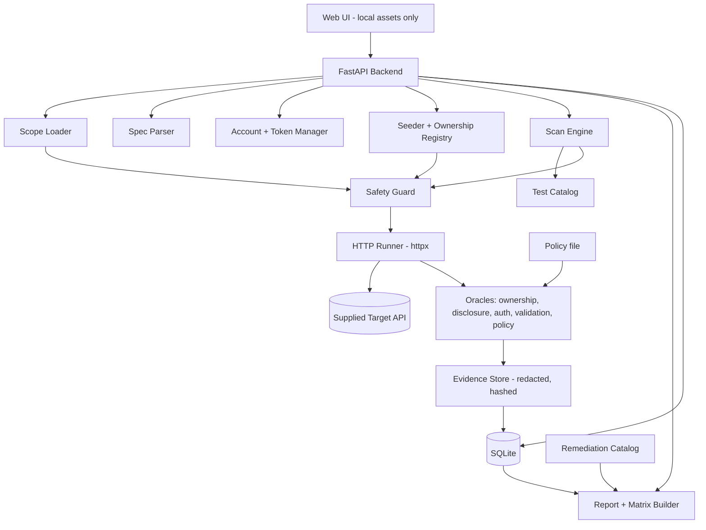

# CanaryGate v3.2 (FROZEN)

**Evidence-based API authorization and security testing with verified ownership.**
Built against the competition problem statement: "API Security Testing Assistant."

Supersedes v1, v2, v3 and v3.1. **Status: frozen.** Change this document only for defects found during implementation, and log each change at the end of Section 0.2. The safety corrections below are implementation-blocking defect fixes. Next milestone is a working end-to-end demonstration (Section 17), not more planning.

## 0.2 What changed from v3.1 (v3.2)

| Change | Reason | Priority |
|---|---|---|
| AUTHN-04a/04b confirmed only when the effective identity or privilege actually changes; HTTP 200 alone is not a finding | Review fix: a modified token that is accepted but has no effect is not a signature-validation weakness | P0 |
| Report fields added: timestamp, account and role, target resource and verified owner, exact verdict reason | Auditable evidence | P0 |
| curl reproductions use credential placeholders, never real tokens | Reports must not leak secrets | P0 |
| Setup status model: SUCCESS, PARTIAL, FAILED, SKIPPED, NEEDS_MANUAL_INPUT, with reason and resulting BOLA coverage | Report exactly how far seeding got | P0 |
| Minimal setup recipe (accounts, resource discovery, ID field, ownership field, ownership model) | Configuration layer: one engine, different recipe per API | P0 |
| Credentials from environment variables or secure input only | Never store passwords in recipe, scope file, evidence or report | P0 |
| Three readiness gates (authentication, resource, ownership) and hard rules enforced in code | See Section 23 | P0 |
| Resource creation disabled by default; exact operation requires explicit written organizer authorization; created resources are recorded and never deleted | Enforces scope and prohibits destructive cleanup | P1 |
| Competition validation uses offline fixtures first and live tests only against the exact supplied target; VAmPI/crAPI excluded unless explicitly authorized | Prevents unauthorized target traffic | P0 |
| Central HTTP guard enforces exact host/port, method policy, no redirects and no external traffic before execution | Safety enforced in code | P0 |
| Multi-step business-workflow setup | Out of scope | Cut |
| Safety correction: exact supplied host/port allow-list enforced centrally; redirects disabled; no external traffic | Competition scope must be enforced before HTTP execution | P0 |
| Destructive operations and automatic DELETE cleanup removed; created resources, if explicitly approved, are left untouched | Destructive testing is prohibited | P0 |
| VAmPI/crAPI removed from competition validation; offline fixtures/mocked responses first; independent lab API requires written organizer approval | Testing limited to supplied isolated environment | P0 |
| Report checklist now requires zero out-of-scope requests, zero destructive requests, zero redirects and zero external requests | Auditable compliance evidence | P0 |

These safety corrections also update Sections 2, 4, 7, 11, 14, 15, 16, 17, 18, 20, 21, 22 and 23 so implementation and demo instructions remain consistent.

## 0.1 What changed from v3 (v3.1)

| Change | Reason |
|---|---|
| Section 8: explicit JWT claims rule | Decoded claims label accounts only; they are never proof of identity, privilege or authorization |
| Section 8: AUTHN-04 split into two meaningful tampering tests (`sub` to Account B's ID; `role` to `admin`, original signature kept) | A random payload edit tells us little; these target fields an API might trust |
| Section 8: opaque-token handling; JWT-specific tests are SKIPPED when the token is not a JWT | Never report a test as passed when it was never performed |
| JWT detection validates the decoded header, not just three dot-separated segments | Opaque tokens can contain dots |
| New Section 22: own lab API as a first-class demo target | Organizer inputs (spec, accounts, scope) have not been received; the demo must work without them |
| Section 14 O1 status updated: organizer inputs not yet received | Build against VAmPI and the lab API; adapt when inputs arrive |
| Do not assume POST, DELETE or privileged operations are permitted until the written scope confirms it | Problem statement prohibits destructive testing |

**Principle:** CanaryGate must never report a test as passed when it was never performed. SKIPPED is a legitimate and important result.

---

## 0. What changed from v2

| Change | Reason |
|---|---|
| Input validation and information disclosure added back as core test categories | Explicit core requirements in the problem statement; v2 dropped them by mistake |
| Authentication checks module added (JWT/token checks, no private keys) | Problem statement lists "selected authentication weaknesses" |
| Expected access rules are a visible column in the endpoint inventory | Problem statement: "list endpoints with their expected access rules" |
| Primary seeding path is supplied test accounts; self-registration is fallback | Organizers supply role-based accounts |
| Destructive testing excluded; write tests only if the written scope allows | Problem statement prohibits destructive testing |
| No external traffic: all UI assets served locally, no LLM or third-party calls | Problem statement prohibits traffic to external systems |
| BOLA evidence split into ownership evidence and disclosure evidence (both required) | Review fix: resource ID or owner field alone is not proof of a leak |
| Ownership models: private / shared / public | Review fix: "users never read others' objects" is not universal |
| OpenAPI `spec` source relabeled "authentication requirements only" | Review fix: OpenAPI security is not authorization policy |
| "Zero-config / autonomous" replaced by **guided bootstrap** | Review fix: overclaim; user confirmations are required |
| Safety guard made implementation-precise | Review fix: DNS pinning, size limits, safe YAML, timeouts, no redirects, request cap |
| Report promoted to the centerpiece, with a "secure endpoints that passed" section | Problem statement: evidence-based report; distinguish vulnerable from secure |
| Fix verification demoed on our own lab API; on the supplied API, show reproducibility after reset | Cannot patch the organizers' API |
| Competitor benchmark demoted to optional | Testing is limited to the supplied environment |
| Keys decision: JWT claims decoded for identity; evidence hashing optional | See Section 8 |

---

## 1. Problem statement and our response

> Build a tool that runs authorized security checks against an isolated, intentionally vulnerable API and produces an evidence-based vulnerability report.
> Constraint: testing is limited to the supplied environment and test accounts. Destructive testing and any traffic to external systems are prohibited.

**One-line pitch:** *CanaryGate reads the API spec, shows each endpoint's expected access, tests it as each supplied account, proves every finding with request/response evidence and verified resource ownership, shows which endpoints were correctly secured, and recommends a fix for each issue, all within a scope file it enforces.*

---

## 2. Requirements traceability (checked against the problem statement)

| # | Requirement (from the statement) | Our feature | Test group | Report section | Status |
|---|---|---|---|---|---|
| R1 | Parse the API specification (OpenAPI preferred) | OpenAPI 3.0/3.1 parser, `$ref` resolution, security inheritance/override | PARSE | Endpoint inventory | Planned |
| R2 | List endpoints with their expected access rules | Inventory table with Expected access + Source columns | PARSE, POLICY | Endpoint inventory | Planned |
| R3 | Run authorized tests using test accounts with different roles | Account loader, login, token store; every request checked against scope file | AUTH, BOLA, BFLA | Scope and accounts used | Planned |
| R4 | Detect selected authentication weaknesses | Authentication checks module (Section 8) | AUTHN | Findings: Authentication | Planned |
| R5 | Detect authorization weaknesses incl. object-level (one user reading another's data) | Read-BOLA with ownership + disclosure evidence; BFLA by privilege differential | BOLA, BFLA | Findings: Authorization | Planned (flagship) |
| R6 | Detect selected input-validation issues | Safe input-validation checks | INPUT | Findings: Input validation | Planned |
| R7 | Detect selected information-disclosure issues | Stack-trace, verbose-error, sensitive-field and header checks | DISC | Findings: Disclosure | Planned |
| R8 | Record request and response evidence for every finding | Evidence store: full request/response, redacted tokens, SHA-256 hash | All | Each finding | Planned |
| R9 | Distinguish vulnerable endpoints from correctly secured ones | Verdicts incl. SAFE; "Secured endpoints that passed" section; matrix | All | Secure endpoints section, matrix | Planned |
| R10 | Recommend a remediation for each finding | Remediation catalog keyed by finding type | All | Each finding | Planned |
| C1 | Limited to supplied environment and accounts | Exact supplied host/port allow-list and supplied accounts enforced centrally; all other targets rejected | SAFETY | Scope section | Planned |
| C2 | No destructive testing | Destructive operations always blocked; no DELETE cleanup; state-changing requests blocked by default | SAFETY | Skipped (not executed) list | Planned |
| C3 | No traffic to external systems | Exact target allow-list, redirects disabled, local UI assets, no third-party calls or remote references | SAFETY | Constraint checklist | Planned |

Inputs the statement says we receive: API specification, isolated vulnerable test API (resettable instance per team), role-based test accounts, written testing scope. See open items in Section 14.

---

## 3. Positioning (keep to one slide)

Authorization testing from an OpenAPI spec already exists (ZAP Access Control Testing add-on, 42Crunch Scan v2, StackHawk Business Logic Testing, OWASP ASTF, overstep, and smaller open-source scanners). We do not claim to be first and do not claim others "can't" do these things; we say what their documented workflow requires.

Our emphasis:
- **Trust:** a finding is CONFIRMED only when ownership evidence and disclosure evidence agree.
- **Honesty:** every expected permission carries its source; unknown stays unknown; skipped and inconclusive tests are reported with reasons.
- **Fit to the brief:** it meets every stated requirement and shows the proof.
- **Guided bootstrap:** infers login, ID locations and ownership where possible, asks for confirmation where not, and counts every manual step.

Avoid in the pitch: "autonomous," "zero-config," "AI-powered," "first."

---

## 4. Scope

| Feature | Priority | Notes |
|---|---|---|
| OpenAPI parser and endpoint inventory with expected access | P0 | |
| Scope file and safety guard | P0 | Built before the runner |
| Account loader, login, token handling | P0 | Supplied accounts first |
| Ownership registry and verified seeding | P0 | |
| Read-BOLA with two-part evidence | P0 | Flagship |
| Authentication checks | P0 | Small set, see Section 8 |
| Input-validation and information-disclosure checks | P0 | Safe payloads only |
| Evidence store, verdicts, remediation catalog | P0 | |
| HTML + JSON report | P0 | Centerpiece deliverable |
| BFLA by privilege differential | P1 | Needs an admin account |
| Policy file with provenance | P1 | |
| Authorization matrix with evidence drill-down | P1 | |
| Re-test and before/after on own lab API | P1 | Only if organizers explicitly approve that target; otherwise demonstrate with offline fixtures |
| Update-BOLA or other state-changing authorization tests | Cut for competition target | No PUT/PATCH/DELETE or destructive tests; use read-only evidence |
| Competitor benchmark | P3 | Only if scope permits other tools |
| Signed (Ed25519) evidence | P3 | SHA-256 hash is enough for MVP |
| BOPLA / mass assignment, GraphQL, gRPC, OAuth2 flows, CVSS, plugins, LLM labeling | Cut | |

---

## 5. How it works

```
1. LOAD        spec + organizer-supplied base URL + scope file + accounts (+ optional policy file)
2. GUARD       validate exact host/port, approved operation classes and request budget
3. DISCOVER    parse spec -> endpoints, params, schemas, security requirements
4. EXPECT      assign expected access per endpoint with its source
5. LOGIN       authenticate each supplied account; decode token claims
6. SEED        harvest or create resources; verify ownership; plant canaries
7. TEST        authentication, BOLA, BFLA, input validation, disclosure
8. JUDGE       oracles produce verdicts with evidence checklists
9. REPORT      inventory, findings, secured endpoints, skipped, matrix, remediation
10. RE-RUN     replay stored tests (offline fixtures by default; supplied API only within scope; lab API only with organizer approval)
```

### Guided bootstrap
Infers: login endpoint, token field, where created IDs appear in responses. Each inference is shown for confirmation; edits are possible. The report lists inferred items, confirmed items and manual interventions.

---

## 6. Expected access and provenance

Each endpoint in the inventory has an Expected access value and a Source.

| Expected access | Meaning |
|---|---|
| public | No authentication needed |
| authenticated | Any valid account |
| role:X | Restricted to a role |
| owner-only | Authenticated and must own the object |
| unknown | No reliable expectation |

| Source | What it establishes |
|---|---|
| declared | Policy file or organizer-provided rules |
| spec (authentication only) | OpenAPI security: whether authentication is required, nothing more |
| scope document | Rules stated in the written testing scope |
| inferred | Heuristic (admin-looking path, role in description or scopes); candidate only, user may confirm |
| observed isolation | Seeding step showed owner A's resource is absent from B's list |
| unknown | Nothing known |

Rules:
- Inference never silently becomes a verified rule.
- Unknown permissions are shown grey and never reported as violations.
- A cross-user default expectation is used only when ownership model is `private` (declared, or observed isolation). Otherwise a violation is SUSPECTED at most.

### Policy file (example)

```yaml
roles:
  user:
    allowed: ["GET /profile", "GET /orders/{own_id}"]
    denied:  ["DELETE /users/{id}", "POST /admin/reset"]
  admin:
    allowed: ["GET /users", "DELETE /users/{id}", "POST /admin/reset"]
public: ["GET /health"]
ownership:
  orders:        { model: private, default_access: owner_only }
  documents:     { model: shared,  default_access: explicit_sharing }
  announcements: { model: public,  default_access: public_read }
```

---

## 7. Ownership, seeding and BOLA evidence

### Seeding ladder (in order)
1. **Supplied accounts:** log in as each; harvest each user's own resource IDs from list/GET endpoints (read-only).
2. **Optional creation:** only if organizers explicitly authorize the exact POST operation in writing. Disabled by default; record created resource identifiers and leave resources untouched. Never run cleanup or DELETE. Prefer organizer-provided resources.
3. **Known IDs supplied** by organizers per account.
4. **Self-registration:** disabled unless organizers explicitly authorize the exact operation in writing; otherwise mark setup `SKIPPED`.
5. **HAR import** (post-MVP).

### Verified seeding checklist
```
Account A login            OK / FAILED
Account B login            OK / FAILED
Resource A identified      OK / FAILED (method: harvested | created)
Resource B identified      OK / FAILED
Ownership verified         OK / FAILED (owner reads it; other account's list excludes it)
Canary verified            OK / FAILED / N/A (read-only mode)
```
BOLA tests run only on resources that pass ownership verification. The report states the rung reached.

### Ownership registry
```json
{ "resource_type": "order", "resource_id": "ORD-202", "owner": "user_b",
  "ownership_model": "private", "ownership_verified": true,
  "canary": "CG-7f3a91", "origin": "harvested" }
```
In read-only mode (no creation) a canary may not exist; use a private field from B's baseline response as disclosure evidence.

### Read-BOLA: required evidence for CONFIRMED
**Ownership evidence (all):**
1. Resource belongs to B (verified by seeding).
2. Owner baseline request succeeded; baseline recorded.

**Disclosure evidence (all):**
3. A's request with A's token for B's resource succeeded.
4. A received B's private data: canary, or a private field from B's baseline that policy says A may not see. A resource ID or status that may be public does not count.
5. Policy or ownership model says A must be denied.

Missing items downgrade to SUSPECTED or INCONCLUSIVE.

### Verdicts

| Verdict | Meaning |
|---|---|
| CONFIRMED | Required evidence complete |
| SUSPECTED | Suspicious, evidence incomplete |
| SAFE | Expected behavior demonstrated, body checked |
| INCONCLUSIVE | Cannot establish whether access was authorized (empty 200, ambiguous 404) |
| SKIPPED | Not performed, reason recorded (including "destructive, not executed") |

### BFLA
Run only read-only operations as a normal user and as an admin; compare against policy. Intended access unknown means report unknown. Without an admin account, state limited BFLA coverage. Never execute privileged state-changing or destructive operations; record them as `SKIPPED — not executed (prohibited operation)`.

---

## 8. Authentication checks and the keys decision

**Decision on public/private keys**

| Idea | Decision |
|---|---|
| JWT authentication with supplied accounts | Support: carry bearer tokens; decode payload without verifying to read claims (`sub`, `role`, `exp`) |
| Generating key pairs or per-user keys | Not needed; accounts are supplied |
| Algorithm confusion, expired-token forgery | Out of scope (need keys or signing material) |
| Tamper-evident evidence | P3: SHA-256 hash of each evidence bundle in the report; Ed25519 signing optional |

Keys do not prevent BOLA; the API's ownership logic does.

**JWT claims rule.** JWT claims such as `sub`, `role` and `exp` may be decoded without verification for account identification and metadata. They must never be treated as proof of identity, privilege or authorization. Verdicts must be based on observed API behavior and the applicable expected-access policy.

**JWT detection.** Three dot-separated segments are a heuristic only. Treat a token as a JWT only if the first two segments base64url-decode to JSON objects and the decoded header contains an `alg` field. Otherwise treat it as opaque.

**Opaque tokens.** If the supplied authentication mechanism uses opaque bearer tokens, session cookies or API keys, JWT-specific tests (AUTHN-04, AUTHN-05) are marked `SKIPPED` with the reason: `Token is not a supported JWT format; JWT-specific test not applicable.` They are never marked SAFE.

**Scope.** Crafted-token tests (AUTHN-04, AUTHN-05) run only if the written scope permits them.

**Authentication checks (separate report category, not BOLA/BFLA)**

| ID | Check | Expected |
|---|---|---|
| AUTHN-01 | No token on protected endpoint | Rejected |
| AUTHN-02 | Malformed token | Rejected |
| AUTHN-03 | Wrong auth scheme (for example Basic instead of Bearer) | Rejected |
| AUTHN-04a | Account A's valid JWT with `sub` changed to Account B's ID, original signature retained, sent to an endpoint that reveals the caller's identity (for example `GET /profile`) | Rejected. See verdict logic below |
| AUTHN-04b | Account A's valid JWT with `role` changed to `admin`, original signature retained, sent separately from 04a to an endpoint that requires admin | Rejected. See verdict logic below |
| AUTHN-05 | `alg: none` token | Rejected |
| AUTHN-06 | Token from account A used after logout, if the API has logout | Report observed behavior |
| AUTHN-07 | Public endpoint without token | Allowed if expected access is public |
| AUTHN-08 | Missing or invalid API key (when scheme is API key) | Rejected |

**Verdict logic for AUTHN-04a and AUTHN-04b.** An HTTP 200 alone is never a finding. Judge by whether the API's behavior changed.

| Observation | Verdict |
|---|---|
| Modified token rejected (401/403) | SAFE |
| Token accepted, but the modified claim has no observable effect (response still shows Account A, or no admin capability granted) | SUSPECTED; investigate; not confirmed |
| Modified `sub` changes the effective identity to Account B (response shows B's identity or data) | CONFIRMED authentication weakness |
| Modified `role` grants admin access (admin-only endpoint succeeds) | CONFIRMED authentication weakness |
| No endpoint on the target reveals identity or requires admin, so the effect cannot be observed | INCONCLUSIVE (never SAFE) |
| Token is not a JWT | SKIPPED with the stated reason |

---

## 9. Input validation and information disclosure (safe payloads only)

**Input validation (INPUT)**

| ID | Check |
|---|---|
| INPUT-01 | Missing required parameter |
| INPUT-02 | Wrong data type |
| INPUT-03 | Invalid enum value |
| INPUT-04 | Out-of-range number, overlong string (bounded size) |
| INPUT-05 | Unexpected extra JSON property (report acceptance; no persistence checks in MVP) |
| INPUT-06 | Malformed JSON body |
| INPUT-07 | Special characters in string fields (quote, angle bracket, null-like strings), observing error handling only |

Payloads never attempt exploitation, data extraction, or state damage. Judgments rest on status code, error body, and consistency with the spec.

**Information disclosure (DISC)**

| ID | Check |
|---|---|
| DISC-01 | Stack trace or framework error text in responses |
| DISC-02 | Verbose error messages revealing internals (paths, SQL fragments, library versions) |
| DISC-03 | Sensitive fields in responses (password hash, token, secret, internal flags) by name and pattern |
| DISC-04 | Excess fields compared with the spec's response schema |
| DISC-05 | Server/version headers and debug headers |
| DISC-06 | Different error messages for existing vs. nonexistent resources (enumeration signal) |

---

## 10. Test catalog format

Every test is a row:

```text
id, category, endpoint, actor, target_resource, request_template,
non_destructive (true/false), evidence_required, verdict_rules, remediation_key
```
Tests marked `non_destructive: false` are never executed. Destructive operations are blocked unconditionally. The default competition operation allow-list is read-only (`GET`, `HEAD`, `OPTIONS`), plus the exact organizer-supplied authentication/login operation when required to use supplied accounts. Login requests are never automatically retried. Any other state-changing operation is blocked; a specific resource-creation `POST` may be enabled only after explicit written organizer authorization.

---

## 11. Safety guard (mandatory, built first)

The safety guard is a central enforcement boundary in the HTTP runner. Every outbound request, including login, discovery, seeding and test requests, must pass the same guard immediately before connection. Individual test modules cannot bypass or weaken it.

| Risk | Mandatory enforcement |
|---|---|
| Out-of-scope destination | Exact organizer-supplied competition hostname and port allow-list. Reject every other host, port, scheme or destination before connection. No wildcard or suffix matching. |
| Redirects | Redirect following is disabled. Record a 3xx response; never make a second request. |
| Destructive operations | `DELETE` and all destructive operations are blocked unconditionally, including cleanup. No exception for scanner-created resources. |
| State-changing operations | Default allow-list is read-only: `GET`, `HEAD`, `OPTIONS`, plus the exact in-scope authentication/login operation needed to use supplied accounts. Login is never automatically retried. `PUT`, `PATCH` and other state-changing operations are blocked. A specific resource-creation `POST` may be enabled only with explicit written organizer authorization for that exact endpoint and purpose. |
| Resource creation | Disabled by default. If explicitly authorized, record the request, response and created resource identifiers; leave resources untouched. Never automatically delete or modify them. |
| Retries | No automatic retries for any state-changing request. Never silently replay a request. |
| External traffic | Only the exact approved competition target may receive HTTP traffic. No third-party calls, remote AI APIs, analytics, CDN assets, external fonts, remote `$ref` fetching or external telemetry. Bundle UI assets locally. |
| SSRF / unsafe spec | Remote `$ref` resolution disabled; local `$ref` path-traversal protection; safe YAML load; spec size limit. Spec values never override the target allow-list. |
| DNS rebinding | Resolve the approved hostname, validate the resolved address and pin the connection to it; do not allow the HTTP client to re-resolve it. |
| Lab/development mode | Offline fixtures and mocked transports are the default development path. Any independently hosted lab API is disabled for competition runs and may be used only after explicit organizer approval. |
| Resource limits | Timeout every request; request/response body size limits; per-scan request budget; throttling; stop on repeated 5xx or account lockout. |
| Secrets | Passwords from environment variables or secure input only. Redact credentials and tokens from logs, evidence and reports. |
| Concurrency | Sequential execution; no parallel request fan-out. |

**Enforcement order:** validate mode → exact scheme/host/port → resolve and pin destination → validate method and operation → validate account and request budget → send one request with redirects disabled → redact and record evidence. If any check fails, block and record the request without network execution.

**Competition-mode invariants (hard failures):**
- No request reaches a destination outside the exact approved competition host and port.
- No destructive request is executed, including cleanup.
- No redirect is followed.
- No external-system traffic is generated.
- No state-changing request is sent except the exact in-scope authentication/login operation or a specific resource-creation operation with explicit written organizer authorization.
- No automatic retry replays a state-changing request.

The report prints the approved host/port, out-of-scope requests blocked and executed (executed must be 0), destructive requests executed (must be 0), redirects followed (must be 0), external requests (must be 0), authorized state-changing requests, and scope file hash.

---

## 12. Report (centerpiece)

1. Executive summary: counts by verdict and category.
2. Scope and rules of engagement; accounts and roles used; seeding rung reached; scope file hash.
3. Endpoint inventory: method, path, parameters, security requirement, **expected access, source**.
4. Findings, grouped by category (Authentication, Authorization, Input validation, Disclosure). Each finding: ID, **timestamp**, endpoint, severity, verdict, **exact reason for the verdict**, **account used and its role**, **target resource and verified owner**, request and response (tokens redacted), expected vs. observed (with the expectation's source), evidence checklist, curl reproduction, **remediation**, evidence SHA-256. curl commands use credential placeholders (for example `$TOKEN_A`), never real tokens.
5. **Secured endpoints that passed:** tests run and the denial or correct handling observed.
6. Skipped and inconclusive tests with reasons (including "destructive, not executed").
7. Authorization matrix (Section 13).
8. Manual interventions and inferred items during bootstrap.
9. Constraint checklist.

Severity: simple fixed mapping (High: confirmed BOLA/BFLA or missing auth; Medium: confirmed disclosure or auth weakness; Low: validation/information issues). No CVSS engine.

**Remediation catalog** (one entry per finding type): BOLA (enforce object-level ownership check server-side on every handler), BFLA (central role check for privileged functions), missing authentication (require and verify tokens), token validation weaknesses (verify signature and reject `none`), input validation (schema validation, strict typing), verbose errors (generic error responses, log details server-side), excessive data exposure (response filtering/DTOs), headers (remove version/debug headers).

---

## 13. Authorization matrix

Rows: endpoint (method + path). Columns: anonymous, each account on its own resource, each account on another's resource, each role.

| Cell | Meaning |
|---|---|
| Green | Observed matches expectation |
| Red | CONFIRMED violation |
| Orange | SUSPECTED |
| Grey | Observed only; expectation unknown |
| Hatched | SKIPPED or INCONCLUSIVE, reason on hover |

Click a cell for the test, identity, owner, expectation and source, request/response, evidence checklist, curl command. The matrix is a view over stored results.

---

## 14. Open items to resolve (blocks finalizing)

| # | Question | Who answers | Decides |
|---|---|---|---|
| O1 | What exactly was supplied: spec format and version, accounts and roles, written scope, reset procedure, base URL. **Current status must be confirmed at implementation time.** Until supplied inputs arrive, develop with offline fixtures; do not scan VAmPI/crAPI or an independent lab API without explicit organizer approval | Organizers / our checklist | Seeding rung, BFLA feasibility |
| O2 | Does the scope allow POST creation of resources? Any write methods at all? | Written scope / organizers | Seeding step 2, update-BOLA |
| O3 | Is an admin account supplied? | Organizers | BFLA depth |
| O4 | Is a second tool (ZAP, ASTF) allowed against the supplied instance? | Written scope | Benchmark |
| O5 | Are local labs (crAPI, VAmPI or our own lab API) explicitly authorized for scanner testing? | Organizers; do not assume approval | Validation plan |
| O6 | Does the spec describe roles, scopes or `x-` extensions we can use for expected access? | Read the spec | Expected-access source quality |
| O7 | Report format expected by judges (PDF, HTML, JSON)? | Organizers | Report export |
| O8 | How is the instance reset, and how often? | Organizers | Re-run reproducibility |

---

## 15. Validation

**Validation target policy (competition mode):**

| Validation activity | Decision |
|---|---|
| Offline unit tests, parser/policy/evidence fixtures and mocked HTTP responses | Allowed and preferred for development |
| Supplied competition API in its isolated environment, using supplied accounts and written scope | Allowed; the only live competition scan target |
| VAmPI | Excluded from competition testing unless organizers explicitly authorize it in writing |
| crAPI | Excluded from competition testing unless organizers explicitly authorize it in writing |
| Independent lab API, including our own lab API | Do not scan during the competition unless organizers explicitly approve that target in writing |
| Any other host, service or external system | Prohibited unless explicitly added to written scope by organizers |

Develop the parser, policy engine, evidence logic, verdict oracles and safety guard against offline fixtures and mocked HTTP responses first. When the supplied environment is available, run live checks only against its exact allow-listed host and port, with supplied accounts and approved operations. Do not use an alternate vulnerable API as a substitute target.

- **Ground truth:** build fixture-based expected-result cases before coding; add supplied-instance ground truth only from organizer-provided documentation and authorized observations.
- **Metrics:** true/false positives and negatives, precision = TP/(TP+FP), recall = TP/(TP+FN), endpoints skipped and why, manual steps required. Report fixture metrics separately from supplied-instance results.
- **Must-pass adversarial tests:**
  1. Reflected canary from attacker-controlled input is not confirmed.
  2. Public-looking fields (ID, status) alone do not confirm BOLA.
  3. Shared and public resources do not produce false confirmations.
  4. Unknown permissions never become violations.
  5. BFLA found without relying on endpoint names.
  6. Failed seeding yields an honest coverage report.
  7. OpenAPI global security and operation-level override parsed correctly.
  8. Redirect and out-of-scope host attempts blocked before a network connection.
  9. `DELETE`, destructive operations and unapproved state-changing methods blocked before execution.
  10. Tokens redacted everywhere in the report.
  11. Mocked secure responses produce no CONFIRMED findings when expected behavior is secure.
  12. No cleanup request is generated or executed; resources created under explicit approval remain untouched.
  13. No verified ownership produces no BOLA verdict (unit test asserts the invariant).
  14. Missing second identity produces BOLA coverage SKIPPED, never SAFE.
  15. A modified JWT accepted without changing identity or privilege is SUSPECTED, not CONFIRMED.
  16. No password, token or credential value appears in recipe, scope file, evidence, report or logs.
  17. Guard rejects every non-allow-listed host/port, including alternate IPs and redirect destinations.
  18. Offline fixture mode cannot make network requests; runner follows zero redirects and generates zero external requests.
  19. A state-changing request is never automatically retried.
- **Acceptance gate:** do not present as working until adversarial tests, offline-mode isolation tests and scope-guard tests pass. Live acceptance testing is performed only against the supplied isolated instance and within written scope.

---

## 16. Architecture



| Layer | Tool |
|---|---|
| Backend | Python 3.11+, FastAPI, Pydantic |
| HTTP | httpx (pinned IP connections) |
| Spec | PyYAML safe load + openapi-spec-validator / prance (remote refs off) |
| JWT claims | PyJWT decode without verification (read-only) |
| Storage | SQLite |
| UI | Jinja2 + vendored HTMX/CSS served locally |
| Reports | Jinja2 HTML, JSON |
| Tests | pytest |
| Development validation | Offline fixtures and mocked HTTP transport; independent lab API only with explicit organizer approval |

Modules: `scope/`, `spec/`, `accounts/`, `seed/`, `tests/` (catalog + templates), `runner/`, `guard/`, `oracles/`, `report/`, `api/`, `ui/`.

### Core data models (Pydantic)
`ScopeConfig`, `Endpoint` (with `expected_access`, `expected_source`), `Identity` (account, role, token, claims; password referenced by environment variable name only), `Recipe` (accounts, login, resource discovery, id field, ownership field, ownership model; Section 23), `SetupStatus` (per-step status, reason, resulting BOLA coverage; Section 23), `OwnedResource` (ownership model, verified, origin, canary), `TestCase` (category, non_destructive, evidence_required), `Evidence` (timestamp, account_role, request, response, redacted, sha256), `Result` (verdict, `verdict_reason`, checklist, remediation_key), `MatrixCell`, `ScanRun` (rung reached, interventions, scope hash).

---

## 17. Plan of action (15 hours, 3 people)

| Owner | Responsibility |
|---|---|
| M1 | Spec parser, inventory, expected access, accounts/token manager, seeding |
| M2 | Safety guard, runner, oracles, test catalog, BOLA/BFLA, auth/validation/disclosure checks |
| M3 | UI, report, matrix, remediation catalog, constraint checklist, offline fixtures; optional lab API only if approved |

| Hours | Work |
|---|---|
| 0-1 | Resolve O1-O8 as far as possible. Freeze and commit the shared Pydantic contracts: `ScopeConfig`, `Endpoint`, `Identity`, `OwnedResource`, `Recipe`, `SetupStatus`, `TestCase`, `Evidence`, `Result`, `ScanRun`. Freeze scope file format, recipe format, test catalog format, evidence rules, and the enforced rules in Section 23 |
| 1-3 | M1 parser + inventory using offline fixtures; M2 scope loader + safety guard + mocked runner skeleton; M3 UI shell + report template and offline demo fixtures |
| 3-6 | M1 login, harvest, ownership registry; M2 authentication checks, input and disclosure checks; M3 evidence viewer, remediation catalog |
| 6-9 | M2 read-BOLA oracle with two-part evidence, verdicts; M1 policy file and expected-access sources; M3 report sections 1-6 |
| 9-11 | M2 BFLA; M3 matrix; M1 re-run support using offline fixtures; optional lab API mode switch only if organizers approve that target |
| 11-13 | All: offline fixtures, mocked HTTP responses and guard isolation tests; then supplied instance only if organizers provide it and its written scope is loaded |
| 13-14 | Bug fixes; constraint checklist; metrics into report |
| 14-15 | Freeze; demo rehearsal; final report generation |

Cut order if behind: matrix polish, update-BOLA, benchmark, signed evidence, BFLA depth. Never cut: scope guard, ownership verification, two-part BOLA evidence, report with remediation and secured-endpoints section.

Treat 15 hours as aggressive; P0 items define success.

**First milestone (before adding anything else):** a working end-to-end run against an offline fixture with mocked HTTP responses: load spec, load recipe, simulate two-account authentication, establish fixture ownership, detect read-BOLA, show the two-part evidence and generate the report. If organizers explicitly approve an independent lab API, it may be used as an additional integration target. Everything else is added only after the offline end-to-end path works.

---

## 18. Documents to generate before coding

| # | Document | Owner |
|---|---|---|
| D1 | Inputs inventory (O1-O8 answered) | M1 |
| D2 | Scope and rules-of-engagement file (machine-readable) | M2 |
| D3 | Endpoint inventory schema (with expected access and source) | M1 |
| D4 | Test catalog (rows per Section 10) | M2 |
| D5 | Verdict and evidence rules (Section 7) as a one-page spec | M2 |
| D6 | Remediation catalog | M3 |
| D7 | Report template | M3 |
| D8 | Ground-truth table for offline fixtures and, when available, the supplied instance | All |
| D9 | Pydantic data models | M1 |
| D10 | Demo script and constraint checklist | M3 |
| D11 | Setup recipe for offline fixtures and, if approved, the lab API; supplied API recipe when received | M1 |

---

## 19. Limits (state first)

- Seeding by creation depends on scope permission and API workflow; verification gates (email, OTP, CAPTCHA, SSO) require supplied accounts.
- Needs a reasonably accurate spec; undocumented endpoints are missed unless supplied manually.
- Tenant-level and role-specific rules need a policy file or scope document.
- Expected access is inferred where undeclared and labeled as such.
- BFLA depth depends on admin account availability; privileged state-changing operations are not executed.
- Scope: authentication checks, BOLA read, BFLA, input validation, information disclosure. No BOPLA, rate limiting, SSRF testing, business-logic chains, GraphQL.
- Multi-step business-workflow setup (invitations, approvals, payment-gated creation) is out of scope; such APIs need supplied accounts and a recipe, or BOLA coverage is reported SKIPPED.
- Automatic registration and resource creation work only for supported, simple workflows.
- Authorized, isolated targets only.

---

## 20. Demo script (5 minutes)

1. Load the OpenAPI spec, exact scope file and supplied test-account configuration (or offline fixture configuration if the supplied environment is unavailable).
2. Demonstrate the guard accepting an in-scope request and blocking an out-of-scope host/port before any network call.
3. Show the endpoint inventory with expected access and provenance; point at an `unknown`.
4. Show the bootstrap checklist, ownership verification and manual interventions.
5. Run only against the supplied isolated competition API when available and authorized; otherwise run the offline mocked demonstration and label it clearly as a fixture demonstration.
6. Show the authorization matrix and drill into request/response evidence and remediation.
7. Show SUSPECTED, INCONCLUSIVE and SKIPPED results, including a destructive operation blocked before execution.
8. Show "Secured endpoints that passed."
9. Open the report and verify zero out-of-scope requests executed, zero destructive requests executed, zero redirects followed and zero external requests.
10. Do not run VAmPI, crAPI or an independent lab API during the competition unless organizers explicitly authorize that target in writing.

---

## 21. Constraint checklist (printed in every report)

- Exact supplied competition host and port allow-listed: yes/no
- Out-of-scope requests blocked before connection: count
- Out-of-scope requests executed: **0 required**
- Redirects followed: **0 required**
- Destructive requests executed, including cleanup: **0 required**
- External requests / third-party calls: **0 required**
- State-changing requests executed: **0 by default**; list only the exact in-scope authentication/login operation and any explicitly authorized resource-creation POST with its written authorization and evidence
- Resources created under explicit authorization: recorded and left untouched; cleanup performed: **no**
- Tokens and credentials redacted: yes
- UI assets loaded locally; remote `$ref` fetching disabled: yes
- Scope file hash: shown
- Validation mode and target: offline fixtures / supplied competition instance / organizer-approved exception

---

## 22. Own lab API (development-only; organizer approval required)

An independently hosted lab API is not an approved competition target by default. Do not scan it during the competition unless organizers explicitly authorize it in writing. The default development and demonstration path is offline fixtures with mocked HTTP responses. If organizers approve this lab API as an additional target, record that approval in the scope file and keep its results separate from results against the supplied competition instance.

**Honest labeling.** If organizer approval is obtained, describe this as our own controlled development target, not as the supplied competition API. Without approval, do not send scanner traffic to it during the competition. Offline fixture results are labeled as fixture results and are not represented as live-target accuracy evidence.

### Design

| Item | Specification |
|---|---|
| Stack | Small FastAPI or Flask app, resettable (one command restores seed data) |
| Spec | Its own OpenAPI 3.0 file, written to resemble the supplied spec format as far as known |
| Accounts | Three seeded accounts: `alice` (user), `bob` (user), `admin` (admin); password login returns a JWT |
| Modes | `VULNERABLE` and `SECURE` switch (environment flag), same endpoints in both |
| Scope file | Ships with its own scope file so the safety guard is exercised on it |

### Endpoints (each with a known ground truth)

| Endpoint | Vulnerable mode behavior | Secure mode behavior | Tests exercised |
|---|---|---|---|
| `GET /orders/{id}` | Returns any user's order | Owner only | Read-BOLA (flagship) |
| `GET /orders` | Lists only caller's orders | Same | Ownership verification, ID harvesting |
| `GET /profile` | Own profile | Same | Control (SAFE) |
| `GET /users/{id}` | Returns another user's private fields | Own record or admin only | Read-BOLA, disclosure |
| `GET /admin/stats` | Any authenticated user | Admin only | BFLA |
| `GET /health` | Public | Public | Public endpoint (not a finding) |
| `GET /announcements` | Public read | Public read | Public-resource false-positive check |
| `GET /documents/{id}` | Shared with named users | Same | Shared-model false-positive check |
| `POST /login` | Returns JWT | Same | Authentication |
| Token handling | Accepts token with modified `sub` and original signature | Verifies signature | AUTHN-04a |
| Token handling (second mode) | Accepts modified `role` | Verifies signature | AUTHN-04b |
| Token handling (third mode) | Accepts `alg: none` | Rejects | AUTHN-05 |
| `POST /items` | Missing-field input returns stack trace | Generic validation error | INPUT, DISC |
| `GET /debug/error` | Verbose error with internals | Generic error | DISC |
| Opaque-token variant | Separate run with opaque session tokens | Same | Verifies AUTHN-04/05 are SKIPPED, not SAFE |

The fixture may describe write/delete endpoints as test cases, but the mocked transport must prove that prohibited operations are blocked before any network call. No destructive operation is executed, even against seeded disposable resources. A blocked `DELETE` is recorded as "not executed".

### Ground-truth table (written before the scanner is run)

For every endpoint and mode, record the expected verdict. Example rows:

| Endpoint | Mode | Expected CanaryGate verdict |
|---|---|---|
| `GET /orders/{id}` (Alice reads Bob's) | VULNERABLE | CONFIRMED |
| `GET /orders/{id}` (Alice reads Bob's) | SECURE | SAFE |
| `GET /announcements` (Alice reads public item) | both | SAFE (not a finding) |
| `GET /admin/stats` (user) | VULNERABLE | CONFIRMED (BFLA) |
| `GET /admin/stats` (user) | SECURE | SAFE |
| AUTHN-04a/04b/05 on opaque-token variant | n/a | SKIPPED with reason |

### Demo role

1. Prefer mocked vulnerable and secure response fixtures to demonstrate verdict logic without network traffic.
2. Run the opaque-token fixture: JWT tests show SKIPPED with the stated reason.
3. Show a destructive request blocked by the guard before transport invocation.
4. Show the zero-out-of-scope, zero-destructive, zero-redirect and zero-external-traffic checklist.
5. Only if organizers explicitly approve the lab API, a separate controlled run may demonstrate its live vulnerable/secure modes; label it as an approved independent lab target.

### Ownership and timing

Owner: M3 (per Section 17). Build offline fixtures and mocked transport first. The lab API must not receive scanner traffic during the competition without explicit organizer approval. Keep it small: target under 250 lines. It must not grow into a second project.

---

## 23. Setup recipe, setup status and enforced rules

The recipe is the configuration layer. The scanning engine is generic; each API gets its own recipe. The lab API uses one recipe, the supplied API will use another, and no endpoint path or field name is hardcoded in the engine.

### Minimal recipe (P0)

```yaml
setup:
  # Example only for offline/development configuration; competition mode
  # must use the exact organizer-supplied host and port from the scope file.
  base_url: http://127.0.0.1:8000
  login:
    method: POST
    path: /login
    username_field: username
    password_field: password
    token_path: access_token        # where the token appears in the response
  accounts:
    user_a:
      role: user
      username: alice
      password_env: CANARY_USER_A_PASSWORD
    user_b:
      role: user
      username: bob
      password_env: CANARY_USER_B_PASSWORD
    admin:
      role: admin
      username: admin
      password_env: CANARY_ADMIN_PASSWORD
  resources:
    orders:
      discovery: { method: GET, path: /orders }   # read-only discovery as each account
      id_field: id
      ownership_field: user_id
      ownership_model: private                      # private | shared | public
    announcements:
      discovery: { method: GET, path: /announcements }
      id_field: id
      ownership_model: public
```

Rules:
- Passwords come only from environment variables (`password_env`) or secure input. They are never stored in the recipe, scope file, evidence, report or logs. Reports show the variable name, not the value.
- A recipe may be partial; missing items downgrade coverage and are reported, never guessed.
- Multi-step workflows, dependencies between resources, and conditional logic are not supported.

### Competition scope file requirements

The scope file must contain the exact organizer-supplied scheme, hostname and port, supplied account identifiers/roles, permitted read-only methods and request budget. The target cannot be expanded by the OpenAPI document, recipe, redirects, DNS answers or test modules. Any exception (including a specific resource-creation POST or an additional lab target) requires explicit written organizer approval and a narrowly scoped scope-file entry. Competition mode rejects wildcard hosts and implicit lab-mode access.

### Setup status model

Every setup step returns one of: `SUCCESS`, `PARTIAL`, `FAILED`, `SKIPPED`, `NEEDS_MANUAL_INPUT`, with a reason. The result is stored in `SetupStatus` and printed in the report (Section 12, item 8).

```json
{
  "strategy": "recipe_read_only_discovery",
  "authentication": { "account_a": "SUCCESS", "account_b": "FAILED" },
  "resources": { "resource_a": "SUCCESS", "resource_b": "SKIPPED" },
  "ownership_verification": "SKIPPED",
  "reason": "Account B login failed: environment variable CANARY_USER_B_PASSWORD not set",
  "bola_coverage": "SKIPPED"
}
```

### Three readiness gates

1. **Authentication readiness:** can we authenticate as both accounts?
2. **Resource readiness:** can we identify a resource belonging to each account?
3. **Ownership verification:** is each resource verified as belonging to its account (owner reads it; the other account's list excludes it)?

A BOLA test runs only when all three pass for the resources involved.

### Rules enforced in code (not only documented)

| Rule | Enforcement |
|---|---|
| No verified ownership, no BOLA verdict | The BOLA oracle refuses to run without an `OwnedResource` with `ownership_verified = true` |
| No second identity, BOLA coverage SKIPPED | Scan engine marks the tests SKIPPED with the reason; they are never SAFE |
| Failed or partial seeding yields SKIPPED or INCONCLUSIVE, never SAFE | Verdict function has no path from "not performed" to SAFE |
| No reliable expected permission, no CONFIRMED authorization violation | Expected access `unknown` caps the verdict at SUSPECTED or grey; ownership model `shared` or undeclared caps a cross-user finding at SUSPECTED |
| Unknown stays unknown | Matrix renders grey, never red |
| Exact competition target | HTTP runner rejects every destination except exact organizer-supplied host and port before connecting |
| No destructive operation | `DELETE` and destructive operations are unconditionally blocked; cleanup code does not exist in competition runner |
| Read-only by default | Only `GET`, `HEAD`, `OPTIONS` plus the exact in-scope login operation enabled by default; specific creation `POST` requires explicit written organizer approval |
| No redirects or external traffic | Redirects disabled; UI assets local; remote `$ref`, CDN, analytics and third-party requests disabled |
| Created resources remain untouched | If approved creation occurs, identifiers are recorded; no delete or cleanup request is generated |
| No silent state-changing retries | Runner never automatically retries a state-changing request |

Unit tests assert each invariant (Section 15, tests 13 to 19).

### Implementation order for setup

| Order | Capability | Priority |
|---|---|---|
| 1 | Supplied credentials, configured through the minimal recipe | P0 |
| 2 | Read-only resource discovery and ownership verification | P0 |
| 3 | Known resource IDs per account (recipe entry) | P0 |
| 4 | Resource creation only when the exact operation is explicitly authorized in writing; record and leave created resources untouched | P1 |
| 5 | Richer recipes (multi-step, dependencies) | Cut |

The competition promises supplied accounts and a supplied environment, so steps 1 to 3 must be reliable. Step 4 remains disabled unless organizers explicitly authorize the exact creation operation in writing; created resources are never cleaned up by CanaryGate.

---

## Sources
- ZAP Access Control Testing: https://zaproxy.org/docs/desktop/addons/access-control-testing
- 42Crunch scan configuration: https://docs.42crunch.com/latest/content/concepts/api_conformance_scan_configuration.htm
- StackHawk multi-profile testing: https://docs.stackhawk.com/hawkscan/business-logic-testing/
- OWASP ASTF: https://github.com/OWASP/www-project-api-security-testing-framework/wiki
- overstep: https://pypi.org/project/overstep/
- VAmPI overview: https://dev.co/security/open-source/vampi